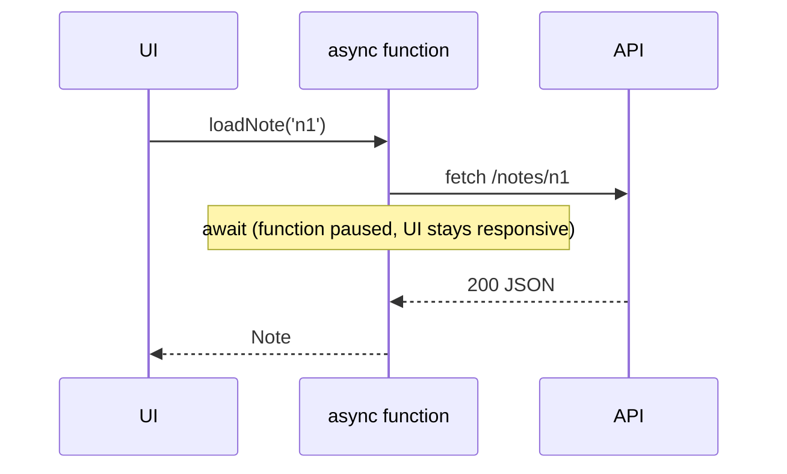

# Async JavaScript and Error Handling

Back to [Module 00](README.md) · Previous: [TypeScript advanced](03-typescript-advanced.md) · Next: [DOM, CSS and responsive design](05-dom-css-responsive.md)

## 1. Learning objectives

- Explain the event loop, microtasks and macrotasks in simple terms.
- Write Promise and `async/await` code with proper `try/catch/finally`.
- Run requests in parallel (`Promise.all`, `allSettled`) and cancel them (`AbortController`).
- Know when Angular uses Promises vs Observables.

## 2. Prerequisites

[JavaScript for Angular](01-javascript-for-angular.md).

## 3. What is it?

JavaScript runs on one thread. Slow work (network, timers, file reads) is handed to the browser, and your code is called back later. A **Promise** represents one future value. `async/await` is a cleaner syntax for Promises.

## 4. Why does Angular need it?

- `resource()` loaders return Promises ([Module 08](../08-signals-and-reactivity/04-resources.md)).
- Signal Forms' `submit()` takes an async function ([Module 12](../12-reactive-forms/04-signal-forms.md)).
- Lazy routes are `import()` Promises.
- Tests use `await fixture.whenStable()`.
- HttpClient uses Observables, which are like "Promises that can emit many values and can be cancelled" ([Module 14](../14-rxjs/01-observables.md)).

## 5. How it works — the event loop

```text
┌──────────── Call stack (your code runs here, one thing at a time)
│
├── Microtask queue  → Promise callbacks (.then, await continuation) — run first, all of them
└── Macrotask queue  → setTimeout, events, network callbacks — one per loop turn
```

```javascript
console.log('1');
setTimeout(() => console.log('4 (macrotask)'), 0);
Promise.resolve().then(() => console.log('3 (microtask)'));
console.log('2');
// 1, 2, 3, 4
```

After every macrotask the browser may repaint. Zone.js used to hook into all of these to know when to run change detection; zoneless Angular (default since v21) relies on signals and events instead ([Module 09](../09-lifecycle-and-change-detection/02-change-detection.md)).

## 6. Syntax reference

```typescript
// Promise
const p = new Promise<number>((resolve, reject) => setTimeout(() => resolve(42), 100));
p.then(v => console.log(v)).catch(e => console.error(e)).finally(() => console.log('done'));

// async/await
async function loadNote(id: string): Promise<Note> {
  const res = await fetch(`/api/v1/notes/${id}`);
  if (!res.ok) throw new Error(`HTTP ${res.status}`);
  return (await res.json()) as Note;
}

// Parallel
const [summary, today] = await Promise.all([getSummary(), getToday()]);   // fails fast
const results = await Promise.allSettled([a(), b()]);                      // never rejects
const fastest = await Promise.race([fetchA(), timeout(5000)]);
const firstOk = await Promise.any([mirrorA(), mirrorB()]);

// Cancellation
const controller = new AbortController();
fetch('/api/v1/search?q=ang', { signal: controller.signal });
controller.abort();   // the fetch rejects with an AbortError
```

## 7. Smallest working example

```typescript
async function safeLoad(id: string): Promise<Note | null> {
  try {
    return await loadNote(id);
  } catch (err) {
    console.error('Could not load note', err);
    return null;
  } finally {
    console.log('load attempt finished');
  }
}
```

## 8. Step-by-step

1. `await loadNote(id)` pauses this function (not the app) until the Promise settles.
2. If it rejects, control jumps to `catch`.
3. `finally` runs either way — perfect for turning off a loading spinner.
4. Note `return await` inside `try`: without `await`, a rejection would escape the `try`.

## 9. Myspce example — loading the dashboard in parallel

```typescript
// Concept only — in Angular you'll do this with resources or forkJoin.
async function loadDashboard(api: DashboardApi) {
  const [summary, today, week] = await Promise.allSettled([
    api.summary(),
    api.today(),
    api.weekProgress(),
  ]);

  return {
    summary: summary.status === 'fulfilled' ? summary.value : null,
    today: today.status === 'fulfilled' ? today.value : [],
    week: week.status === 'fulfilled' ? week.value : null,
    errors: [summary, today, week].filter(r => r.status === 'rejected').length,
  };
}
```

`allSettled` means one broken widget doesn't blank the whole dashboard.

## 10. Advanced example — timeout + cancellation helper

```typescript
export async function fetchJson<T>(url: string, { timeoutMs = 8000, signal }: { timeoutMs?: number; signal?: AbortSignal } = {}): Promise<T> {
  const controller = new AbortController();
  const timer = setTimeout(() => controller.abort(new DOMException('Timeout', 'TimeoutError')), timeoutMs);
  signal?.addEventListener('abort', () => controller.abort(signal.reason), { once: true });

  try {
    const res = await fetch(url, { signal: controller.signal, credentials: 'include' });
    if (!res.ok) throw new Error(`HTTP ${res.status} for ${url}`);
    return (await res.json()) as T;
  } finally {
    clearTimeout(timer);
  }
}
```

The `signal` parameter is exactly what Angular's `resource()` loader gives you (`abortSignal`), so stale requests are cancelled when inputs change.

## 11. Visual explanation



## 12. Common mistakes

| Mistake | Effect | Fix |
|---|---|---|
| Forgetting `await` | You get a Promise, not the value | `const n = await loadNote(id)` |
| `await` inside a `for` loop for independent calls | Sequential, slow | `Promise.all(ids.map(loadNote))` |
| `catch` that swallows errors silently | Bugs disappear | Log, rethrow, or show a UI error |
| `array.forEach(async x => await save(x))` | `forEach` doesn't wait | `for (const x of arr) await save(x)` or `Promise.all` |
| Unhandled rejections | Console errors, lost failures | Always `catch` at the top level |

## 13. Debugging guide

- **`Uncaught (in promise)`** — a rejected Promise without a `catch`. Find where it was created.
- **`AbortError`** — expected when you cancel; filter it out of error toasts.
- DevTools → Sources → enable **async stack traces** to see where an `await` came from.

## 14. Best practices

- Use `async/await` for readability; use `Promise.all` for parallel work.
- Always handle errors at the boundary where you can show something to the user.
- Make long operations cancellable.

## 15. Angular vs React

React uses Promises in `useEffect`/React Query; Angular uses Observables in HttpClient and Promises in resources. Both need cancellation to avoid "old response overwrites new" race conditions.

## 16. Testing

```typescript
import { it, expect, vi } from 'vitest';
it('returns null on failure', async () => {
  vi.stubGlobal('fetch', vi.fn().mockResolvedValue({ ok: false, status: 500 }));
  await expect(safeLoad('n1')).resolves.toBeNull();
});
```

## 17. Practice questions

1. Predict the log order for a mix of `setTimeout`, `Promise.then` and `queueMicrotask`.
2. Rewrite a sequential loop of 5 independent `save()` calls to run in parallel.
3. Add retry (3 attempts, 500 ms delay) to `fetchJson`.

## 18. Interview questions

- **Q: Microtask vs macrotask?** A: Microtasks (Promise callbacks) run right after the current script, before the next macrotask (timers, events).
- **Q: `Promise.all` vs `allSettled`?** A: `all` rejects on the first failure; `allSettled` waits for all and reports each result.
- **Q: Promise vs Observable?** A: A Promise resolves once and can't be cancelled by itself; an Observable can emit many values and is cancelled by unsubscribing.

## 19. Revision notes

`async` returns a Promise · `await` pauses the function · `try/catch/finally` for errors · `Promise.all` parallel · `AbortController` cancel.

## 20. Completion checklist

- [ ] I can explain the event loop with a drawing.
- [ ] I wrote `fetchJson` with timeout and cancellation.
- [ ] I can say which Angular APIs use Promises and which use Observables.
