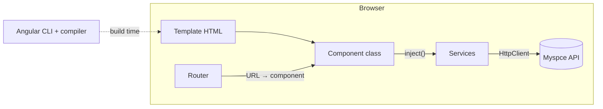
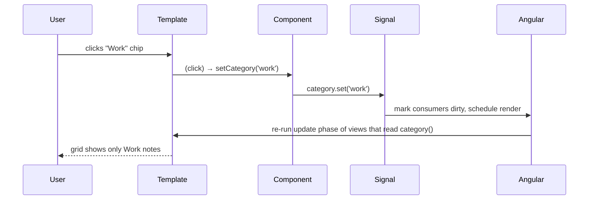

# Angular Architecture and Mental Model

Back to [Module 01](README.md) · Next: [Setup and CLI](02-setup-and-cli.md)

## 1. Learning objectives

- Name Angular's building blocks and what each is responsible for.
- Explain what the Angular compiler does to your templates.
- Explain, at a high level, how a change in state reaches the screen.
- Distinguish standalone applications from NgModule applications.

## 2. Prerequisites

[Module 00](../00-prerequisites/README.md), especially TypeScript classes and decorators.

## 3. What is it?

Angular is a **complete frontend platform**: a component model, a template compiler, dependency injection, a router, forms, an HTTP client, testing utilities and a CLI that builds, serves and tests your app. You don't pick a router or a form library; they ship with the framework and follow the same conventions.

## 4. Why does it work this way?

Large apps fail when every team invents its own structure. Angular trades some flexibility for **consistency**: any Angular developer can open Myspce and know where routes, services and components live, how data flows, and how it's tested.

## 5. How it works internally

### The building blocks



| Block | Responsibility | Myspce example |
|---|---|---|
| **Component** | Renders a piece of UI and handles its events | `NoteCard`, `NotesPage`, `Sidebar` |
| **Template** | HTML + Angular syntax (`{{ }}`, `@if`, `[prop]`, `(event)`) | `note-card.html` |
| **Directive** | Adds behaviour to elements | `copyToClipboard` on the password button |
| **Pipe** | Formats values in templates | `fileSize`, `date` |
| **Service** | Logic and shared state, no UI | `NotesApi`, `AuthStore`, `ThemeStore` |
| **Dependency injection** | Creates services and hands them to whoever asks | `inject(NotesApi)` |
| **Router** | Maps URLs to components, lazy-loads features, guards access | `/notes/:id`, `/admin` |
| **Signals** | Reactive state that tells Angular what changed | `selectedCategory = signal('all')` |

### The compiler (AOT)

At build time, the Angular compiler reads each `@Component` and its template and generates JavaScript instructions that create and update the DOM. Roughly:

```text
template:  <h3>{{ note().title }}</h3>
compiled:  create phase → create <h3>, create text node
           update phase → read note().title; if changed, set text node
```

Two consequences:

1. **Template errors are compile errors.** A typo in a property name fails `ng build` (strict templates are on by default in v22).
2. **No template parsing in the browser.** The app ships only the generated instructions.

### How a change reaches the screen



New Angular 22 apps are **zoneless** and components default to **OnPush**. That means Angular updates a view when:

- a signal the template reads changes,
- an input of the component changes,
- a DOM event bound in the template fires,
- or you explicitly call `markForCheck()`.

Details in [Module 09](../09-lifecycle-and-change-detection/02-change-detection.md).

### Standalone vs NgModule

| | Standalone (modern, default) | NgModule (legacy) |
|---|---|---|
| Declares dependencies | `imports: [...]` on each component | `declarations` + `imports` on a module |
| Bootstrapping | `bootstrapApplication(App, appConfig)` | `platformBrowserDynamic().bootstrapModule(AppModule)` |
| Lazy loading | `loadComponent`, `loadChildren` → routes file | `loadChildren` → module |
| Providers | `app.config.ts`, route `providers` | module `providers` |
| Since | default since v19 | before v14–v17 |

You'll meet NgModules in older codebases (including many production apps). Recognise them:

```typescript
// Legacy: app.module.ts
@NgModule({
  declarations: [AppComponent, NoteCardComponent],   // components that belong to this module
  imports: [BrowserModule, HttpClientModule, AppRoutingModule],
  providers: [],
  bootstrap: [AppComponent],
})
export class AppModule {}
```

Migrate with `ng generate @angular/core:standalone`.

## 6. Syntax and API reference

| Decorator / function | Creates |
|---|---|
| `@Component({ selector, template/templateUrl, styles/styleUrl, imports, host })` | component |
| `@Directive({ selector, host })` | directive |
| `@Pipe({ name })` | pipe |
| `@Service()` (v22) / `@Injectable({ providedIn: 'root' })` | service |
| `bootstrapApplication(Root, config)` | starts the app |
| `signal`, `computed`, `effect`, `input`, `output`, `model` | reactivity and component API |

## 7. Smallest working example

```typescript
// main.ts — a complete Angular app in one file
import { Component, signal } from '@angular/core';
import { bootstrapApplication } from '@angular/platform-browser';

@Component({
  selector: 'app-root',
  template: `
    <h1>Hello {{ name() }}</h1>
    <button type="button" (click)="name.set('Pranjal')">Greet</button>
  `,
})
class App {
  name = signal('world');
}

bootstrapApplication(App);
```

## 8. Step-by-step

1. `@Component` tells the compiler this class renders `<app-root>`.
2. `bootstrapApplication(App)` finds `<app-root>` in `index.html` and renders `App` into it.
3. `name` is a signal; the template reads it with `name()`.
4. Clicking sets the signal; Angular re-renders just that text.

## 9. Myspce real-world example — mapping screens to blocks

| Myspce screen | Route | Page component | Presentational components | Services |
|---|---|---|---|---|
| Dashboard | `/dashboard` | `DashboardPage` | `StatTile`, `QuickAction`, `ActivityList`, `TodayTasks`, `WeekProgress` | `DashboardApi`, `TasksStore` |
| Notes | `/notes` | `NotesPage` | `NoteCard`, `ChipFilter`, `SearchBox`, `EmptyState` | `NotesApi`, `NotesStore`, `CategoriesApi` |
| Credentials | `/credentials` | `CredentialsPage` | `CredentialRow`, `MaskedSecret` | `CredentialsApi` |
| Tasks & Goals | `/tasks` | `TasksPage` | `TaskItem`, `TaskGroup` | `TasksApi`, `TasksStore` |
| Settings | `/settings` | `SettingsPage` | `Toggle`, `Tabs` | `SettingsApi`, `ThemeStore` |
| (all) | – | `Shell` | `Sidebar`, `Topbar`, `GlobalSearch` | `AuthStore`, `BootstrapStore` |

## 10. Advanced example — how the pieces meet in one feature

```text
URL /notes?category=work
 └─ Router matches 'notes' → lazy-loads notes.routes.ts → NotesPage
     └─ NotesPage: category = input<string>()  (query param bound as input)
         └─ notes = httpResource(() => `/api/v1/notes?category=${category()}`)
             └─ HttpClient (+ authInterceptor adds the token)
         └─ template: @for (n of notes.value()?.data; track n.id) { <app-note-card [note]="n" /> }
```

Each layer has one job, which is what makes it testable.

## 11. Visual explanation

```text
┌────────────────────────── Angular application ───────────────────────────┐
│  Router ──► Page components (smart) ──► UI components (presentational)    │
│                 │                                                          │
│                 └── inject() ──► Stores/Services ──► HttpClient ──► API    │
│  Compiler: templates → instructions   Change detection: signals → DOM     │
└────────────────────────────────────────────────────────────────────────────┘
```

## 12. Common mistakes

| Mistake | Why it's wrong | Do instead |
|---|---|---|
| Putting HTTP calls in components | Hard to test and reuse | Put them in a service |
| Treating Angular like jQuery (`document.querySelector`) | Fights the renderer, breaks SSR | Bind in templates; use `viewChild` when you must |
| Copying NgModule tutorials into a v22 app | Mixed patterns, confusing errors | Use standalone APIs |
| Assuming "default" change detection | v22 default is OnPush | Keep state in signals or inputs |

## 13. Debugging guide

- **`NG0303: Can't bind to 'x' since it isn't a known property`** — the component or directive isn't in `imports`, or the input name is wrong.
- **`NG8001: 'app-note-card' is not a known element`** — add `NoteCard` to the parent's `imports`.
- **`NG0201: No provider for X`** — the service isn't provided where it's injected ([Module 07](../07-services-and-dependency-injection/03-injector-hierarchy.md)).
- Every `NG0xxx` code has a page at `https://angular.dev/errors/NG0xxx`.

## 14. Best practices

- Smart (page) components talk to services; presentational components only use inputs/outputs.
- One feature folder per Myspce module.
- Keep templates declarative; push logic into `computed()` and services.

## 15. Angular vs React

React is a **library** for UI; you assemble routing, data fetching and forms from other libraries. Angular is a **framework** that includes them. Angular compiles templates ahead of time; React calls component functions at runtime and diffs a virtual DOM. See [Angular vs React](05-angular-vs-react.md).

## 16. Testing

Each block has its own test style: components with `TestBed` + DOM assertions, services with `TestBed.inject`, HTTP with `HttpTestingController`, routes with `RouterTestingHarness`. All in [Module 19](../19-testing/README.md).

## 17. Practice questions

1. Draw the Myspce Credentials feature using the blocks above.
2. Which block would you use to mask a password in the list? To copy it? To format "Updated 4 hours ago"?
3. Why can Angular catch template typos at build time?

## 18. Interview questions

- **Beginner — What is a component?** A class with a decorator that pairs it with a template and styles to render UI.
- **Intermediate — What does AOT compilation give you?** Build-time template errors, smaller bundles, faster startup.
- **Advanced — How does a signal change lead to a DOM update in a zoneless app?** Setting a signal marks its consumers (templates, computed) dirty and schedules change detection; Angular then refreshes only views marked dirty.

## 19. Revision notes

| Block | Job |
|---|---|
| Component | UI |
| Service | logic/state |
| DI | wiring |
| Router | URL ↔ component |
| Signals | reactivity |
| Compiler | templates → JS at build time |

## 20. Completion checklist

- [ ] I can draw the architecture from memory.
- [ ] I can map every Myspce v1 screen to page, UI components and services.
- [ ] I recognise an NgModule app and know the standalone equivalent.
