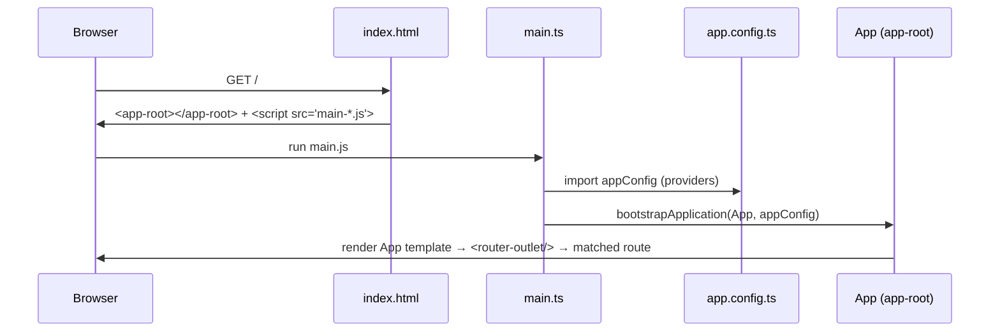

# Project Structure and Bootstrap

Back to [Module 01](README.md) · Previous: [Setup and CLI](02-setup-and-cli.md) · Next: [Configuration and builds](04-configuration-and-builds.md)

## 1. Learning objectives

- Know what every file in a fresh Angular 22 workspace does.
- Trace the bootstrap: `index.html` → `main.ts` → `app.config.ts` → `App`.
- Add global providers and routes correctly.
- Organise Myspce into `core/`, `shared/`, `features/`, `admin/`.

## 2. Prerequisites

[Setup and CLI](02-setup-and-cli.md).

## 3. What is it?

The folder layout `ng new` produces, plus the startup sequence that turns it into a running app.

## 4. Why it matters

Most "where do I put this?" questions have one answer in Angular. Knowing the bootstrap path is how you debug "the app is blank" and "my interceptor never runs".

## 5. How it works — the generated workspace

```text
myspce/
├── angular.json          # workspace + build/serve/test configuration
├── package.json          # dependencies and scripts
├── package-lock.json
├── tsconfig.json         # base TypeScript + Angular compiler options
├── tsconfig.app.json     # app build (excludes specs)
├── tsconfig.spec.json    # tests
├── .postcssrc.json       # Tailwind (you add this)
├── public/               # static files copied as-is (favicon.ico, images)
└── src/
    ├── index.html        # the single HTML page; contains <app-root>
    ├── main.ts           # entry point: bootstrapApplication(App, appConfig)
    ├── styles.css        # global styles (Tailwind import)
    └── app/
        ├── app.ts        # root component class
        ├── app.html      # root template (usually just <router-outlet />)
        ├── app.css       # root styles
        ├── app.spec.ts   # root test
        ├── app.config.ts # application-wide providers
        └── app.routes.ts # top-level routes
```

### The bootstrap sequence



### The files

```html
<!-- src/index.html -->
<!doctype html>
<html lang="en">
<head>
  <meta charset="utf-8">
  <title>MySpace</title>
  <base href="/">
  <meta name="viewport" content="width=device-width, initial-scale=1">
  <link rel="icon" type="image/x-icon" href="favicon.ico">
</head>
<body>
  <app-root></app-root>
</body>
</html>
```

`<base href="/">` tells the router how to resolve URLs. If you deploy under `/myspce/`, build with `--base-href /myspce/`.

```typescript
// src/main.ts
import { bootstrapApplication } from '@angular/platform-browser';
import { appConfig } from './app/app.config';
import { App } from './app/app';

bootstrapApplication(App, appConfig).catch(err => console.error(err));
```

```typescript
// src/app/app.config.ts (as generated in v22, zoneless by default)
import { ApplicationConfig, provideBrowserGlobalErrorListeners } from '@angular/core';
import { provideRouter } from '@angular/router';
import { routes } from './app.routes';

export const appConfig: ApplicationConfig = {
  providers: [
    provideBrowserGlobalErrorListeners(),   // routes uncaught errors/rejections to Angular's ErrorHandler
    provideRouter(routes),
  ],
};
```

- There's no `provideZonelessChangeDetection()` line: zoneless is the default for new apps since v21. Older apps use `provideZoneChangeDetection({ eventCoalescing: true })` and load `zone.js`.
- There's no `provideHttpClient()` line: since v21 `HttpClient` is injectable without it. You add `provideHttpClient(withInterceptors([...]))` when you need interceptors ([Module 13](../13-http-and-api-integration/02-interceptors-and-auth.md)).

```typescript
// src/app/app.routes.ts
import { Routes } from '@angular/router';
export const routes: Routes = [];
```

```typescript
// src/app/app.ts
import { Component, signal } from '@angular/core';
import { RouterOutlet } from '@angular/router';

@Component({
  selector: 'app-root',
  imports: [RouterOutlet],
  templateUrl: './app.html',
  styleUrl: './app.css',
})
export class App {
  protected readonly title = signal('myspce');
}
```

`protected` members are usable in the template but hidden from other classes — a good default for template-only state.

## 6. Syntax and API reference

| API | Where | Purpose |
|---|---|---|
| `bootstrapApplication(root, config)` | `main.ts` | start the app |
| `ApplicationConfig` | `app.config.ts` | `{ providers: [...] }` |
| `provideRouter(routes, ...features)` | config | router + features (`withComponentInputBinding()`, `withViewTransitions()`, `withInMemoryScrolling()`) |
| `provideHttpClient(...features)` | config | configure HttpClient (interceptors, XSRF, `withXhr()`) |
| `provideAppInitializer(fn)` | config | run setup (load bootstrap data) before the first render |
| `provideBrowserGlobalErrorListeners()` | config | global error routing |
| `mergeApplicationConfig(a, b)` | SSR configs | combine configs |

## 7. Smallest working example — adding routes and input binding

```typescript
// app.config.ts
providers: [
  provideBrowserGlobalErrorListeners(),
  provideRouter(routes, withComponentInputBinding()),
],
```

```typescript
// app.routes.ts
export const routes: Routes = [
  { path: '', pathMatch: 'full', redirectTo: 'dashboard' },
  { path: 'dashboard', loadComponent: () => import('./features/dashboard/pages/dashboard-page').then(m => m.DashboardPage) },
];
```

## 8. Step-by-step

1. `withComponentInputBinding()` lets route params and query params arrive as component `input()`s.
2. `loadComponent` + dynamic `import()` puts the Dashboard in its own lazy chunk.
3. `App`'s template must contain `<router-outlet />` for the route to render.

## 9. Myspce real-world example — the final app config

```typescript
// src/app/app.config.ts
import { ApplicationConfig, inject, provideAppInitializer, provideBrowserGlobalErrorListeners } from '@angular/core';
import { provideRouter, withComponentInputBinding, withInMemoryScrolling, withViewTransitions } from '@angular/router';
import { provideHttpClient, withInterceptors } from '@angular/common/http';
import { routes } from './app.routes';
import { authInterceptor } from './core/auth/auth-interceptor';
import { errorInterceptor } from './core/http/error-interceptor';
import { API_URL } from './core/http/api-url.token';
import { BootstrapStore } from './core/bootstrap/bootstrap-store';
import { environment } from '../environments/environment';

export const appConfig: ApplicationConfig = {
  providers: [
    provideBrowserGlobalErrorListeners(),
    provideRouter(
      routes,
      withComponentInputBinding(),
      withViewTransitions(),
      withInMemoryScrolling({ scrollPositionRestoration: 'top' }),
    ),
    provideHttpClient(withInterceptors([authInterceptor, errorInterceptor])),
    { provide: API_URL, useValue: environment.apiUrl },
    provideAppInitializer(() => inject(BootstrapStore).load()),   // theme, nav, user, flags
  ],
};
```

You'll build each referenced file in later modules; this is the shape to aim for.

### Recommended Myspce `src/app` structure

```text
src/app/
├── app.ts · app.html · app.config.ts · app.routes.ts
├── core/            # singletons used app-wide; imported, never importing features
│   ├── auth/        auth-store.ts · auth-interceptor.ts · auth-guard.ts · role-guard.ts
│   ├── bootstrap/   bootstrap-store.ts
│   ├── http/        api-url.token.ts · error-interceptor.ts
│   ├── layout/      shell.ts · sidebar.ts · topbar.ts
│   ├── theme/       theme-store.ts
│   └── models/      index.ts
├── shared/          # reusable, stateless building blocks
│   ├── ui/          page-header · note-card · chip-filter · empty-state · modal · toast · toggle
│   ├── directives/  copy-to-clipboard.ts · has-role.ts
│   └── pipes/       file-size.ts · time-ago.ts
├── features/        # one folder per Myspce module
│   ├── dashboard/   pages/ · components/ · data-access/
│   ├── notes/       notes.routes.ts · pages/ · components/ · data-access/
│   ├── credentials/ · tasks/ · settings/
└── admin/           admin.routes.ts · branding/ · theme/ · navigation/ · widgets/
```

Dependency rule: `features → shared, core`; `shared → nothing app-specific`; features never import other features.

## 10. Advanced example — loading bootstrap data before render

```typescript
// core/bootstrap/bootstrap-store.ts
import { Service, inject, signal } from '@angular/core';
import { HttpClient } from '@angular/common/http';
import { firstValueFrom } from 'rxjs';
import { API_URL } from '../http/api-url.token';

export interface BootstrapData {
  user: User | null;
  theme: Record<string, string>;
  nav: { label: string; route: string; icon: string; visible: boolean }[];
  flags: Record<string, boolean>;
}

@Service()
export class BootstrapStore {
  private http = inject(HttpClient);
  private api = inject(API_URL);
  readonly data = signal<BootstrapData | null>(null);

  async load(): Promise<void> {
    try {
      this.data.set(await firstValueFrom(this.http.get<BootstrapData>(`${this.api}/bootstrap`)));
    } catch {
      this.data.set(null);   // logged out or API down: app still renders the login page
    }
  }
}
```

`provideAppInitializer` waits for the returned Promise, so the sidebar never flashes the wrong items. Keep it fast; a slow initializer delays first paint.

## 11. Visual explanation

```text
index.html <app-root>
  └─ App (router-outlet)
      ├─ /login         → LoginPage
      └─ ''  Shell (sidebar + topbar + router-outlet)
            ├─ /dashboard   → DashboardPage
            ├─ /notes       → NotesPage
            └─ /credentials → CredentialsPage
```

## 12. Common mistakes

| Mistake | Symptom | Fix |
|---|---|---|
| Forgot `<router-outlet />` in `app.html` | Routes never show | Add it and import `RouterOutlet` |
| Interceptor added to a component's `providers` | Never runs for most requests | Register in `provideHttpClient(withInterceptors())` in `app.config.ts` |
| Slow/failing `provideAppInitializer` | Blank screen | Catch errors; keep it short |
| Putting feature services in `core/` | Bloated, tangled core | Feature-specific services live in the feature |

## 13. Debugging guide

- Blank page + console error from `main.ts` → read the first error; bootstrap failures stop everything.
- `NG04002: Cannot match any routes` → path typo or missing `**` route.
- Check that `bootstrapApplication` receives `appConfig`; without it, no router or providers exist.

## 14. Best practices

- Keep `app.config.ts` the **only** place for app-wide providers.
- Keep `App` tiny: a router outlet and maybe global overlays (toasts).
- Lazy-load every feature from `app.routes.ts`.

## 15. Angular vs React

`main.ts` ≈ `main.tsx` with `createRoot(...).render(<App />)`. `app.config.ts` providers ≈ the stack of `<Router>`, `<QueryClientProvider>`, `<ThemeProvider>` wrappers in React — but flat and injected instead of nested.

## 16. Testing

```typescript
// app.spec.ts
import { TestBed } from '@angular/core/testing';
import { provideRouter } from '@angular/router';
import { App } from './app';

describe('App', () => {
  it('creates the root component', async () => {
    TestBed.configureTestingModule({ imports: [App], providers: [provideRouter([])] });
    const fixture = TestBed.createComponent(App);
    await fixture.whenStable();
    expect(fixture.componentInstance).toBeTruthy();
  });
});
```

## 17. Practice questions

1. Where would you register a global `ErrorHandler`? A `TitleStrategy`?
2. What happens if two routes have the same path?
3. Move `title` from a field to a signal and render it in `app.html`.

## 18. Interview questions

- **Q: What does `bootstrapApplication` do?** Creates the root injector from the config providers, then creates and renders the root component into its selector in `index.html`.
- **Q: Why `protected` on template fields?** It allows template access while keeping the field out of the class's public API.
- **Q: How do you run code before the app renders?** `provideAppInitializer(() => …)` returning a Promise or Observable.

## 19. Revision notes

`index.html` → `main.ts` → `bootstrapApplication(App, appConfig)` → providers → `App` → `<router-outlet>` → route. New apps: zoneless, HttpClient injectable without provider, OnPush default.

## 20. Completion checklist

- [ ] I can explain every generated file.
- [ ] I added routes with input binding and a lazy Dashboard.
- [ ] My Myspce folders follow core/shared/features/admin.
