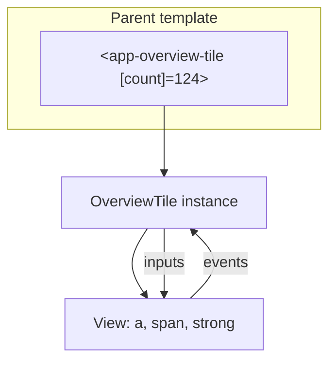

# Components

Back to [Module 02](README.md) · Next: [Data binding](02-data-binding.md)

## 1. Learning objectives

- Write a standalone component with every important metadata option.
- Choose inline vs external templates and styles.
- Explain view encapsulation, `:host`, and global vs component styles.
- Use the `host` property to bind to the component's own element.
- Explain what Angular does when it renders a component.

## 2. Prerequisites

[Module 01](../01-angular-fundamentals/README.md), [TypeScript classes and decorators](../00-prerequisites/03-typescript-advanced.md).

## 3. What is it?

**Simple:** a component is a reusable piece of UI — a class for the behaviour, a template for the HTML, styles for the looks.

**Precise:** a component is a directive with a template. The `@Component` decorator registers a class with the Angular compiler, which generates a component definition that creates a **host element** matching the `selector`, a **view** from the template, and an instance of the class that the view binds to.

## 4. Why does Angular need it?

Without components, a page like the Myspce dashboard would be one huge HTML file with scattered scripts. Components give you **encapsulation** (own template, styles, state), **reuse** (one `StatTile` for eight counters), and **testability** (render one component in isolation).

## 5. How it works internally

When a parent template contains `<app-stat-tile>`:

1. At build time the compiler sees `StatTile` in the parent's `imports` and links the tag to it.
2. At runtime Angular creates the host element `<app-stat-tile>`.
3. It creates the `StatTile` instance (running field initializers and the constructor in an **injection context**, so `inject()` works).
4. It sets inputs, runs lifecycle hooks, creates the template's DOM inside the host element (the **creation pass**).
5. On later change detection runs it only executes the **update pass** for bindings whose values changed.

```text
<app-stat-tile>            ← host element (selector)
  <a class="tile">         ← component view (template)
    <span>Notes</span>
    <strong>124</strong>
  </a>
</app-stat-tile>
```

## 6. Syntax and API reference

```typescript
@Component({
  selector: 'app-stat-tile',        // element selector (also '[appX]' attribute or '.x' class selectors, rare)
  templateUrl: './stat-tile.html',  // or template: `…`
  styleUrl: './stat-tile.css',      // or styleUrls: [...], or styles: `…`
  imports: [RouterLink, DecimalPipe],  // components, directives, pipes used in the template
  changeDetection: ChangeDetectionStrategy.OnPush,   // default in v22; Eager = old default
  encapsulation: ViewEncapsulation.Emulated,         // default
  host: {                                             // bindings on <app-stat-tile> itself
    class: 'block',
    '[class.is-active]': 'active()',
    '(keydown.enter)': 'open()',
    role: 'listitem',
  },
  providers: [],                     // services scoped to this component and its children
  exportAs: 'statTile',              // name for template refs: #t="statTile"
})
export class StatTile {}
```

| Option | When to use |
|---|---|
| `template` (inline) | ≤ ~15 lines, tightly coupled markup (small UI atoms) |
| `templateUrl` | anything bigger; better editor support |
| `styles` / `styleUrl` | component-specific CSS (with Tailwind, often empty) |
| `imports` | **every** component, directive and pipe used in the template |
| `host` | classes, attributes, listeners on the host element (replaces `@HostBinding`/`@HostListener`) |
| `providers` | per-instance services (e.g. a form-state service per editor) |
| `encapsulation` | rarely changed; `None` makes styles global, `ShadowDom` uses real shadow DOM |

### View encapsulation

By default (`Emulated`), Angular rewrites component CSS so it only matches that component's template:

```css
/* stat-tile.css */
strong { font-size: 1.5rem; }
/* compiled to: strong[_ngcontent-abc-c12] { … } — won't leak to other components */

:host { display: block; }               /* styles the host element <app-stat-tile> */
:host(.is-active) { outline: 2px solid var(--color-primary); }
:host-context(.dark) strong { color: white; }   /* when an ancestor has .dark */
```

Global styles live in `src/styles.css`. With Tailwind, most styling is utility classes in the template, so component CSS files are often empty or contain only `:host`.

`::ng-deep` pierces encapsulation but is deprecated in spirit; avoid it (use a global style or a CSS variable instead).

## 7. Smallest working example

```typescript
// shared/ui/stat-tile.ts
import { Component, input } from '@angular/core';

@Component({
  selector: 'app-stat-tile',
  template: `
    <span class="text-sm text-slate-500">{{ label() }}</span>
    <strong class="text-2xl font-semibold">{{ value() }}</strong>
  `,
  host: { class: 'flex flex-col gap-1 rounded-xl bg-white p-4 shadow-sm dark:bg-slate-900' },
})
export class StatTile {
  label = input.required<string>();
  value = input.required<number>();
}
```

```html
<!-- in a parent template; parent must import StatTile -->
<app-stat-tile label="Notes" [value]="124" />
```

## 8. Step-by-step

1. `selector: 'app-stat-tile'` — parents write `<app-stat-tile>`. Self-closing tags (`/>`) are valid for components.
2. `input.required<string>()` — the parent must pass `label`; reading it is `label()`.
3. `host.class` — styling the host element means no extra wrapper `<div>`.
4. `label="Notes"` passes a static string; `[value]="124"` passes a number expression.

## 9. Myspce real-world example — the dashboard overview tile

The design shows eight tiles (Notes 124, Credentials 28, …), each with an icon, colour, label, count, and a link to the module.

```typescript
// features/dashboard/components/overview-tile.ts
import { Component, input } from '@angular/core';
import { RouterLink } from '@angular/router';
import { DecimalPipe } from '@angular/common';

export type TileTone = 'blue' | 'green' | 'red' | 'amber' | 'violet' | 'pink';

@Component({
  selector: 'app-overview-tile',
  imports: [RouterLink, DecimalPipe],
  templateUrl: './overview-tile.html',
  host: { class: 'block' },
})
export class OverviewTile {
  label = input.required<string>();
  count = input.required<number>();
  route = input.required<string>();
  icon = input.required<string>();
  tone = input<TileTone>('blue');

  protected readonly toneClasses: Record<TileTone, string> = {
    blue: 'bg-blue-500/15 text-blue-500',
    green: 'bg-emerald-500/15 text-emerald-500',
    red: 'bg-rose-500/15 text-rose-500',
    amber: 'bg-amber-500/15 text-amber-500',
    violet: 'bg-violet-500/15 text-violet-500',
    pink: 'bg-pink-500/15 text-pink-500',
  };
}
```

```html
<!-- features/dashboard/components/overview-tile.html -->
<a [routerLink]="route()"
   class="flex flex-col gap-3 rounded-xl border border-slate-200 bg-white p-4 transition hover:shadow-md
          focus-visible:outline-2 focus-visible:outline-blue-500 dark:border-slate-800 dark:bg-slate-900">
  <span class="grid size-9 place-items-center rounded-lg" [class]="toneClasses[tone()]" aria-hidden="true">
    <app-icon [name]="icon()" />
  </span>
  <span class="text-sm text-slate-500 dark:text-slate-400">{{ label() }}</span>
  <strong class="text-xl font-semibold">{{ count() | number }}</strong>
</a>
```

(`app-icon` comes from the shared UI kit in [Module 16](../16-advanced-components/04-reusable-ui-kit.md); add `Icon` to `imports` when you build it.)

Usage on the dashboard:

```html
<section aria-labelledby="overview-title">
  <h2 id="overview-title" class="mb-3 font-semibold">Quick Overview</h2>
  <div class="grid grid-cols-2 gap-3 sm:grid-cols-4">
    <app-overview-tile label="Notes" [count]="summary().notes" route="/notes" icon="notebook" tone="blue" />
    <app-overview-tile label="Credentials" [count]="summary().credentials" route="/credentials" icon="key" tone="green" />
    <app-overview-tile label="Memories" [count]="summary().memories" route="/memories" icon="image" tone="red" />
    <app-overview-tile label="Tasks" [count]="summary().tasks" route="/tasks" icon="check-square" tone="amber" />
  </div>
</section>
```

## 10. Advanced example — a component with its own scoped service

The note editor needs "unsaved changes" state per editor instance, not app-wide:

```typescript
// features/notes/data-access/editor-state.ts
import { Injectable, signal, computed } from '@angular/core';

@Injectable()   // not root-provided: each editor gets its own
export class EditorState {
  readonly saved = signal('');
  readonly draft = signal('');
  readonly dirty = computed(() => this.saved() !== this.draft());
}

// features/notes/pages/note-editor-page.ts
@Component({
  selector: 'app-note-editor-page',
  providers: [EditorState],   // new instance for this component and its children
  templateUrl: './note-editor-page.html',
})
export class NoteEditorPage {
  protected state = inject(EditorState);
}
```

Children like `EditorToolbar` can `inject(EditorState)` and get the **same** instance as their parent editor. Two editors open side by side get two instances.

## 11. Visual explanation



## 12. Common mistakes

| Wrong | Problem | Right |
|---|---|---|
| Using `<app-note-card>` without adding `NoteCard` to `imports` | `NG8001: not a known element` | `imports: [NoteCard]` |
| Wrapping everything in an extra `<div>` | Extra DOM, harder layout | Put classes on the host with `host: { class }` |
| `::ng-deep .btn { … }` | Leaks styles globally, unpredictable | CSS variables or global styles |
| Doing work in the constructor that needs inputs | Inputs aren't set yet | Read inputs in templates/`computed()`; use `ngOnInit` if you must |
| Huge 500-line component | Unmaintainable | Split into page + presentational parts ([note 4](04-composition-and-organization.md)) |

## 13. Debugging guide

| Error | Meaning | Fix |
|---|---|---|
| `NG8001: 'app-x' is not a known element` | not imported | add to `imports` |
| `NG0950: Input is required but no value is available yet` | read a required input too early (constructor/field initializer) | read it in the template, `computed`, or later lifecycle |
| `NG8023: Multiple components match node` (v22, compile time) | two components share a selector | rename one selector |
| Styles not applying | encapsulation | style the host with `:host`, or move to global CSS |

Use Angular DevTools → Components to inspect the instance and input values.

## 14. Best practices

- One component per file; selector prefix `app-` (or a project prefix like `ms-`).
- Prefer the `host` property over `@HostBinding`/`@HostListener`.
- Keep templates declarative; push logic into the class.
- Use `protected` for template-only members.
- Keep presentational components free of `inject()` calls to API services.

## 15. Angular vs React

A component instance is created once and updated in place; a React function component re-runs every render. `host` bindings have no React equivalent — in React you'd add props to the root element you return.

## 16. Testing

```typescript
// shared/ui/stat-tile.spec.ts
import { TestBed } from '@angular/core/testing';
import { StatTile } from './stat-tile';

describe('StatTile', () => {
  it('renders label and value', async () => {
    const fixture = TestBed.createComponent(StatTile);
    fixture.componentRef.setInput('label', 'Notes');
    fixture.componentRef.setInput('value', 124);
    await fixture.whenStable();
    const el: HTMLElement = fixture.nativeElement;
    expect(el.textContent).toContain('Notes');
    expect(el.querySelector('strong')?.textContent).toBe('124');
    expect(el.classList).toContain('rounded-xl');   // host class
  });
});
```

## 17. Practice questions

1. Build `QuickAction` (icon, title, subtitle, link) for the four dashboard cards.
2. Convert a component's `@HostBinding('class.active')` + `@HostListener('click')` to the `host` property.
3. When would you give a component its own `providers`?
4. Why might `encapsulation: ViewEncapsulation.None` be dangerous?

## 18. Interview questions

- **Beginner — What does `imports` on a component do?** Declares which components, directives and pipes its template may use.
- **Intermediate — How does emulated encapsulation work?** Angular adds unique attributes to elements and rewrites selectors to include them, scoping styles to the component.
- **Advanced — What's the difference between `providers` on a component and on a route?** Component providers create an instance per component (in the element injector); route providers create one instance per route activation in an environment injector shared by that route's subtree.

## 19. Revision notes

| Metadata | Purpose |
|---|---|
| `selector` | tag to use |
| `template(Url)` | markup |
| `style(Url)` | scoped CSS |
| `imports` | template dependencies |
| `host` | bindings on host element |
| `providers` | scoped services |
| `changeDetection` | OnPush default (v22) |

## 20. Completion checklist

- [ ] I built `StatTile`, `OverviewTile` and `QuickAction`.
- [ ] I styled a host element with `host` and `:host`.
- [ ] I wrote a component test using `setInput`.
