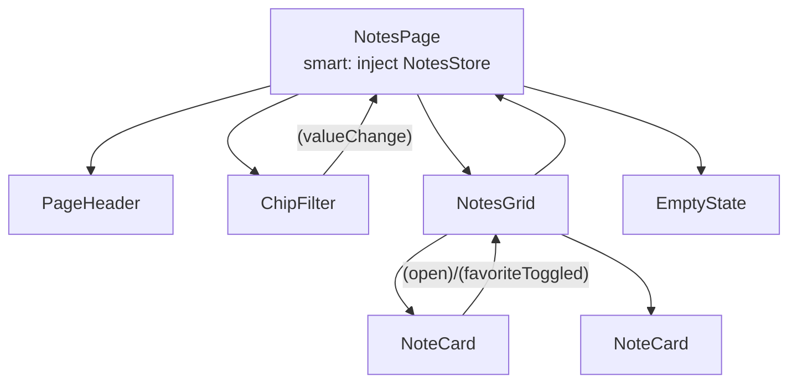

# Component Composition and Organisation

Back to [Module 02](README.md) · Previous: [Class, style and attribute binding](03-class-style-attribute-binding.md) · Next module: [03 Control flow](../03-template-control-flow/README.md)

## 1. Learning objectives

- Split a screen into smart (container) and presentational components.
- Design parent–child relationships with clear inputs and outputs.
- Name and place files according to the Angular style guide (v20+).
- Decide when to extract a component.

## 2. Prerequisites

[Components](01-components.md), [Data binding](02-data-binding.md).

## 3. What is it?

**Composition** is building big UI from small components. **Organisation** is where those components live and what they're allowed to depend on.

## 4. Why it matters

A Myspce page could be one 600-line component. It would work — until you need the same note card on the Favorites page, a test for the empty state, or a dark-mode fix in one place.

## 5. How it works — smart vs presentational

| | Smart (page / container) | Presentational (UI) |
|---|---|---|
| Knows about | services, stores, router | only its inputs |
| Gets data by | `inject()` + signals/resources | `input()` |
| Reports actions by | calling services | `output()` |
| Examples | `NotesPage`, `DashboardPage` | `NoteCard`, `ChipFilter`, `EmptyState` |
| Reusable? | rarely | yes, everywhere |
| Test style | with mocked services | inputs in, DOM out |



Data flows **down** through inputs; events flow **up** through outputs; only the page talks to the store.

## 6. Style guide essentials (v20+)

| Rule | Example |
|---|---|
| File names: kebab-case, no type suffix for components/services | `note-card.ts`, `notes-api.ts` |
| Class names: PascalCase, describe the thing | `NoteCard`, `NotesApi`, `NotesPage` |
| Template/style beside the class | `note-card.html`, `note-card.css` |
| Test beside the file | `note-card.spec.ts` |
| One concept per file | |
| Selector prefix | `app-note-card` |
| Organise by feature, not by type | `features/notes/…`, not `components/`, `services/` |
| `protected` for template-only members, `readonly` for things that shouldn't be reassigned | |

Suffixes like `-page`, `-store`, `-api` are naming choices that make roles obvious; the style guide allows them when they add meaning.

## 7. Smallest working example

```typescript
// shared/ui/empty-state.ts
import { Component, input, output } from '@angular/core';

@Component({
  selector: 'app-empty-state',
  template: `
    <div class="flex flex-col items-center gap-2 rounded-xl border border-dashed border-slate-300 p-10 text-center dark:border-slate-700">
      <p class="font-medium">{{ title() }}</p>
      @if (hint()) { <p class="text-sm text-slate-500">{{ hint() }}</p> }
      @if (actionLabel()) {
        <button type="button" class="mt-2 rounded-lg bg-blue-600 px-3 py-1.5 text-sm text-white" (click)="action.emit()">
          {{ actionLabel() }}
        </button>
      }
    </div>
  `,
})
export class EmptyState {
  title = input.required<string>();
  hint = input<string>();
  actionLabel = input<string>();
  action = output<void>();
}
```

## 8. Step-by-step

1. No `inject()`: it can't depend on any feature.
2. All variation comes through inputs; the one action goes out through an output.
3. Usable on every Myspce page: "No notes yet", "No credentials", "Trash is empty".

## 9. Myspce real-world example — the Notes page split

```text
features/notes/
├── notes.routes.ts
├── pages/
│   └── notes-page.ts / .html          ← smart
├── components/
│   ├── notes-grid.ts                  ← presentational, feature-specific
│   └── note-card.ts / .html
└── data-access/
    ├── notes-api.ts
    └── notes-store.ts
shared/ui/
├── page-header.ts                     ← presentational, app-wide
├── chip-filter.ts
├── search-box.ts
└── empty-state.ts
```

```typescript
// features/notes/pages/notes-page.ts
import { Component, inject } from '@angular/core';
import { PageHeader } from '../../../shared/ui/page-header';
import { ChipFilter } from '../../../shared/ui/chip-filter';
import { SearchBox } from '../../../shared/ui/search-box';
import { EmptyState } from '../../../shared/ui/empty-state';
import { NotesGrid } from '../components/notes-grid';
import { NotesStore } from '../data-access/notes-store';

@Component({
  selector: 'app-notes-page',
  imports: [PageHeader, ChipFilter, SearchBox, EmptyState, NotesGrid],
  templateUrl: './notes-page.html',
})
export class NotesPage {
  protected store = inject(NotesStore);
}
```

```html
<!-- features/notes/pages/notes-page.html -->
<app-page-header title="Notes">
  <app-search-box actions placeholder="Search notes…" [(value)]="store.query" />
  <button actions type="button" class="rounded-lg bg-blue-600 px-3 py-2 text-sm text-white" (click)="store.create()">
    + New Note
  </button>
</app-page-header>

<app-chip-filter [options]="store.categoryOptions()" [(value)]="store.category" />

@if (store.visibleNotes().length) {
  <app-notes-grid [notes]="store.visibleNotes()"
                  (open)="store.open($event)"
                  (favoriteToggled)="store.toggleFavorite($event)" />
} @else {
  <app-empty-state title="No notes yet" hint="Capture your first idea." actionLabel="New Note" (action)="store.create()" />
}
```

The store (`query`, `category` writable signals; `visibleNotes` computed) is built in [Module 08](../08-signals-and-reactivity/README.md) and [Module 15](../15-state-management/02-signal-stores.md). `[(value)]="store.query"` works because `query` is a writable signal. The `actions` attribute targets a projection slot ([Module 16](../16-advanced-components/01-content-projection.md)).

## 10. Advanced example — when to extract a component

Extract when **any** is true:

1. The markup appears twice (note card on Notes **and** Favorites).
2. It has its own state or behaviour (a password field with show/hide).
3. The parent template is longer than one screen.
4. You want to test it alone (empty state variations).

Don't extract when it's a single `<span>` with no logic, or when the "component" would need ten inputs to cover every case (that's two components pretending to be one).

## 11. Visual explanation

```text
Dependency direction (allowed →)
features/notes ──► shared/ui, shared/pipes, core
features/tasks ──► shared/ui, core
shared/ui      ──► nothing app-specific
core           ──► shared (rarely), never features
features/notes ──X features/tasks   (move shared bits to shared/)
```

Enforce it later with ESLint boundaries or Nx module boundaries.

## 12. Common mistakes

| Mistake | Fix |
|---|---|
| Presentational component injects `NotesApi` | Pass data in, emit events out |
| Child mutates an input object (`note().title = 'x'`) | Emit an event; the owner updates state immutably |
| `components/`, `services/`, `models/` folders at root | Feature folders |
| A "generic" component with 15 boolean inputs | Split into variants or use content projection |
| Deep prop chains (page → grid → card → button) for one event | Fine for 2–3 levels; deeper, inject a store in the nearest smart component |

## 13. Debugging guide

- "Which component owns this state?" — Angular DevTools component tree; follow inputs upward.
- Circular import warnings at build time usually mean a feature imports another feature; move the shared code.

## 14. Best practices

- Pages are smart; everything else is presentational until proven otherwise.
- Shared UI lives in `shared/ui` and has zero app-service dependencies.
- Name by role: `…Page`, `…Store`, `…Api` help readers instantly.

## 15. Angular vs React

Same container/presentational idea as in React. Difference: in Angular the smart component usually holds a **service/store** instance via DI, not hook state.

## 16. Testing

Presentational components: set inputs, assert DOM, subscribe to outputs. Pages: provide a fake store.

```typescript
it('emits action when the button is clicked', async () => {
  const fixture = TestBed.createComponent(EmptyState);
  fixture.componentRef.setInput('title', 'No notes yet');
  fixture.componentRef.setInput('actionLabel', 'New Note');
  let clicked = false;
  fixture.componentInstance.action.subscribe(() => (clicked = true));
  await fixture.whenStable();
  fixture.nativeElement.querySelector('button').click();
  expect(clicked).toBe(true);
});
```

## 17. Practice questions

1. Draw the component tree for the Credentials screen and label smart vs presentational.
2. Should `CredentialRow` inject `CredentialsApi` to reveal a password? Why or why not?
3. Plan the folder layout for the Tasks feature.

## 18. Interview questions

- **Q: Smart vs presentational components?** Smart components know about services and state; presentational ones only use inputs/outputs and are reusable and easy to test.
- **Q: Why organise by feature?** Changes to a feature stay in one folder; lazy loading maps naturally to folders; ownership is clear.

## 19. Revision notes

Data down (inputs), events up (outputs), page talks to store, shared UI has no app dependencies, organise by feature.

## 20. Completion checklist

- [ ] I split the Notes page into page + grid + card + shared UI.
- [ ] I built `EmptyState` and used it twice.
- [ ] My folders follow the dependency rules.
