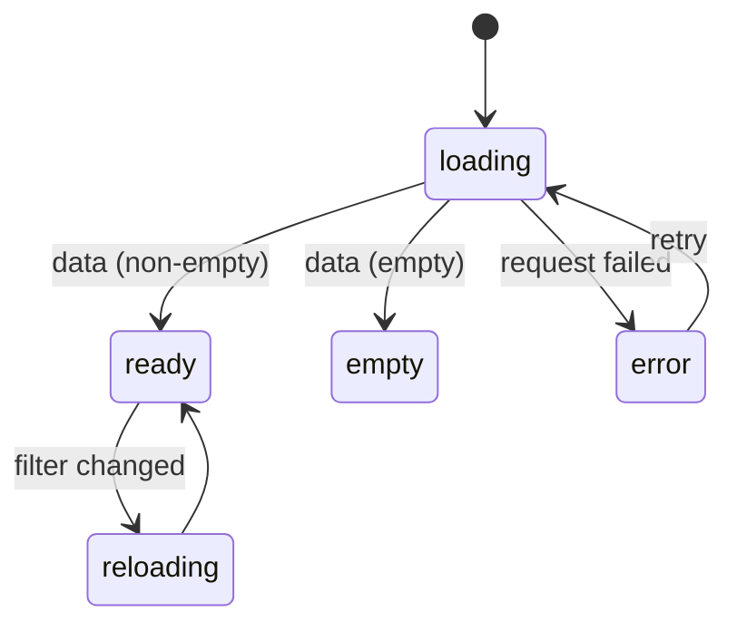

# Template Expressions, Optional Data and Loading States

Back to [Module 03](README.md) · Previous: [`@if`, `@for`, `@switch`](01-if-for-switch.md) · Next module: [04 Component communication](../04-component-communication/README.md)

## 1. Learning objectives

- Write safe template expressions with `?.`, `??` and `@let`.
- Decide between removing DOM (`@if`) and hiding it with CSS.
- Render loading, empty, error and success states consistently.
- Debug the most common template errors.

## 2. Prerequisites

[`@if`, `@for`, `@switch`](01-if-for-switch.md).

## 3. What is it?

Patterns for templates that handle **data that may not exist yet**: API responses that are loading, failed, or empty.

## 4. Why does Angular need it?

Every Myspce screen loads from the API. Without explicit states, users see blank boxes, flashes of "No notes", or crashes like `Cannot read properties of undefined`.

## 5. How it works

### Safe navigation and nullish coalescing

```html
{{ note()?.category?.name ?? 'Uncategorised' }}

```

- `a?.b` returns `undefined` if `a` is `null`/`undefined`. **v22 change:** this now matches TypeScript exactly (`undefined`, not `null` as in older Angular). The `ng update` migration wraps existing uses in `$safeNavigationMigration(...)` so you can review them.
- `a ?? b` falls back only when `a` is `null`/`undefined`.
- v22 understands guards: inside `@if (project?.author) { … }` you can write `project.author` without `?.`, and extended diagnostics may warn about unnecessary `?.`.

### Remove vs hide

| Use `@if` (remove from DOM) | Use a class (`hidden`, `invisible`, `sr-only`) |
|---|---|
| Content is expensive or has state you want reset | Toggling often and the DOM is cheap |
| Should not exist for assistive tech | Must keep state (a half-typed form in a collapsed panel) |
| Security-relevant (admin links) — although the server must still enforce it | Animations need the element to exist |

```html
@if (isAdmin()) { <a routerLink="/admin">Admin</a> }          <!-- not in DOM for non-admins -->
<aside class="lg:block" [class.hidden]="!sidebarOpen()">…</aside>  <!-- kept, just hidden -->
<span class="sr-only">Copied to clipboard</span>              <!-- visible only to screen readers -->
```

## 6. Syntax reference — the four-state pattern

Model state explicitly. With resources ([Module 08](../08-signals-and-reactivity/04-resources.md)) you get it for free:

```html
@if (notes.isLoading() && !notes.hasValue()) {
  <app-notes-skeleton />
} @else if (notes.error()) {
  <app-error-state message="Couldn't load notes." (retry)="notes.reload()" />
} @else if (!notes.value()?.data?.length) {
  <app-empty-state title="No notes yet" actionLabel="New Note" (action)="create()" />
} @else {
  <app-notes-grid [notes]="notes.value()!.data" />
  @if (notes.isLoading()) { <p class="text-xs text-slate-400" role="status">Refreshing…</p> }
}
```

Order matters: **loading (first load) → error → empty → data**, with a subtle "refreshing" indicator when reloading over existing data (resource status `'reloading'`).

## 7. Smallest working example — a reusable state switch

```typescript
// shared/ui/async-state.ts
import { Component, input, output } from '@angular/core';

export type ViewState = 'loading' | 'error' | 'empty' | 'ready';

@Component({
  selector: 'app-async-state',
  template: `
    @switch (state()) {
      @case ('loading') { <div class="animate-pulse space-y-2" aria-busy="true"><div class="h-16 rounded bg-slate-200 dark:bg-slate-800"></div></div> }
      @case ('error') {
        <div role="alert" class="rounded-lg bg-rose-50 p-4 text-rose-700 dark:bg-rose-950 dark:text-rose-200">
          {{ errorMessage() }}
          <button type="button" class="ml-2 underline" (click)="retry.emit()">Try again</button>
        </div>
      }
      @case ('empty') { <ng-content select="[empty]" /> }
      @case ('ready') { <ng-content /> }
      @default never;
    }
  `,
})
export class AsyncState {
  state = input.required<ViewState>();
  errorMessage = input('Something went wrong.');
  retry = output<void>();
}
```

```html
<app-async-state [state]="viewState()" (retry)="notes.reload()">
  <app-empty-state empty title="No notes yet" />
  <app-notes-grid [notes]="visibleNotes()" />
</app-async-state>
```

```typescript
viewState = computed<ViewState>(() => {
  if (this.notes.isLoading() && !this.notes.hasValue()) return 'loading';
  if (this.notes.error()) return 'error';
  return this.visibleNotes().length ? 'ready' : 'empty';
});
```

## 8. Step-by-step

1. The page computes one `viewState` value from the resource — one source of truth.
2. `AsyncState` decides what to show; projected content (`<ng-content>`) supplies the empty and ready markup.
3. `@default never;` guarantees every state is handled.

Caveat: projected content is **created even if not displayed** (content projection instantiates children of the parent template). For heavy "ready" content, keep the `@if` chain in the page instead, or use `ng-template` projection ([Module 16](../16-advanced-components/01-content-projection.md)).

## 9. Myspce real-world example — Credentials list states

```html
<!-- features/credentials/pages/credentials-page.html -->
@let res = credentials;
@if (res.isLoading() && !res.hasValue()) {
  <ul aria-busy="true" class="space-y-2">
    @for (i of [1, 2, 3, 4, 5]; track i) { <li class="h-14 animate-pulse rounded-lg bg-slate-800"></li> }
  </ul>
} @else if (res.error(); as err) {
  <app-error-state [message]="errorText(err)" (retry)="res.reload()" />
} @else {
  @let rows = filtered();
  @if (rows.length) {
    <ul class="divide-y divide-slate-800">
      @for (c of rows; track c.id) { <app-credential-row [credential]="c" /> }
    </ul>
  } @else if (query()) {
    <app-empty-state [title]="'No credentials match “' + query() + '”'" hint="Try another search." />
  } @else {
    <app-empty-state title="Your vault is empty" actionLabel="Add Credential" (action)="add()" />
  }
}
```

Note the two different empty states: "no results for this search" vs "nothing saved yet". Users need different next steps for each.

## 10. Advanced example — avoiding layout shift

Skeletons should match the final layout's size so content doesn't jump (CLS, [Module 17](../17-performance/03-measuring.md)). Give skeleton rows the same height as real rows (`h-14` above), and reserve space for images with explicit `width`/`height` or `aspect-ratio`.

## 11. Visual explanation



## 12. Common mistakes

| Mistake | Effect | Fix |
|---|---|---|
| Showing "No notes" while loading | flash of wrong content | check loading before empty |
| Hiding the list during reload | flicker | keep data, show a small "refreshing" indicator |
| `note()!.title` everywhere | crashes when null | narrow with `@if (note(); as n)` |
| One generic "Something went wrong" for everything | unhelpful | map status codes to messages ([Module 13](../13-http-and-api-integration/03-error-handling-retry.md)) |
| `[hidden]` with Tailwind's `flex` class | `display:flex` overrides `hidden` attribute | use `@if` or the `hidden` class |

## 13. Debugging guide

| Error | Likely cause |
|---|---|
| `Cannot read properties of undefined (reading 'x')` at runtime | template read data before it existed; add a state check |
| `Object is possibly 'undefined'` at compile time | strict templates; narrow with `@if … as` |
| `NG0100 ExpressionChangedAfterItHasBeenChecked` | a value changed during rendering (e.g. a getter that mutates) |
| Template parse error `Unexpected character "{"` | stray `{` or `}` in text — escape as `&#123;` / `&#125;` or `{{ '{' }}` |

## 14. Best practices

- Model view state explicitly; derive it with `computed()`.
- Always design four states per async view: loading, error, empty, ready.
- Keep skeletons the same size as real content.
- Use `role="status"` for non-urgent updates and `role="alert"` for errors.

## 15. Angular vs React

React Query gives `isLoading/isError/data`; Angular resources give `isLoading()/error()/value()/hasValue()/status()`. The template pattern is the same; Angular's `@if/@else if` chain replaces nested ternaries.

## 16. Testing

Test each state: provide a resource-like stub or mock HTTP with delayed/failed/empty responses and assert the matching markup ([Module 19](../19-testing/03-service-http-tests.md)).

## 17. Practice questions

1. Add loading/error/empty/ready states to the Dashboard's "Recent Activity" widget.
2. Write `errorText(err)` that maps 401, 403, 404, 0 (network) and 5xx to friendly messages.
3. When is CSS hiding better than `@if` for the mobile sidebar?

## 18. Interview questions

- **Q: What does `?.` return in Angular 22 templates when the left side is null?** `undefined`, matching TypeScript (older versions returned `null`).
- **Q: Why separate "loading" and "reloading"?** So existing data stays visible during refreshes, avoiding flicker.

## 19. Revision notes

`?.` safe access (returns `undefined` in v22) · `??` default · `@let` alias · remove vs hide · loading → error → empty → ready · skeletons match layout.

## 20. Completion checklist

- [ ] Every list page in my practice app has four states.
- [ ] I built `AsyncState` and understand its projection caveat.
- [ ] I fixed a runtime "undefined" error by modelling state, not by sprinkling `?.`.
