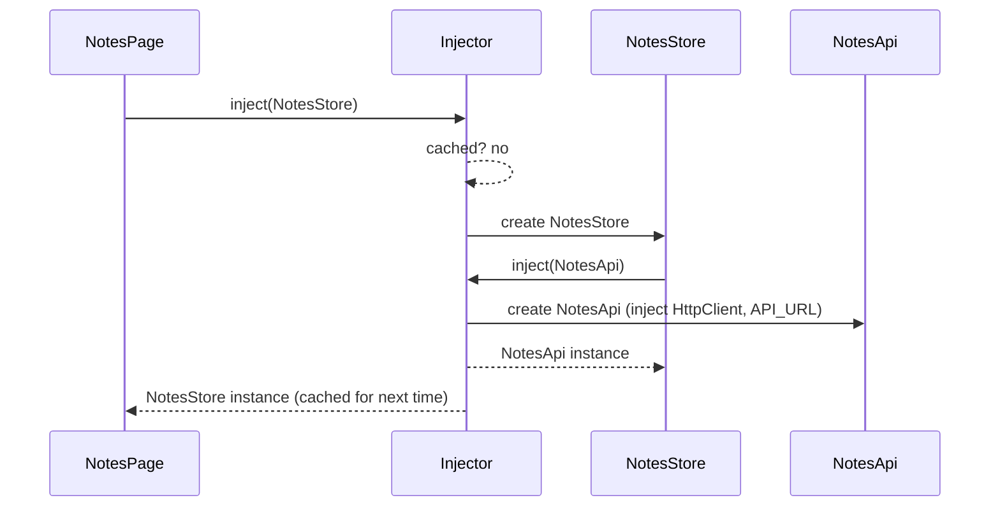

# Services and `inject()`

Back to [Module 07](README.md) · Next: [Providers and tokens](02-providers-and-tokens.md)

## 1. Learning objectives

- Decide what logic belongs in a service.
- Create root services with `@Service()` (v22) and `@Injectable()`.
- Use `inject()` correctly and understand injection contexts.
- Read legacy constructor injection.
- Lazy-load a heavy service with `injectAsync()` (v22).

## 2. Prerequisites

[Components](../02-components-and-templates/01-components.md), [TypeScript classes](../00-prerequisites/02-typescript-fundamentals.md).

## 3. What is it?

**Simple:** a service is a class for work that isn't UI: calling the API, holding shared state, formatting rules, talking to localStorage.

**Precise:** any class (or value) registered with a **provider** in an **injector**. When code calls `inject(NotesApi)`, the injector returns an existing instance or creates one (resolving its own dependencies), then caches it for that injector's lifetime.

## 4. Why does Angular need it?

| Without DI | With DI |
|---|---|
| `new NotesApi(new HttpClient(...))` everywhere | `inject(NotesApi)` |
| Each component makes its own copy of state | one shared instance |
| Tests must monkey-patch globals | tests swap a provider |
| Hard-coded config | tokens provided per environment |

## 5. How it works internally



`inject()` works only in an **injection context**: while Angular is constructing something it manages. That's

- field initializers and constructors of components, directives, pipes, services,
- `useFactory` functions and `InjectionToken` factories,
- functional guards, resolvers, interceptors (called by Angular inside a context),
- `provideAppInitializer` callbacks,
- inside `runInInjectionContext(injector, fn)`.

Calling `inject()` in a method, `setTimeout` or `subscribe` callback throws `NG0203`.

## 6. Syntax and API reference

### `@Service()` — new in v22

```typescript
import { Service, inject } from '@angular/core';

@Service()                        // root-provided singleton; `ng generate service` emits this in v22
export class NotesApi {
  private http = inject(HttpClient);   // dependencies MUST use inject(), not constructor params
}

@Service({ autoProvided: false })  // not auto-provided; you provide it yourself (route/component)
export class EditorState {}
```

### `@Injectable()` — still valid, more options

```typescript
@Injectable({ providedIn: 'root' })     // same as @Service()
export class LegacyNotesApi {
  constructor(private http: HttpClient) {}   // constructor injection is allowed with @Injectable
}

@Injectable()                            // no providedIn: must be listed in some `providers`
export class FormDraftState {}
```

| | `@Service()` | `@Injectable({ providedIn: 'root' })` | `@Injectable()` |
|---|---|---|---|
| Auto-provided in root | ✅ (unless `autoProvided: false`) | ✅ | ❌ |
| Tree-shakable if unused | ✅ | ✅ | depends where provided |
| Constructor injection | ❌ use `inject()` | ✅ | ✅ |
| Generated by CLI (v22) | default | `--injectable` | `--injectable` |

### `inject()` options

```typescript
private analytics = inject(Analytics, { optional: true });   // null if not provided
private parentForm = inject(FormGroupDirective, { skipSelf: true, optional: true });
private local = inject(EditorState, { self: true });          // only this element's injector
private host = inject(ParentCard, { host: true });            // stop at the host component
```

### `injectAsync()` — new in v22

```typescript
// admin/audit-log/audit-log-page.ts
import { Component, injectAsync } from '@angular/core';

export class AuditLogPage {
  // The export service (with a PDF library) loads only when needed.
  private exporter = injectAsync(() => import('./audit-export').then(m => m.AuditExport));

  async exportPdf() {
    const exporter = await this.exporter();
    await exporter.toPdf();
  }
}
```

The service must be auto-provided (`@Service()` or `providedIn: 'root'`). An optional `prefetch` (e.g. `onIdle`) downloads the chunk in the background.

## 7. Smallest working example

```typescript
// core/storage/local-store.ts
import { Service } from '@angular/core';

@Service()
export class LocalStore {
  get<T>(key: string, fallback: T): T {
    try {
      const raw = localStorage.getItem(`myspce.${key}`);
      return raw === null ? fallback : (JSON.parse(raw) as T);
    } catch {
      return fallback;
    }
  }
  set(key: string, value: unknown): void {
    try { localStorage.setItem(`myspce.${key}`, JSON.stringify(value)); } catch { /* quota/private mode */ }
  }
}

// any component
export class SettingsPage {
  private store = inject(LocalStore);
  view = signal(this.store.get<'grid' | 'list'>('notes.view', 'grid'));
}
```

## 8. Step-by-step

1. `@Service()` registers `LocalStore` in the root injector, created on first `inject()`.
2. All `localStorage` access goes through one place (safe to change prefix, add encryption, mock in tests).
3. `try/catch` because storage can throw in private mode or when full.

## 9. Myspce real-world example — what goes where

| Responsibility | Lives in | Example |
|---|---|---|
| HTTP calls for a resource | `*-api.ts` service | `NotesApi.list(query)` |
| State for a feature + actions | `*-store.ts` service | `NotesStore.visibleNotes`, `toggleFavorite()` |
| App-wide session | `core/auth/auth-store.ts` | `AuthStore.user`, `login()`, `logout()` |
| Cross-cutting browser APIs | `core/…` services | `LocalStore`, `ClipboardService`, `IdleLock` |
| Rendering and user input | components | `NotesPage`, `NoteCard` |
| Pure formatting | pipes | `fileSize` |

```typescript
// features/notes/data-access/notes-api.ts
import { Service, inject } from '@angular/core';
import { HttpClient, HttpParams } from '@angular/common/http';
import { API_URL } from '../../../core/http/api-url.token';
import { Note, Paginated } from '../../../core/models';
import { CreateNoteDto, NoteQuery, UpdateNoteDto } from './notes.models';

@Service()
export class NotesApi {
  private http = inject(HttpClient);
  private base = `${inject(API_URL)}/notes`;

  list(query: NoteQuery = {}) {
    const params = new HttpParams({ fromObject: clean(query) });
    return this.http.get<Paginated<Note>>(this.base, { params });
  }
  get(id: string) { return this.http.get<Note>(`${this.base}/${id}`); }
  create(dto: CreateNoteDto) { return this.http.post<Note>(this.base, dto); }
  update(id: string, dto: UpdateNoteDto) { return this.http.patch<Note>(`${this.base}/${id}`, dto); }
  remove(id: string) { return this.http.delete<void>(`${this.base}/${id}`); }
  restore(id: string) { return this.http.post<Note>(`${this.base}/${id}/restore`, {}); }
  pin(id: string, pinned: boolean) { return this.http.patch<Note>(`${this.base}/${id}/pin`, { pinned }); }
}

function clean(q: object): Record<string, string> {
  return Object.fromEntries(
    Object.entries(q).filter(([, v]) => v !== undefined && v !== null && v !== '').map(([k, v]) => [k, String(v)]),
  );
}
```

## 10. Advanced example — `inject()` helper functions

Small reusable "inject functions" are Angular's answer to custom hooks:

```typescript
// core/auth/inject-current-user.ts
export function injectCurrentUser() {
  const auth = inject(AuthStore);
  return computed(() => auth.user());
}

// core/http/inject-api-url.ts
export function injectApiUrl(path = '') {
  return `${inject(API_URL)}${path}`;
}

// usage in any component/service field initializer
user = injectCurrentUser();
private base = injectApiUrl('/tasks');
```

They must be called in an injection context, like `inject()` itself.

## 11. Visual explanation

```text
Component ─inject─► NotesStore ─inject─► NotesApi ─inject─► HttpClient
                                     └──inject─► API_URL (token)
All instances created once by the root injector and reused.
```

## 12. Common mistakes

| Mistake | Error / effect | Fix |
|---|---|---|
| `inject()` inside a method or callback | `NG0203: inject() must be called from an injection context` | inject in a field; or `runInInjectionContext` |
| Constructor params with `@Service()` | not supported | use `inject()` |
| `new NotesApi()` manually | bypasses DI; its `inject()` calls throw | always `inject(NotesApi)` |
| Business logic in components | untestable duplication | move to a store/service |
| One giant `ApiService` for everything | huge, coupled | one API service per resource |

## 13. Debugging guide

| Error | Meaning |
|---|---|
| `NG0201: No provider for X found in NodeInjector` | X isn't provided where you inject it (missing `providedIn`, `autoProvided: false`, or a scoped provider missing) |
| `NG0203` | `inject()` outside an injection context |
| `NG0200: Circular dependency in DI detected for X` | A injects B, B injects A — see [injector hierarchy](03-injector-hierarchy.md) |

Angular DevTools → Injector tree shows which injector created each service.

## 14. Best practices

- `@Service()` for app-wide services in v22; `@Injectable()` when you need `providedIn` variants or constructor injection for compatibility.
- `inject()` over constructor injection in new code.
- Keep API services thin (HTTP only); put state and orchestration in stores.
- Make services the single entry point to browser APIs.

## 15. Angular vs React

`inject(X)` ≈ `useContext(XContext)` without needing a Provider wrapper (root services) — and the instance is created lazily by the framework. Inject functions ≈ custom hooks.

## 16. Testing

```typescript
// features/notes/data-access/notes-api.spec.ts
import { TestBed } from '@angular/core/testing';
import { provideHttpClient } from '@angular/common/http';
import { HttpTestingController, provideHttpClientTesting } from '@angular/common/http/testing';

describe('NotesApi', () => {
  it('sends only defined query params', () => {
    TestBed.configureTestingModule({
      providers: [provideHttpClient(), provideHttpClientTesting(), { provide: API_URL, useValue: '/api/v1' }],
    });
    const api = TestBed.inject(NotesApi);
    const http = TestBed.inject(HttpTestingController);

    api.list({ category: 'work', q: '' }).subscribe();
    const req = http.expectOne(r => r.url === '/api/v1/notes');
    expect(req.request.params.get('category')).toBe('work');
    expect(req.request.params.has('q')).toBe(false);
    req.flush({ data: [], meta: { total: 0, page: 1, limit: 20 } });
    http.verify();
  });
});
```

## 17. Practice questions

1. Write `TasksApi` for the planned endpoints (`/tasks?view=…`, `/tasks/:id/toggle`).
2. Convert a constructor-injected service to `inject()` + `@Service()`.
3. Write `injectDestroyed()` that returns a signal becoming `true` on destroy.

## 18. Interview questions

- **Beginner — What is a service?** A class providing logic or state to other parts of the app via DI.
- **Intermediate — What is an injection context?** The phase during which Angular constructs a DI-managed object, when `inject()` can resolve dependencies.
- **Advanced — `@Service()` vs `@Injectable({ providedIn: 'root' })`?** Same root-provided, tree-shakable behaviour; `@Service()` is the v22 shorthand, requires `inject()` for dependencies, and supports `autoProvided: false`.

## 19. Revision notes

`@Service()` (v22) ≈ `@Injectable({ providedIn: 'root' })` · `inject()` in fields · injection contexts · `injectAsync()` for heavy lazy services · API services thin, stores hold state.

## 20. Completion checklist

- [ ] `NotesApi`, `TasksApi`, `LocalStore` written with `@Service()`.
- [ ] I triggered and fixed `NG0203` on purpose.
- [ ] I wrote one inject helper function.
