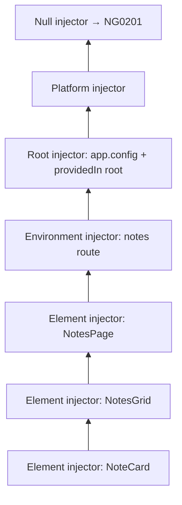

# The Injector Hierarchy

Back to [Module 07](README.md) · Previous: [Providers and tokens](02-providers-and-tokens.md) · Next: [Myspce API layer](04-myspce-api-layer.md)

## 1. Learning objectives

- Name the injector types: platform, root, environment (route), element (component/directive).
- Predict which provider `inject()` resolves and how many instances exist.
- Scope services to routes and components deliberately.
- Diagnose and fix circular dependencies.

## 2. Prerequisites

[Providers and tokens](02-providers-and-tokens.md).

## 3. What is it?

Injectors form two linked trees:

- The **environment injector** tree: platform → root (app config) → one child per lazy route with `providers`.
- The **element injector** tree: one per component/directive that declares `providers`, following the DOM/component tree.

## 4. Why does Angular need it?

Scoping. Myspce wants **one** `AuthStore` for the whole app, **one** `AdminStore` only while `/admin` is loaded, and **one** `EditorState` per open note editor.

## 5. How it works internally — resolution order



`inject(X)` from `NoteCard`:

1. Walk up **element injectors** (NoteCard → NotesGrid → NotesPage) looking for a provider of X.
2. If none, walk the **environment injectors** (the route's injector → root → platform).
3. If still none → `NullInjector` throws `NG0201` (or returns `null` with `{ optional: true }`).

The first provider found wins. Modifiers change the walk:

| Option | Effect |
|---|---|
| `{ self: true }` | only the current element injector |
| `{ skipSelf: true }` | start from the parent |
| `{ host: true }` | stop at the host component's injector |
| `{ optional: true }` | return `null` instead of throwing |

## 6. Syntax and API reference — where to provide

| Where | Syntax | Lifetime | Instances |
|---|---|---|---|
| Root | `@Service()`, `providedIn: 'root'`, or `app.config.ts` `providers` | whole app | 1 |
| Lazy route | `{ path: 'admin', providers: [AdminStore], loadChildren: … }` | while route config is active (created on first use) | 1 per route injector |
| Component | `@Component({ providers: [EditorState] })` | that component instance | 1 per component instance (shared with its children) |
| Component (view only) | `viewProviders: [X]` | same, but **not** visible to projected content | per instance |
| Directive | `@Directive({ providers: [...] })` | that directive instance | per instance |

## 7. Smallest working example

```typescript
@Injectable()
export class Counter { value = signal(0); }

@Component({ selector: 'app-child', template: `{{ c.value() }}` })
class Child { c = inject(Counter); }

@Component({
  selector: 'app-parent',
  providers: [Counter],
  imports: [Child],
  template: `<button (click)="c.value.update(v => v + 1)">+</button> <app-child /> <app-child />`,
})
class Parent { c = inject(Counter); }
```

Two `<app-parent>` elements → two counters. Inside one parent, both children share that parent's counter.

## 8. Step-by-step

1. `Parent` provides `Counter` → element injector for each `Parent` instance.
2. `Child` doesn't provide it → walks up to its `Parent`.
3. A second `Parent` elsewhere has its own injector → separate state.

## 9. Myspce real-world example — scoping decisions

| Service | Scope | Why |
|---|---|---|
| `AuthStore`, `ThemeStore`, `BootstrapStore` | root (`@Service()`) | app-wide, one session |
| `NotesApi`, `TasksApi` | root | stateless HTTP wrappers; one instance is fine |
| `NotesStore` | root **or** notes route | root keeps the list cached when you leave and return (fast back-navigation); route scope frees memory when leaving. Myspce choice: root (single user, small data). |
| `AdminStore` | `admin` route `providers` | only exists for admins, only when admin is loaded |
| `EditorState` | note editor component `providers` | one per editor instance |

```typescript
// app.routes.ts (excerpt)
{
  path: 'admin',
  canMatch: [roleGuard(['admin', 'super_admin'])],
  providers: [AdminStore, provideAdminTheme()],     // environment injector for the admin subtree
  loadChildren: () => import('./admin/admin.routes'),
}
```

With v22's experimental `withExperimentalAutoCleanupInjectors()` router feature, route injectors can be destroyed when you navigate away; by default they live once created.

## 10. Advanced example — circular dependencies

```typescript
@Service() export class AuthStore { private http = inject(HttpClient); /* … */ }

// auth interceptor injects AuthStore, and AuthStore uses HttpClient → HttpClient runs interceptors → interceptor injects AuthStore…
```

This specific loop is fine in practice because the interceptor injects `AuthStore` at **request time**, not construction time. Real circular errors look like:

```typescript
@Service() export class NotesStore { private tasks = inject(TasksStore); }
@Service() export class TasksStore { private notes = inject(NotesStore); }
// NG0200: Circular dependency in DI detected for NotesStore
```

Fixes, best first:

1. **Restructure:** extract what both need into a third service (`LinksStore`), or move the shared logic down.
2. **Communicate via signals:** one store exposes a signal; the other reads it through a shared parent service.
3. **Defer injection:** `private injector = inject(Injector);` then `this.injector.get(TasksStore)` inside a method (a code smell; last resort).

## 11. Visual explanation

```text
Root injector ────────────── AuthStore, ThemeStore, NotesApi, NotesStore
 └─ admin route injector ─── AdminStore
     └─ AdminThemePage (element) ── (inherits AdminStore)
NotesPage (element)
 └─ NoteEditorPage (element) ── EditorState #1
NoteEditorPage (element, 2nd) ── EditorState #2
```

## 12. Common mistakes

| Mistake | Effect | Fix |
|---|---|---|
| Listing a root service in a component's `providers` | a second instance; state not shared | remove it from `providers` |
| Feature service in `app.config.ts` | always in the initial bundle | `@Service()` (tree-shaken) or route providers |
| Expecting a route-scoped service from a component outside that route | `NG0201` | provide at the right level |
| Using `viewProviders` and wondering why projected children can't see it | by design | use `providers` |

## 13. Debugging guide

- Angular DevTools → **Injector tree**: select a component to see which injector resolved each dependency.
- Count instances: add `constructor() { console.count('NotesStore created'); }` temporarily.
- `NG0200` stack lists the chain; break the cycle at the most "domain-wrong" edge.

## 14. Best practices

- Default to root. Scope narrower only for a reason (per-instance state, admin-only, memory).
- Never re-provide root services.
- Keep dependency graphs acyclic; stores depend on APIs, not on each other where avoidable.

## 15. Angular vs React

Element injectors ≈ nested Context providers; environment/route injectors have no React equivalent (closest: a provider placed in a lazy route's layout component). Angular resolves through both trees automatically.

## 16. Testing

```typescript
it('gives each editor its own state', () => {
  const a = TestBed.createComponent(NoteEditorPage);
  const b = TestBed.createComponent(NoteEditorPage);
  const sa = a.debugElement.injector.get(EditorState);
  const sb = b.debugElement.injector.get(EditorState);
  expect(sa).not.toBe(sb);
});
```

## 17. Practice questions

1. How many `EditorState` instances exist with two editors open side by side? With an editor inside a dialog?
2. Move `NotesStore` to the notes route's `providers`. What changes when you leave and return to `/notes`?
3. Create and fix an `NG0200` between two stores.

## 18. Interview questions

- **Beginner — What does `providedIn: 'root'` mean?** One app-wide instance, created lazily, tree-shaken if unused.
- **Intermediate — How does Angular resolve a dependency?** Element injectors up the component tree, then environment injectors up to root and platform, then the null injector.
- **Advanced — `providers` vs `viewProviders`?** `viewProviders` are visible only to the component's own view, not to content projected into it.

## 19. Revision notes

element → environment → root → platform → null · first provider wins · root by default · route `providers` for feature scope · component `providers` per instance · avoid cycles.

## 20. Completion checklist

- [ ] I can draw Myspce's injector tree.
- [ ] I scoped `AdminStore` to the admin route.
- [ ] I fixed a circular dependency by restructuring.
