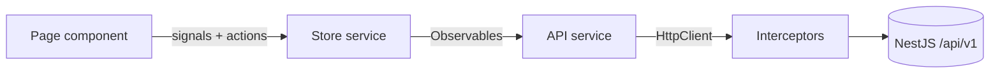

# Designing the Myspce API Layer

Back to [Module 07](README.md) · Previous: [Injector hierarchy](03-injector-hierarchy.md) · Next module: [08 Signals](../08-signals-and-reactivity/README.md)

This note pulls Module 07 together into the actual service architecture Myspce will use. It's a design note: the HTTP details come in [Module 13](../13-http-and-api-integration/README.md) and the stores in [Module 15](../15-state-management/README.md).

## 1. Learning objectives

- Separate API services, stores and components cleanly.
- Write a typed, consistent API service per resource.
- Build a mock backend so you can learn without the NestJS server.
- Test each layer in isolation.

## 2. The three layers



| Layer | Knows | Doesn't know | Returns |
|---|---|---|---|
| **API service** (`notes-api.ts`) | URLs, DTOs, HTTP verbs | UI, state | `Observable<T>` |
| **Store** (`notes-store.ts`) | state, loading/error, optimistic updates, which API to call | DOM | signals + methods |
| **Component** | layout, events | URLs | — |

Why not call HttpClient from components? Because then every component re-implements loading flags, error handling, caching and optimistic updates — and tests need HTTP mocks for every UI test.

## 3. A consistent API service shape

All Myspce resources follow the planned REST conventions (see [project context](../MYSPCE_PROJECT_CONTEXT.md#3-planned-api-from-the-api-list-doc)): list with query params returning `Paginated<T>`, CRUD by ULID, soft delete + restore.

```typescript
// core/http/crud-api.ts
import { inject } from '@angular/core';
import { HttpClient, HttpParams } from '@angular/common/http';
import { Observable } from 'rxjs';
import { API_URL } from './api-url.token';
import { Paginated } from '../models';

/** Shared helpers for REST resources following the Myspce conventions. */
export function createCrudApi<T, Q extends object, C, U = Partial<C>>(resource: string) {
  const http = inject(HttpClient);
  const base = `${inject(API_URL)}/${resource}`;

  return {
    base,
    list: (query?: Q): Observable<Paginated<T>> => http.get<Paginated<T>>(base, { params: toParams(query) }),
    get: (id: string): Observable<T> => http.get<T>(`${base}/${id}`),
    create: (dto: C): Observable<T> => http.post<T>(base, dto),
    update: (id: string, dto: U): Observable<T> => http.patch<T>(`${base}/${id}`, dto),
    remove: (id: string): Observable<void> => http.delete<void>(`${base}/${id}`),
    restore: (id: string): Observable<T> => http.post<T>(`${base}/${id}/restore`, {}),
  };
}

export function toParams(query?: object): HttpParams {
  let params = new HttpParams();
  for (const [k, v] of Object.entries(query ?? {})) {
    if (v === undefined || v === null || v === '') continue;
    params = Array.isArray(v) ? v.reduce((p, item) => p.append(k, String(item)), params) : params.set(k, String(v));
  }
  return params;
}
```

A function using `inject()` instead of a base class keeps each API service small and avoids inheritance:

```typescript
// features/tasks/data-access/tasks-api.ts
import { Service, inject } from '@angular/core';
import { HttpClient } from '@angular/common/http';
import { createCrudApi } from '../../../core/http/crud-api';
import { Task } from '../../../core/models';

export interface TaskQuery { view?: 'today' | 'tomorrow' | 'week' | 'upcoming' | 'completed'; category?: string; goalId?: string; page?: number; limit?: number; }
export interface CreateTaskDto { title: string; notes?: string | null; dueAt?: string | null; priority?: Task['priority']; categoryId?: string | null; goalId?: string | null; }

@Service()
export class TasksApi {
  private http = inject(HttpClient);
  private crud = createCrudApi<Task, TaskQuery, CreateTaskDto>('tasks');

  list = this.crud.list;
  get = this.crud.get;
  create = this.crud.create;
  update = this.crud.update;
  remove = this.crud.remove;
  restore = this.crud.restore;

  toggle(id: string) { return this.http.patch<Task>(`${this.crud.base}/${id}/toggle`, {}); }
  reorder(items: { id: string; sortOrder: number }[]) { return this.http.patch<void>(`${this.crud.base}/reorder`, items); }
}
```

## 4. Credentials: types that encode security

```typescript
// features/credentials/data-access/credentials-api.ts
export interface CreateCredentialDto {
  name: string;
  url: string | null;
  username: string;
  password: string;          // sent once over HTTPS; never stored client-side
  notes?: string | null;
  categoryId: string | null;
}

@Service()
export class CredentialsApi {
  private http = inject(HttpClient);
  private crud = createCrudApi<CredentialSummary, { category?: string; q?: string }, CreateCredentialDto>('credentials');

  list = this.crud.list;                 // returns CredentialSummary — no secrets
  create = this.crud.create;
  update = this.crud.update;
  remove = this.crud.remove;

  /** Requires a recent /auth/reauth; the API audits every call. */
  reveal(id: string) { return this.http.post<{ secret: string }>(`${this.crud.base}/${id}/reveal`, {}); }
}
```

The list type has **no** password field. A developer can't accidentally render a secret from the list because the type doesn't contain one.

## 5. Learning without a backend: a mock interceptor

Until NestJS exists (assumption A6), serve fake data from an interceptor in development only:

```typescript
// core/http/mock-backend.interceptor.ts  (dev only)
import { HttpInterceptorFn, HttpResponse } from '@angular/common/http';
import { of, delay } from 'rxjs';
import { MOCK_NOTES, MOCK_TASKS } from './mock-data';

export const mockBackendInterceptor: HttpInterceptorFn = (req, next) => {
  const url = new URL(req.url, 'http://local');
  const ok = <T>(body: T) => of(new HttpResponse({ status: 200, body })).pipe(delay(300));

  if (req.method === 'GET' && url.pathname === '/api/v1/notes') {
    const category = url.searchParams.get('category');
    const data = category ? MOCK_NOTES.filter(n => n.category?.slug === category) : MOCK_NOTES;
    return ok({ data, meta: { total: data.length, page: 1, limit: 20 } });
  }
  if (req.method === 'GET' && url.pathname === '/api/v1/tasks') {
    return ok({ data: MOCK_TASKS, meta: { total: MOCK_TASKS.length, page: 1, limit: 50 } });
  }
  return next(req);   // everything else goes to the real network (or 404s)
};
```

```typescript
// app.config.ts
provideHttpClient(withInterceptors([
  ...(environment.production ? [] : [mockBackendInterceptor]),
  authInterceptor,
  errorInterceptor,
])),
```

Because components and stores only see `NotesApi`, switching to the real backend later is a one-line config change.

## 6. Test doubles for each layer

```typescript
// testing/fakes.ts
import { signal } from '@angular/core';
import { of } from 'rxjs';

export function fakeNotesApi(overrides: Partial<NotesApi> = {}): Partial<NotesApi> {
  return {
    list: () => of({ data: MOCK_NOTES, meta: { total: MOCK_NOTES.length, page: 1, limit: 20 } }),
    update: (_id, dto) => of({ ...MOCK_NOTES[0]!, ...dto }),
    ...overrides,
  };
}

export function fakeNotesStore() {
  return {
    category: signal('all'),
    query: signal(''),
    visibleNotes: signal(MOCK_NOTES),
    toggleFavorite: vi.fn(),
    create: vi.fn(),
  };
}
```

- API service tests: `HttpTestingController` ([Module 19](../19-testing/03-service-http-tests.md)).
- Store tests: provide `fakeNotesApi()`.
- Page tests: provide `fakeNotesStore()`.

## 7. Common mistakes

| Mistake | Fix |
|---|---|
| Stores calling `HttpClient` directly | go through the API service |
| API services holding state (`notes = signal([])`) | state lives in stores |
| One `ApiService` with 50 methods | one per resource |
| Mock data leaking into production | gate by `environment.production`; keep mocks under `core/http/mock-*` |
| `any` responses | type every method's return |

## 8. Practice

1. Write `CategoriesApi` (`GET /categories?module=`) and `DashboardApi` (`/dashboard/summary`, `/today`, `/week-progress`).
2. Add the mock interceptor with 12 sample notes across 6 categories.
3. Write a test proving `toParams` repeats array params (`tag=a&tag=b`).

## 9. Interview questions

- **Q: Why separate API services from stores?** API services are stateless HTTP mappings; stores own state and orchestration. Each is simpler to test and reason about.
- **Q: How do you develop the frontend before the backend exists?** Agree on the API contract, implement typed API services, and serve mock data via an interceptor or a mock server.

## 10. Completion checklist

- [ ] `createCrudApi`, `NotesApi`, `TasksApi`, `CredentialsApi` written.
- [ ] Mock backend interceptor serves Notes and Tasks in dev.
- [ ] I have fakes for API and store layers.
