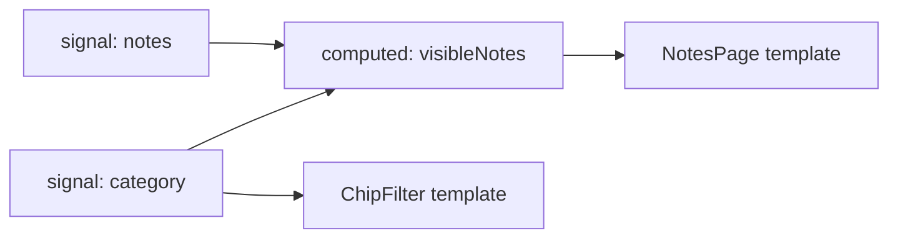

# Signal Basics

Back to [Module 08](README.md) · Next: [`computed()` and `effect()`](02-computed-and-effect.md)

## 1. Learning objectives

- Explain reactive programming and Angular's signal model in plain words.
- Create, read and update signals; update collections immutably.
- Control equality and expose read-only signals.
- Use signals in templates, components and services.

## 2. Prerequisites

[Immutability](../00-prerequisites/01-javascript-for-angular.md), [Services](../07-services-and-dependency-injection/01-services-and-inject.md).

## 3. What is it?

**Simple:** a signal is a box holding a value that tells anyone who looked inside when the value changes.

**Precise:** a signal is a reactive **producer**. Reading it inside a reactive context (a template, `computed`, `effect`) registers that context as a **consumer**. Setting it marks consumers dirty and schedules Angular to refresh affected views.

## 4. Why does Angular need it?

Before signals, Angular used Zone.js to guess when *something* might have changed and then checked component trees. Signals tell Angular **exactly** what changed and who depends on it. That enables zoneless apps (default since v21), OnPush by default (v22), and fine-grained updates.

## 5. How it works internally



- **Push (dirty marking):** `category.set('work')` walks the graph and marks `visibleNotes` and the templates as *maybe dirty*. No computation runs yet.
- **Pull (lazy evaluation):** when Angular refreshes the template, it reads `visibleNotes()`, which recomputes only if a dependency actually changed.

This "push dirty, pull values" design is **glitch-free**: a consumer never sees a half-updated state, and nothing computes that nobody reads.

### Equality

`set(v)` notifies only if `!Object.is(old, v)`. For objects/arrays that means **reference** equality:

```typescript
const notes = signal<Note[]>([]);
const list = notes();
list.push(n);
notes.set(list);              // ❌ same reference → no notification
notes.set([...list, n]);      // ✅ new reference
notes.update(l => [...l, n]); // ✅ preferred
```

## 6. Syntax and API reference

```typescript
import { signal, isSignal, WritableSignal, Signal } from '@angular/core';

const count: WritableSignal<number> = signal(0);
count();                        // read → 0
count.set(5);                   // replace
count.update(c => c + 1);       // derive from previous
const ro: Signal<number> = count.asReadonly();   // read-only view of the same signal
isSignal(count);                // true

// custom equality (e.g. compare by id to avoid notifying for identical content)
const selected = signal<Note | null>(null, { equal: (a, b) => a?.id === b?.id });

// debug name (shows in Angular DevTools' signal graph)
const query = signal('', { debugName: 'notes.query' });
```

| API | Returns | Notes |
|---|---|---|
| `signal(v, { equal?, debugName? })` | `WritableSignal<T>` | |
| `s()` | `T` | registers a dependency when in a reactive context |
| `s.set(v)` | void | |
| `s.update(fn)` | void | `fn(prev) => next` |
| `s.asReadonly()` | `Signal<T>` | can't be written through |

Signals are synchronous: after `count.set(5)`, `count()` returns 5 immediately. The **DOM** updates later, when Angular runs change detection (very soon, in a microtask/animation frame).

## 7. Smallest working example

```typescript
// counter.ts
import { Component, signal } from '@angular/core';

@Component({
  selector: 'app-counter',
  template: `
    <button type="button" (click)="count.update(c => c - 1)">−</button>
    <span aria-live="polite">{{ count() }}</span>
    <button type="button" (click)="count.update(c => c + 1)">+</button>
  `,
})
export class Counter {
  count = signal(0);
}
```

## 8. Step-by-step

1. The template reads `count()`; the template becomes a consumer.
2. A click calls `update`; the signal changes and marks the template dirty.
3. Angular refreshes just this component's view (OnPush + zoneless).

## 9. Myspce real-world example — Notes UI state in a store

```typescript
// features/notes/data-access/notes-store.ts (first version; extended in later notes)
import { Service, computed, signal } from '@angular/core';
import { Note } from '../../../core/models';
import { patch } from '../../../shared/utils/entity';

@Service()
export class NotesStore {
  // private writable state
  private readonly _notes = signal<Note[]>([]);

  // public writable UI state (bound with [(value)])
  readonly category = signal<string>('all');
  readonly query = signal('');

  // public read-only state
  readonly notes = this._notes.asReadonly();
  readonly count = computed(() => this._notes().length);

  setAll(notes: Note[]) { this._notes.set(notes); }

  toggleFavorite(id: string) {
    this._notes.update(list => patch(list, id, { isFavorite: !list.find(n => n.id === id)?.isFavorite }));
  }

  remove(id: string) {
    this._notes.update(list => list.filter(n => n.id !== id));
  }
}
```

Conventions:

- Private `_writable` signals for state only the store may change.
- Public `readonly` signals (`asReadonly()` or `computed`) for everything else.
- Public writable signals only for pure UI choices that components bind two-way (`category`, `query`).

## 10. Advanced example — signals holding Maps and objects

Normalised state (by id) makes updates O(1) and avoids duplicate data:

```typescript
private readonly byId = signal<ReadonlyMap<string, Note>>(new Map());
readonly list = computed(() => [...this.byId().values()].toSorted((a, b) => b.updatedAt.localeCompare(a.updatedAt)));

upsert(note: Note) {
  this.byId.update(m => new Map(m).set(note.id, note));   // new Map → new reference
}
```

## 11. Visual explanation

```text
category.set('work')
   │ push: mark dirty
   ▼
visibleNotes (dirty?) ──► NotesPage view (dirty)
                               │ Angular refresh
                               ▼ pull
                        visibleNotes() recomputes → new array → @for diffs by track id
```

## 12. Common mistakes

| Wrong | Problem | Right |
|---|---|---|
| `{{ count }}` | renders the function | `{{ count() }}` |
| `notes().push(n)` | mutation, no notification | `notes.update(l => [...l, n])` |
| `this.title = this.note().title` in a field | read once, never updates | `title = computed(() => this.note().title)` |
| Exposing `_notes` publicly | anyone can write | `asReadonly()` |
| A signal for every variable | noise | signals for state the UI or others depend on; plain fields for constants |
| Storing derived values in separate signals and syncing them | drift | `computed()` |

## 13. Debugging guide

- Angular DevTools → Components → select a component → signals show with current values; the **signal graph** view shows producers/consumers (v22 also exposes it to Chrome DevTools).
- "Value changed but UI didn't": was it mutated in place? Is the template reading the signal (with `()`)?
- `NG0600: Writing to signals is not allowed in a computed` → move the write to an event handler or effect.

## 14. Best practices

- Immutable updates, always.
- Private writable + public readonly.
- Name signals as nouns (`notes`, `selectedId`), not verbs.
- Add `debugName` for important store signals.

## 15. Angular vs React

`signal()` ≈ `useState`, but: the component doesn't re-run; reading is a function call; updates are synchronous reads; and signals can live **outside** components (in services) with no extra library.

## 16. Testing

Signals are plain values; test them directly:

```typescript
it('toggles favorite immutably', () => {
  const store = TestBed.inject(NotesStore);
  store.setAll([{ id: 'n1', isFavorite: false } as Note]);
  const before = store.notes();
  store.toggleFavorite('n1');
  expect(store.notes()).not.toBe(before);
  expect(store.notes()[0]!.isFavorite).toBe(true);
});
```

## 17. Practice questions

1. Why does `notes.set(notes())` never notify?
2. Add `pin(id)` and `rename(id, title)` to `NotesStore`.
3. Write a signal with custom equality for `{ lat, lng }` that ignores changes smaller than 0.0001.

## 18. Interview questions

- **Beginner — How do you read and write a signal?** Call it to read; `set` or `update` to write.
- **Intermediate — When does a signal notify consumers?** When the new value isn't equal to the old one according to its `equal` function (default `Object.is`).
- **Advanced — What does "glitch-free" mean?** Consumers never observe intermediate states, because dirty-marking is pushed but values are pulled and recomputed in dependency order on read.

## 19. Revision notes

`signal(v)` · read `s()` · `set`/`update` · immutable · `Object.is` equality · `asReadonly()` · `{ equal, debugName }` · push dirty, pull values.

## 20. Completion checklist

- [ ] `NotesStore` v1 with private/public signals.
- [ ] I can explain push/pull with a drawing.
- [ ] I've inspected signals in Angular DevTools.
