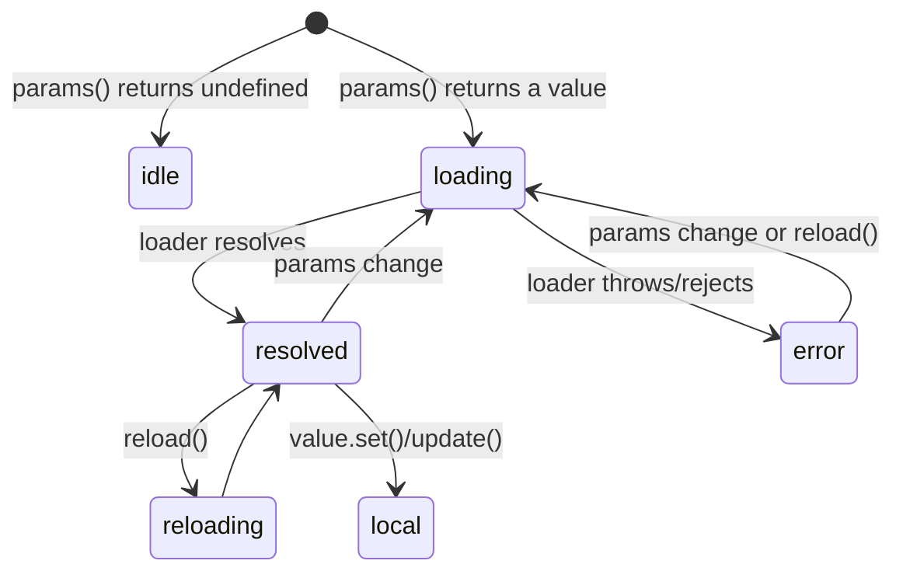
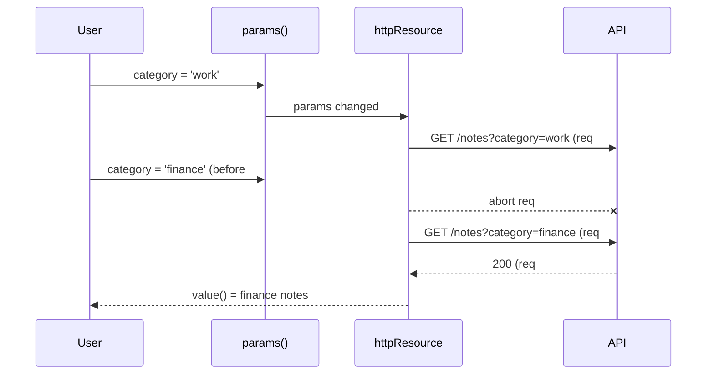

# Resources: `resource()`, `rxResource()`, `httpResource()`

Back to [Module 08](README.md) · Previous: [`linkedSignal()`](03-linked-signal.md) · Next: [Signals vs RxJS and patterns](05-signals-vs-rxjs-and-patterns.md)

> **Version note:** resources were experimental in v19–v21 and are **stable in v22**. v20 renamed `request` → `params` and (for `rxResource`) `loader` → `stream`. v22 added `chain()` for dependent resources and the experimental `debounced()`.

## 1. Learning objectives

- Load async data reactively and get loading/error/value state as signals.
- Choose between `resource`, `rxResource` and `httpResource`.
- Handle reload, local updates, cancellation and idle states.
- Chain dependent resources and debounce inputs.

## 2. Prerequisites

[`computed()`](02-computed-and-effect.md), [Async](../00-prerequisites/04-async-and-error-handling.md), basic Observables (see [Module 14](../14-rxjs/01-observables.md) if new).

## 3. What is it?

A **resource** connects signals to asynchronous work. You give it reactive **params** and a **loader**; it re-runs the loader whenever params change, cancels stale runs, and exposes the result as signals.

## 4. Why does Angular need it?

Fetching in effects causes races and has no loading/error state. Resources give you, out of the box:

- `value()`, `hasValue()`, `error()`, `isLoading()`, `status()`
- automatic re-fetch when params change
- cancellation of stale requests (`abortSignal`)
- `reload()` and local `set()`/`update()` for optimistic UI

## 5. How it works internally



When `params` changes while a load is in flight, the previous run's `abortSignal` is aborted and its result ignored — no "old response overwrites new" race.

## 6. Syntax and API reference

### `resource` — Promise-based, any async source

```typescript
import { resource } from '@angular/core';

user = resource({
  params: () => ({ id: this.userId() }),             // return undefined → status 'idle', loader not called
  loader: async ({ params, abortSignal, previous }) => {
    const res = await fetch(`/api/v1/users/${params.id}`, { signal: abortSignal });
    if (!res.ok) throw new Error(`HTTP ${res.status}`);
    return (await res.json()) as User;
  },
  defaultValue: null,                                 // value() before first load / when idle
});
```

### `rxResource` — Observable-based (use your HttpClient API services)

```typescript
import { rxResource } from '@angular/core/rxjs-interop';

tasks = rxResource({
  params: () => ({ view: this.view() }),
  stream: ({ params }) => this.tasksApi.list(params),   // Observable; unsubscribed when params change
});
```

### `httpResource` — HTTP GET driven by a reactive URL/request (uses HttpClient + interceptors)

```typescript
import { httpResource } from '@angular/common/http';

notes = httpResource<Paginated<Note>>(() => ({
  url: `${this.api}/notes`,
  params: { category: this.category() === 'all' ? '' : this.category(), q: this.query() },
}));

summary = httpResource<DashboardSummary>(() => `${this.api}/dashboard/summary`);
avatar = httpResource.blob(() => this.avatarUrl());   // also .text(), .arrayBuffer()
```

`httpResource` returns an `HttpResourceRef` with extra signals: `headers()`, `statusCode()`, `progress()`. Options: `defaultValue`, `parse` (runtime validation), `equal`, `injector`.

### The ref API (all three)

| Member | Meaning |
|---|---|
| `value()` | current value (`defaultValue`/`undefined` before load). **Throws if `status()` is `'error'`** — check `error()` or `hasValue()` first |
| `hasValue()` | `true` when a value is available (type guard) |
| `error()` | the error, or `undefined` |
| `isLoading()` | `true` for `'loading'` and `'reloading'` |
| `status()` | `'idle' \| 'loading' \| 'reloading' \| 'resolved' \| 'error' \| 'local'` |
| `reload()` | re-run the loader with the same params |
| `set(v)` / `update(fn)` | local override (status `'local'`), e.g. optimistic updates |
| `asReadonly()` | expose without `set`/`reload` |
| `destroy()` | stop it (normally automatic with its injector) |

### When to use which

| Use | When |
|---|---|
| `httpResource` | a GET whose URL/params come from signals — most list and detail screens |
| `rxResource` | you already have an Observable API service, or need RxJS operators (`retry`, `map`) |
| `resource` | non-HTTP async work: IndexedDB, Web Crypto, `fetch` outside Angular, a SDK with Promises |
| none (use HttpClient directly) | **mutations** (POST/PATCH/DELETE) — resources are for reading |

## 7. Smallest working example

```typescript
// features/dashboard/components/overview.ts
import { Component, inject } from '@angular/core';
import { httpResource } from '@angular/common/http';
import { API_URL } from '../../../core/http/api-url.token';

interface DashboardSummary { notes: number; credentials: number; memories: number; tasks: number; files: number; events: number; favorites: number; trash: number; }

@Component({
  selector: 'app-overview',
  template: `
    @if (summary.isLoading() && !summary.hasValue()) {
      <p role="status">Loading…</p>
    } @else if (summary.error()) {
      <p role="alert">Couldn't load. <button type="button" (click)="summary.reload()">Retry</button></p>
    } @else if (summary.hasValue()) {
      <p>{{ summary.value().notes }} notes · {{ summary.value().tasks }} tasks</p>
    }
  `,
})
export class Overview {
  protected summary = httpResource<DashboardSummary>(() => `${inject(API_URL)}/dashboard/summary`);
}
```

Careful: `inject()` inside the URL function runs **outside** an injection context on re-evaluation. Inject once into a field instead:

```typescript
private api = inject(API_URL);
protected summary = httpResource<DashboardSummary>(() => `${this.api}/dashboard/summary`);
```

## 8. Step-by-step

1. The URL function has no signal reads, so the request runs once on creation.
2. `isLoading() && !hasValue()` shows the first-load state; later reloads keep data on screen.
3. `error()` is checked **before** reading `value()` (which would throw in error state).

## 9. Myspce real-world example — Notes list driven by filters

```typescript
// features/notes/pages/notes-page.ts
import { Component, computed, inject, input, linkedSignal } from '@angular/core';
import { httpResource } from '@angular/common/http';
import { Router } from '@angular/router';
import { API_URL } from '../../../core/http/api-url.token';
import { Note, Paginated } from '../../../core/models';

@Component({ selector: 'app-notes-page', templateUrl: './notes-page.html' })
export class NotesPage {
  private api = inject(API_URL);
  private router = inject(Router);

  // URL state (query params bound as inputs via withComponentInputBinding)
  category = input('all');
  q = input('');

  protected page = linkedSignal(() => { this.category(); this.q(); return 1; });

  protected notes = httpResource<Paginated<Note>>(() => ({
    url: `${this.api}/notes`,
    params: {
      page: this.page(),
      limit: 12,
      ...(this.category() !== 'all' ? { category: this.category() } : {}),
      ...(this.q() ? { q: this.q() } : {}),
    },
  }), { defaultValue: { data: [], meta: { total: 0, page: 1, limit: 12 } } });

  protected items = computed(() => (this.notes.hasValue() ? this.notes.value().data : []));
  protected total = computed(() => (this.notes.hasValue() ? this.notes.value().meta.total : 0));

  setCategory(c: string) {
    this.router.navigate([], { queryParams: { category: c === 'all' ? null : c }, queryParamsHandling: 'merge' });
  }
}
```

Flow: chip click → URL changes → `category` input changes → `page` resets to 1 → request params change → previous request cancelled → new request → template updates.

## 10. Advanced example — optimistic toggle, chaining and debouncing

### Optimistic local update

```typescript
async toggleFavorite(id: string) {
  const before = this.notes.value();
  this.notes.update(p => ({ ...p, data: p.data.map(n => (n.id === id ? { ...n, isFavorite: !n.isFavorite } : n)) }));
  try {
    await firstValueFrom(this.notesApi.update(id, { isFavorite: !before.data.find(n => n.id === id)?.isFavorite }));
  } catch {
    this.notes.set(before);          // roll back
    this.toast.error('Could not update favourite');
  }
}
```

(Assumes `UpdateNoteDto` includes `isFavorite`; adapt to the final API — the planned API also has a `POST /favorites` endpoint.)

### Chaining (v22)

```typescript
note = httpResource<Note>(() => (this.id() ? `${this.api}/notes/${this.id()}` : undefined));

related = httpResource<Paginated<Note>>(({ chain }) => {
  const n = chain(this.note);                 // propagates idle/loading/error from `note`
  return n?.category ? { url: `${this.api}/notes`, params: { category: n.category.slug, limit: 4 } } : undefined;
});
```

### Debounced search input (v22, experimental)

```typescript
import { debounced } from '@angular/core';   // experimental in v22 — confirm the export in the API reference

query = signal('');
private settledQuery = debounced(() => this.query(), 300);     // a Resource<string>

results = httpResource<SearchResult[]>(() => {
  const q = this.settledQuery.value().trim();
  return q.length >= 2 ? { url: `${this.api}/search`, params: { q } } : undefined;   // undefined → idle
});
// template: @if (settledQuery.isLoading()) { typing… }
```

Without the experimental API, debounce with RxJS (`toObservable` + `debounceTime` + `toSignal`) — see [Module 14](../14-rxjs/02-operators.md).

## 11. Visual explanation



## 12. Common mistakes

| Mistake | Effect | Fix |
|---|---|---|
| Reading `value()` without checking `error()`/`hasValue()` | throws in error state | guard first |
| `inject()` inside the params/URL function | `NG0203` on re-run | inject into a field |
| Using resources for POST/PATCH | re-sends mutations when signals change | call the API service directly |
| `params` returning a new object with the same content every time | fine (no extra requests unless signals change) — but don't read unrelated signals | read only what defines the request |
| Showing a spinner on every reload | flicker | `isLoading() && !hasValue()` for first load |
| Expecting `httpResource` to work without HttpClient interceptors | it uses HttpClient, so interceptors **do** run | — |

## 13. Debugging guide

| Symptom | Check |
|---|---|
| Request never fires | params function returns `undefined` → status `'idle'` |
| Request fires too often | params read a signal that changes a lot (e.g., a clock) |
| 401 on every resource | auth interceptor registered? ([Module 13](../13-http-and-api-integration/02-interceptors-and-auth.md)) |
| Value stuck after error | `reload()` or change params; status `'error'` persists until then |

## 14. Best practices

- Resources for reads, API services for writes.
- One resource per "thing on screen"; derive with `computed`.
- Use `defaultValue` to simplify templates where an empty default makes sense.
- Use `parse` with a schema library (e.g. Zod) to validate critical responses at runtime.

## 15. Angular vs React

`httpResource` ≈ React Query's `useQuery` with the query key being "whatever signals the URL function reads". `set`/`update` ≈ `queryClient.setQueryData`. There's no global cache by default; for caching across components, put the resource in a store service.

## 16. Testing

```typescript
it('loads notes for the selected category', async () => {
  TestBed.configureTestingModule({
    providers: [provideHttpClient(), provideHttpClientTesting(), provideRouter([]), { provide: API_URL, useValue: '/api/v1' }],
  });
  const fixture = TestBed.createComponent(NotesPage);
  fixture.componentRef.setInput('category', 'work');
  TestBed.tick();
  const http = TestBed.inject(HttpTestingController);
  const req = http.expectOne(r => r.url === '/api/v1/notes' && r.params.get('category') === 'work');
  req.flush({ data: [MOCK_NOTES[0]], meta: { total: 1, page: 1, limit: 12 } });
  await fixture.whenStable();
  expect(fixture.nativeElement.textContent).toContain(MOCK_NOTES[0]!.title);
});
```

## 17. Practice questions

1. Build `TasksPage` with `rxResource` using `TasksApi.list({ view })`.
2. Add `parse` to the dashboard summary that throws if any count is negative.
3. Build a `noteDetail` resource that's idle when `id()` is `null`.

## 18. Interview questions

- **Beginner — What does a resource give you?** Async data as signals: value, loading, error, status, plus reload and local updates.
- **Intermediate — How do resources avoid race conditions?** When params change, the in-flight load is aborted/unsubscribed and its result discarded.
- **Advanced — Why not use `httpResource` for a POST?** Resources re-run whenever their reactive params change; mutations must run exactly once on user intent.

## 19. Revision notes

`resource({ params, loader })` · `rxResource({ params, stream })` · `httpResource(() => url | req)` · `value/hasValue/error/isLoading/status/reload/set` · `undefined` params → idle · `chain()` · `debounced()` (experimental) · reads only.

## 20. Completion checklist

- [ ] Dashboard summary and Notes list use `httpResource`.
- [ ] Tasks use `rxResource`.
- [ ] Optimistic favourite toggle with rollback works.
