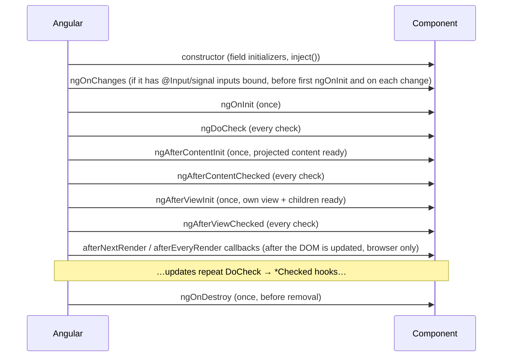

# Lifecycle Hooks

Back to [Module 09](README.md) · Next: [Change detection](02-change-detection.md)

## 1. Learning objectives

- Know every lifecycle hook, its order and its purpose.
- Use `afterNextRender` / `afterEveryRender` for DOM work.
- Decide which hooks are still needed in a signals-first app.

## 2. Prerequisites

[Components](../02-components-and-templates/01-components.md), [Signals](../08-signals-and-reactivity/README.md).

## 3. What is it?

Methods Angular calls at specific moments in a component's or directive's life: creation, input changes, after content/view rendering, and destruction. You opt in by implementing the method (and, by convention, the matching interface like `OnInit`).

## 4. Why does Angular need it?

Some work must happen at a specific time: read inputs once they're set, measure the DOM after it renders, initialise a chart library on a real element, clean up before removal.

## 5. How it works — order



## 6. Syntax and API reference

| Hook | Runs | Typical use | With signals… |
|---|---|---|---|
| `constructor` | instance created | `inject()`, create effects/resources | still the place for setup |
| `ngOnChanges(changes)` | before `ngOnInit` and when inputs change | legacy input reactions | usually replaced by `computed`/`linkedSignal` |
| `ngOnInit` | once, after first inputs are set | one-time init that needs inputs | fine; often unnecessary |
| `ngDoCheck` | every change-detection check | custom change detection | avoid |
| `ngAfterContentInit` | once, after `<ng-content>` children exist | read `contentChild` (legacy decorators) | signal queries make it rarely needed |
| `ngAfterContentChecked` | after every content check | — | avoid |
| `ngAfterViewInit` | once, after own view rendered | read `viewChild` (legacy) | prefer `afterNextRender` |
| `ngAfterViewChecked` | after every view check | — | avoid |
| `ngOnDestroy` | once, before removal | cleanup | `DestroyRef.onDestroy` is an alternative |
| `afterNextRender(cb)` | once, after the next render | DOM measurement, third-party init | ✅ modern |
| `afterEveryRender(cb)` | after every render | sync DOM-dependent state (rare) | ✅ modern (renamed from `afterRender` in v20) |

`afterNextRender`/`afterEveryRender` accept **phases** to batch DOM reads and writes and avoid layout thrashing:

```typescript
afterNextRender({
  earlyRead: () => this.host.nativeElement.getBoundingClientRect().width,   // read layout
  write: width => this.chart?.resize(width),                                 // write DOM
});
```

Phases: `earlyRead` → `write` → `mixedReadWrite` → `read`. Each receives the previous phase's return value. They **never run on the server** (SSR-safe).

## 7. Smallest working example

```typescript
// lifecycle-demo.ts
import { AfterViewInit, Component, OnDestroy, OnInit, afterNextRender, input } from '@angular/core';

@Component({ selector: 'app-lifecycle-demo', template: `<p>{{ name() }}</p>` })
export class LifecycleDemo implements OnInit, AfterViewInit, OnDestroy {
  name = input('demo');
  constructor() {
    console.log('constructor — inputs not set yet');
    afterNextRender(() => console.log('afterNextRender — DOM is painted'));
  }
  ngOnInit() { console.log('ngOnInit — name =', this.name()); }
  ngAfterViewInit() { console.log('ngAfterViewInit — view created'); }
  ngOnDestroy() { console.log('ngOnDestroy — clean up'); }
}
```

## 8. Step-by-step

1. Constructor runs first; reading a **required** input here would throw `NG0950`.
2. `ngOnInit` sees inputs.
3. `ngAfterViewInit` runs once the view exists; `afterNextRender` runs after the browser DOM is updated.
4. `ngOnDestroy` runs when an `@if` hides it or the route changes.

## 9. Myspce real-world example — Memories map (Leaflet)

```typescript
// features/memories/components/memory-map.ts (v1.1)
import { Component, DestroyRef, ElementRef, afterNextRender, effect, inject, input, viewChild } from '@angular/core';
import type { Map as LeafletMap, LayerGroup } from 'leaflet';

export interface MemoryPin { id: string; title: string; lat: number; lng: number; }

@Component({
  selector: 'app-memory-map',
  template: `<div #mapEl class="h-96 w-full rounded-xl" role="application" aria-label="Memories map"></div>`,
})
export class MemoryMap {
  pins = input.required<MemoryPin[]>();
  private mapEl = viewChild.required<ElementRef<HTMLDivElement>>('mapEl');
  private map: LeafletMap | null = null;
  private layer: LayerGroup | null = null;

  constructor() {
    afterNextRender(async () => {
      const L = await import('leaflet');                         // lazy-load the library
      this.map = L.map(this.mapEl().nativeElement).setView([22.5, 79], 5);   // India
      L.tileLayer('https://tile.openstreetmap.org/{z}/{x}/{y}.png', { attribution: '© OpenStreetMap' }).addTo(this.map);
      this.layer = L.layerGroup().addTo(this.map);
      this.renderPins(L);
    });

    effect(() => {
      this.pins();                       // re-render pins when input changes (after map exists)
      if (this.map) import('leaflet').then(L => this.renderPins(L));
    });

    inject(DestroyRef).onDestroy(() => this.map?.remove());
  }

  private renderPins(L: typeof import('leaflet')) {
    this.layer?.clearLayers();
    for (const p of this.pins()) L.marker([p.lat, p.lng]).bindPopup(p.title).addTo(this.layer!);
  }
}
```

Why each tool:

- `afterNextRender` — Leaflet needs a real, laid-out element, and must not run during SSR.
- `effect` — sync the input (signal) to an imperative library.
- `DestroyRef.onDestroy` — release the map's listeners and DOM.

## 10. Advanced example — content hooks vs signal queries

```typescript
// Legacy
@ContentChildren(TabPanel) panels!: QueryList<TabPanel>;
ngAfterContentInit() { this.select(this.panels.first); }

// Modern
panels = contentChildren(TabPanel);
active = linkedSignal(() => this.panels()[0] ?? null);
```

Signal queries update automatically; no hook needed ([Module 16](../16-advanced-components/02-queries.md)).

## 11. Visual explanation

```text
create:  constructor → (inputs set) → ngOnChanges → ngOnInit → content hooks → view hooks → afterNextRender
update:  input changes → ngOnChanges → ngDoCheck → content checked → view checked → afterEveryRender
destroy: ngOnDestroy / DestroyRef callbacks
```

## 12. Common mistakes

| Mistake | Fix |
|---|---|
| Reading a required input in the constructor | read in template/`computed`/`ngOnInit` |
| DOM measurement in `ngOnInit` | `afterNextRender` |
| Heavy work in `ngDoCheck` / `ngAfter*Checked` | runs every check — avoid entirely |
| Changing bound state in `ngAfterViewInit` | `NG0100 ExpressionChangedAfterItHasBeenChecked`; use signals or `afterNextRender` |
| Forgetting `implements OnInit` | works, but no type check on the method name |

## 13. Debugging guide

- Put `console.count('NotesPage check')` in a template binding temporarily to see how often a view is checked.
- `NG0100` is dev-only; it means a value changed **during** the check. Find what writes state in a hook or getter.

## 14. Best practices

- Constructor for setup (inject, effects, resources, `afterNextRender`).
- `ngOnInit` only if you really need "once, with inputs" imperative code.
- `afterNextRender` for DOM and third-party libraries.
- `DestroyRef` or `ngOnDestroy` for cleanup.

## 15. Angular vs React

| React | Angular |
|---|---|
| `useEffect(() => {...}, [])` mount | `afterNextRender` (DOM) or constructor/`ngOnInit` (logic) |
| `useLayoutEffect` | `afterNextRender({ earlyRead, write })` |
| cleanup function | `DestroyRef.onDestroy` / `ngOnDestroy` / effect `onCleanup` |
| re-run on prop change | `computed` / `effect` / `ngOnChanges` |

## 16. Testing

```typescript
it('destroys the map when the component is destroyed', async () => {
  const fixture = TestBed.createComponent(MemoryMap);
  fixture.componentRef.setInput('pins', []);
  await fixture.whenStable();
  const remove = vi.fn();
  (fixture.componentInstance as any).map = { remove };
  fixture.destroy();
  expect(remove).toHaveBeenCalled();
});
```

## 17. Practice questions

1. Where would you initialise a rich-text editor (Tiptap) for notes, and where would you destroy it?
2. Rewrite an `ngOnChanges` that recalculates a label into `computed`.
3. Why do `afterNextRender` callbacks not run during SSR?

## 18. Interview questions

- **Beginner — Constructor vs `ngOnInit`?** Constructor runs before inputs are set; `ngOnInit` runs once after the first inputs are available.
- **Intermediate — What replaced `afterRender`?** `afterEveryRender` (v20), alongside `afterNextRender`.
- **Advanced — Why use render phases?** To group DOM reads and writes and avoid forced synchronous layouts across components.

## 19. Revision notes

constructor → ngOnChanges → ngOnInit → content → view → afterNextRender · `*Checked` and `ngDoCheck` every check (avoid) · `ngOnDestroy`/`DestroyRef` cleanup · phases: earlyRead/write/mixedReadWrite/read.

## 20. Completion checklist

- [ ] I can recite the hook order.
- [ ] I initialised a third-party library with `afterNextRender` and cleaned it up.
- [ ] I replaced an `ngOnChanges` with `computed`.
