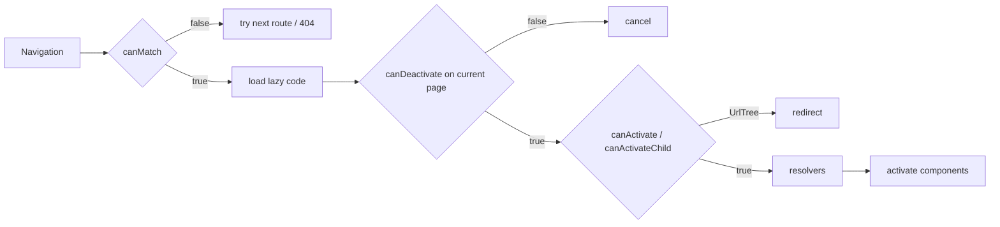

# Guards and Resolvers

Back to [Module 10](README.md) · Previous: [Nested layouts and lazy loading](03-nested-layouts-and-lazy-loading.md) · Next module: [11 Template-driven forms](../11-template-driven-forms/README.md)

## 1. Learning objectives

- Write functional `canActivate`, `canActivateChild`, `canMatch` and `canDeactivate` guards.
- Return booleans, `UrlTree`s or `RedirectCommand`s correctly.
- Handle async auth state (session restore on refresh).
- Write resolvers and title resolvers, and know when not to use them.
- Test guards and resolvers.

## 2. Prerequisites

[Router basics](01-router-basics.md), [Services](../07-services-and-dependency-injection/01-services-and-inject.md).

## 3. What is it?

- **Guards** are functions the router calls to decide whether a navigation may proceed.
- **Resolvers** are functions that fetch data before a route activates and pass it to the component.

> **Guards are UX, not security.** A user can edit JavaScript or call the API directly. Myspce's NestJS backend must verify the JWT and role on every request; frontend guards only avoid showing pages that would fail anyway.

## 4. Why does Angular need it?

To redirect logged-out users to login, hide admin pages from non-admins, warn before leaving an unsaved note, and gate v1.1 modules behind admin feature flags.

## 5. How it works internally



Guards run in an **injection context**, so `inject()` works inside them. Each can return `boolean | UrlTree | RedirectCommand`, or an `Observable`/`Promise` of those.

## 6. Syntax and API reference

```typescript
import { CanActivateFn, CanActivateChildFn, CanMatchFn, CanDeactivateFn, ResolveFn, RedirectCommand, Router } from '@angular/router';

export const authGuard: CanActivateFn = (route, state) => …;
export const childGuard: CanActivateChildFn = (childRoute, state) => …;
export const flagGuard: CanMatchFn = (route, segments, currentSnapshot) => …;   // v22: 3rd arg (migration adds it)
export const leaveGuard: CanDeactivateFn<HasUnsavedChanges> = (component, currentRoute, currentState, nextState) => …;
export const noteResolver: ResolveFn<Note> = (route, state) => …;
```

| Guard | When | Myspce use |
|---|---|---|
| `canActivate` | before activating a route | logged in? |
| `canActivateChild` | before any child activates | protect all shell children |
| `canMatch` | while matching — if false, router tries the next route and **doesn't load lazy code** | admin role, feature flags |
| `canDeactivate` | before leaving | unsaved note / credential form |

Return values:

| Return | Effect |
|---|---|
| `true` | continue |
| `false` | cancel navigation (stay put) |
| `UrlTree` (`router.createUrlTree(...)` / `parseUrl`) | redirect |
| `new RedirectCommand(urlTree, { replaceUrl: true })` | redirect with navigation options |

## 7. Smallest working example

```typescript
// core/auth/auth-guard.ts
import { inject } from '@angular/core';
import { CanActivateFn, Router } from '@angular/router';
import { AuthStore } from './auth-store';

export const authGuard: CanActivateFn = (_route, state) => {
  const auth = inject(AuthStore);
  return auth.isLoggedIn() || inject(Router).createUrlTree(['/login'], { queryParams: { returnUrl: state.url } });
};

export const guestGuard: CanActivateFn = () =>
  !inject(AuthStore).isLoggedIn() || inject(Router).createUrlTree(['/dashboard']);
```

## 8. Step-by-step

1. `authGuard` reads the signal `isLoggedIn()` synchronously.
2. If false, it returns a `UrlTree` → the router redirects to `/login?returnUrl=/notes`.
3. `guestGuard` keeps logged-in users away from the login page.

## 9. Myspce real-world example — session restore, roles, flags, unsaved changes

### Waiting for session restore

On refresh, the access token (kept in memory) is gone; the app calls `POST /auth/refresh` (cookie) to restore the session. Guards must wait for that:

```typescript
// core/auth/auth-store.ts (excerpt)
@Service()
export class AuthStore {
  readonly user = signal<User | null>(null);
  readonly status = signal<'unknown' | 'authenticated' | 'anonymous'>('unknown');
  readonly isLoggedIn = computed(() => this.status() === 'authenticated');
  private restoring: Promise<void> | null = null;

  /** Resolves once we know whether a session exists. */
  ensureSession(): Promise<void> {
    if (this.status() !== 'unknown') return Promise.resolve();
    return (this.restoring ??= this.restore());
  }
  private async restore() { /* call /auth/refresh, set user/status; see Module 13 */ }
}
```

```typescript
// core/auth/auth-guard.ts (final)
export const authGuard: CanActivateFn = async (_route, state) => {
  const auth = inject(AuthStore);
  const router = inject(Router);
  await auth.ensureSession();
  return auth.isLoggedIn() ? true : router.createUrlTree(['/login'], { queryParams: { returnUrl: state.url } });
};
```

### Roles (with `canMatch`)

```typescript
// core/auth/role-guard.ts
import type { User } from '../models';

export const roleGuard = (roles: User['role'][]): CanMatchFn => async () => {
  const auth = inject(AuthStore);
  await auth.ensureSession();
  const role = auth.user()?.role;
  return (role !== undefined && roles.includes(role)) || inject(Router).createUrlTree(['/dashboard']);
};
```

### Feature flags (admin turns modules on/off)

```typescript
// core/feature-flags/feature-guard.ts
export const featureGuard = (flag: string): CanMatchFn => () =>
  inject(BootstrapStore).data()?.flags[flag] === true;   // false → route not matched → falls through to **
```

### Unsaved changes

```typescript
// core/routing/unsaved-changes-guard.ts
export interface HasUnsavedChanges { hasUnsavedChanges(): boolean; }

export const unsavedChangesGuard: CanDeactivateFn<HasUnsavedChanges> = component =>
  !component.hasUnsavedChanges() || inject(ConfirmService).ask({
    title: 'Discard changes?',
    message: 'You have unsaved changes to this note.',
    confirmLabel: 'Discard',
    tone: 'danger',
  });   // Promise<boolean>
```

```typescript
// features/notes/pages/note-editor-page.ts
export default class NoteEditorPage implements HasUnsavedChanges {
  protected dirty = computed(() => /* draft !== saved */ false);
  hasUnsavedChanges() { return this.dirty(); }
}
```

Also warn on tab close/refresh (the router can't catch that):

```typescript
host: { '(window:beforeunload)': 'onBeforeUnload($event)' }
onBeforeUnload(e: BeforeUnloadEvent) { if (this.dirty()) e.preventDefault(); }
```

## 10. Advanced example — resolvers (and when not to use them)

```typescript
// features/notes/data-access/note-resolver.ts
import { inject } from '@angular/core';
import { ResolveFn, Router, RedirectCommand } from '@angular/router';
import { catchError, map, of } from 'rxjs';
import { NotesApi } from './notes-api';
import { Note } from '../../../core/models';

export const noteResolver: ResolveFn<Note> = route => {
  const router = inject(Router);
  return inject(NotesApi).get(route.paramMap.get('id')!).pipe(
    catchError(() => of(new RedirectCommand(router.parseUrl('/notes'), { replaceUrl: true }))),
  );
};

export const noteTitleResolver: ResolveFn<string> = route =>
  inject(NotesApi).get(route.paramMap.get('id')!).pipe(map(n => n.title), catchError(() => of('Note')));
```

The component receives `note = input.required<Note>()` (via input binding).

**Trade-off:** a resolver **blocks** navigation until the data arrives. The user clicks and nothing happens for 300 ms. For Myspce, prefer loading inside the page with `httpResource` and a skeleton — the page appears instantly. Use resolvers when:

- the page is meaningless without the data and a redirect on 404 is cleaner (as above), or
- you need the data for the route title/breadcrumbs.

(The duplicate request between `noteResolver` and `noteTitleResolver` should be avoided with a small cache in `NotesApi` or by setting the title from the page instead.)

## 11. Visual explanation

```text
/admin by a 'user'          /notes by logged-out user        leave /notes/01J with edits
canMatch roleGuard → UrlTree   canActivate authGuard → UrlTree   canDeactivate → confirm dialog
→ /dashboard                   → /login?returnUrl=/notes         → stay or leave
(admin chunk never loaded)
```

## 12. Common mistakes

| Mistake | Fix |
|---|---|
| Guard reads auth before the session is restored → logged-in users bounced to login on refresh | await `ensureSession()` |
| `canActivate` for role checks on lazy features | `canMatch` so code isn't downloaded |
| Returning `router.navigate(...)` from a guard | return a `UrlTree`/`RedirectCommand`, don't navigate inside guards |
| Treating guards as security | enforce on the server |
| Resolvers for everything | slower perceived navigation; load in the page |
| `window.confirm` in `canDeactivate` | works, but blocks and can't be styled; use a dialog service |

## 13. Debugging guide

- Navigation silently cancelled → a guard returned `false`; add `withDebugTracing()` to see `GuardsCheckEnd` with `shouldActivate: false`.
- Infinite redirect loop → guard redirects to a route protected by the same guard (e.g. `/login` behind `authGuard`).
- `NG04002` after a `canMatch` fails → no fallback route; that's expected; ensure `**` exists.

## 14. Best practices

- Functional guards with `inject()`.
- Factory functions for parameterised guards (`roleGuard([...])`, `featureGuard('x')`).
- One source of truth for auth state (`AuthStore`), awaited in guards.
- Pages own their loading; resolvers only when blocking is desired.

## 15. Angular vs React

Guards ≈ React Router `loader`s that `redirect()`, or wrapper components like `<RequireAuth>`. `canDeactivate` ≈ `useBlocker`.

## 16. Testing

```typescript
// core/auth/auth-guard.spec.ts
import { TestBed } from '@angular/core/testing';
import { Router, UrlTree, provideRouter, ActivatedRouteSnapshot, RouterStateSnapshot } from '@angular/router';

describe('authGuard', () => {
  function run(loggedIn: boolean) {
    TestBed.configureTestingModule({
      providers: [
        provideRouter([]),
        { provide: AuthStore, useValue: { ensureSession: () => Promise.resolve(), isLoggedIn: () => loggedIn } },
      ],
    });
    return TestBed.runInInjectionContext(() =>
      authGuard({} as ActivatedRouteSnapshot, { url: '/notes' } as RouterStateSnapshot),
    ) as Promise<boolean | UrlTree>;
  }

  it('allows logged-in users', async () => expect(await run(true)).toBe(true));

  it('redirects others to login with returnUrl', async () => {
    const result = await run(false);
    expect(TestBed.inject(Router).serializeUrl(result as UrlTree)).toBe('/login?returnUrl=%2Fnotes');
  });
});
```

## 17. Practice questions

1. Write `canActivateChild` for the shell so every child is protected with one line.
2. Add `canDeactivate` to the credential form.
3. Replace a resolver with in-page loading and compare the perceived speed.

## 18. Interview questions

- **Beginner — What does a guard return?** `true`, `false`, a `UrlTree`/`RedirectCommand`, or an async version of those.
- **Intermediate — `canActivate` vs `canMatch`?** `canMatch` runs during matching; if it fails, the router tries other routes and won't load the lazy code. `canActivate` runs after matching.
- **Advanced — Why don't guards provide security?** They run in the user's browser and can be bypassed; only server-side checks protect data.

## 19. Revision notes

Functional guards with `inject()` · `UrlTree`/`RedirectCommand` to redirect · `canMatch` for roles/flags · `canDeactivate` for unsaved changes · await session restore · resolvers block — use sparingly · v22 `CanMatchFn` has a 3rd arg.

## 20. Completion checklist

- [ ] `authGuard`, `guestGuard`, `roleGuard`, `featureGuard`, `unsavedChangesGuard` written and tested.
- [ ] Refreshing a protected page keeps me logged in.
- [ ] I can explain why the backend must check roles too.
