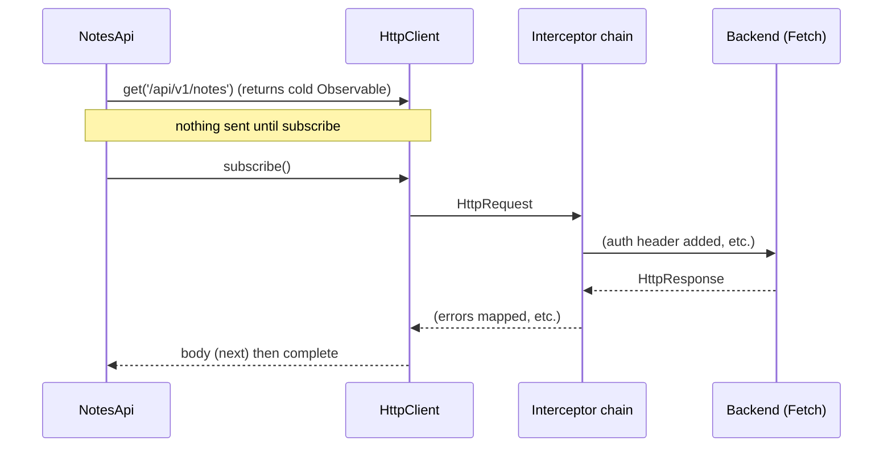

# HttpClient Basics

Back to [Module 13](README.md) · Next: [Interceptors and auth](02-interceptors-and-auth.md)

## 1. Learning objectives

- Configure `HttpClient` for Myspce.
- Make typed requests with every verb, params, headers and options.
- Structure API services consistently.
- Validate critical responses at runtime.

## 2. Prerequisites

[Services](../07-services-and-dependency-injection/01-services-and-inject.md), [Observables](../14-rxjs/01-observables.md) (skim first if new).

## 3. What is it?

`HttpClient` (`@angular/common/http`) is Angular's HTTP API. It returns **Observables**, supports interceptors, typed responses, JSON by default, and testing utilities. In v22 it runs on the browser's `fetch` by default.

## 4. Why does Angular need it?

Compared with raw `fetch`: interceptors (auth, errors, logging), typed responses, automatic JSON, cancellation by unsubscribing, XSRF support, transfer cache for SSR, and first-class testing.

## 5. How it works internally



Key facts:

- **Cold:** each `subscribe()` sends a new request. Two `async` pipes on the same Observable = two requests.
- **Completes** after one response — so a forgotten unsubscribe is usually harmless, but unsubscribing **cancels** an in-flight request.
- Errors (non-2xx, network failure) arrive as `HttpErrorResponse` on the error channel.
- Requests are **immutable** `HttpRequest` objects; interceptors `clone()` them.

## 6. Syntax and API reference

```typescript
// app.config.ts
provideHttpClient(
  withInterceptors([authInterceptor, errorInterceptor]),
  withXsrfConfiguration({ cookieName: 'XSRF-TOKEN', headerName: 'X-XSRF-TOKEN' }),  // only if the backend uses XSRF cookies
  // withXhr(),   // only if you need upload progress through HttpClient (v22)
)
```

```typescript
const http = inject(HttpClient);

http.get<Note[]>(url);                                         // body as JSON, typed
http.get<Note[]>(url, { params: { category: 'work', page: 2 } });
http.get(url, { params: new HttpParams().set('q', 'aws').append('tag', 'a').append('tag', 'b') });
http.get<Note>(url, { headers: { 'X-Request-Source': 'notes-page' } });
http.get(url, { observe: 'response' });                       // full HttpResponse (status, headers)
http.get(url, { responseType: 'blob' });                      // file download ('text', 'arraybuffer')
http.post<Note>(url, body);
http.put<Note>(url, body);
http.patch<Note>(url, partial);
http.delete<void>(url);
http.request('GET', url, { context: new HttpContext().set(SKIP_AUTH, true) });   // per-request metadata
http.get(url, { timeout: 10_000 });                            // v20+: request timeout option
http.get(url, { credentials: 'include' });                     // fetch credentials mode (v20+); or withCredentials: true
```

| Option | Use |
|---|---|
| `params` | query string (values become strings) |
| `headers` | extra headers |
| `observe: 'response' \| 'events'` | full response / progress events |
| `responseType` | `'json'` (default), `'text'`, `'blob'`, `'arraybuffer'` |
| `withCredentials` | send cookies cross-origin (same-origin sends them anyway) |
| `context` | metadata for interceptors (`HttpContextToken`) |
| `timeout` | abort after N ms |
| `reportUploadProgress` / `reportDownloadProgress` | progress events (v22; upload requires `withXhr()`) |

## 7. Smallest working example

```typescript
// features/dashboard/data-access/dashboard-api.ts
import { Service, inject } from '@angular/core';
import { HttpClient } from '@angular/common/http';
import { API_URL } from '../../../core/http/api-url.token';
import { Task } from '../../../core/models';

export interface DashboardSummary { notes: number; credentials: number; memories: number; tasks: number; files: number; events: number; favorites: number; trash: number; }
export interface WeekProgress { done: number; total: number; }

@Service()
export class DashboardApi {
  private http = inject(HttpClient);
  private base = `${inject(API_URL)}/dashboard`;

  summary() { return this.http.get<DashboardSummary>(`${this.base}/summary`); }
  today() { return this.http.get<{ tasks: Task[]; events: unknown[] }>(`${this.base}/today`); }
  weekProgress() { return this.http.get<WeekProgress>(`${this.base}/week-progress`); }
}
```

## 8. Step-by-step

1. Inject `HttpClient` and the `API_URL` token once.
2. Each method returns a typed, cold Observable; nothing is sent until someone subscribes (or a resource/`toSignal` does).
3. Consumers decide how to use it: `rxResource`, `firstValueFrom`, or a store.

## 9. Myspce real-world example — using API services in pages and stores

```typescript
// Read: let a resource subscribe for you
protected summary = rxResource({ stream: () => inject(DashboardApi).summary() });   // ❌ inject() inside stream!

// ✅ inject once, use in the stream
private dashboard = inject(DashboardApi);
protected summary = rxResource({ stream: () => this.dashboard.summary() });
```

```typescript
// Write: call on user intent; Promise style with firstValueFrom is often clearest
async saveNote(dto: CreateNoteDto) {
  this.saving.set(true);
  try {
    const note = await firstValueFrom(this.notesApi.create(dto));
    this.toast.success('Note saved');
    await this.router.navigate(['/notes', note.id]);
  } finally {
    this.saving.set(false);
  }
}
```

`firstValueFrom` subscribes, resolves with the body, and rejects with the `HttpErrorResponse`.

### Same origin in development and production

| Env | Browser calls | Reaches |
|---|---|---|
| Dev | `http://localhost:4200/api/v1/...` | NestJS on `:3000` via `proxy.conf.json` |
| Prod | `https://myspace.example/api/v1/...` | NestJS behind nginx/ALB on the same domain |

Same origin means: no CORS configuration, and the httpOnly refresh cookie just works.

## 10. Advanced example — runtime validation of responses

TypeScript types don't validate JSON. For critical data (the bootstrap payload that drives the whole UI), validate:

```typescript
// core/bootstrap/bootstrap.schema.ts
import { z } from 'zod';

export const BootstrapSchema = z.object({
  user: z.object({ id: z.string(), name: z.string(), email: z.string().email(), role: z.enum(['super_admin', 'admin', 'user']), avatarUrl: z.string().nullable(), bio: z.string().nullable() }).nullable(),
  theme: z.record(z.string(), z.string()),
  nav: z.array(z.object({ label: z.string(), route: z.string().startsWith('/'), icon: z.string(), visible: z.boolean() })),
  flags: z.record(z.string(), z.boolean()),
});
export type BootstrapData = z.infer<typeof BootstrapSchema>;
```

```typescript
// with httpResource's parse option
bootstrap = httpResource(() => `${this.api}/bootstrap`, { parse: v => BootstrapSchema.parse(v) });

// or in an Observable pipeline
this.http.get(`${this.api}/bootstrap`).pipe(map(v => BootstrapSchema.parse(v)));
```

A schema failure becomes an error you can see, instead of a mysterious `undefined` deep in a template. (Zod is a third-party library: `npm i zod`.)

## 11. Visual explanation

```text
API service method ─► cold Observable ─┬─► rxResource / httpResource (reads)
                                       ├─► firstValueFrom (writes on intent)
                                       └─► store pipelines (RxJS)
```

## 12. Common mistakes

| Mistake | Fix |
|---|---|
| Subscribing twice to one request Observable → duplicate requests | subscribe once; share with `shareReplay` only when needed |
| Building URLs with string concatenation of user input | use `params`/`HttpParams` (encoding handled) |
| Typing responses as `any` | interfaces for every response |
| Calling HttpClient in components | API services |
| Hard-coded `http://localhost:3000` | `API_URL` + proxy |
| Expecting `http.get()` to run without subscribing | it's lazy |

## 13. Debugging guide

- Network tab: is the request sent? Status? Response body? Request headers (`Authorization`)?
- No request at all → nobody subscribed (or a resource's params returned `undefined`).
- `status: 0` → network error, CORS block, or the dev proxy isn't running.
- `Http failure during parsing` → server returned HTML (often an nginx 404/502 page) where JSON was expected.

## 14. Best practices

- One API service per resource, typed DTOs, returns Observables.
- Reads via resources; writes via `firstValueFrom` in stores/pages.
- Same-origin `/api/v1` everywhere.
- Validate critical payloads at runtime.

## 15. Angular vs React

`HttpClient` ≈ axios with interceptors, but returns Observables and integrates with DI and testing. React apps usually wrap `fetch`/axios in React Query; Angular's equivalent is resources + stores.

## 16. Testing

```typescript
it('requests the dashboard summary', () => {
  TestBed.configureTestingModule({ providers: [provideHttpClient(), provideHttpClientTesting(), { provide: API_URL, useValue: '/api/v1' }] });
  const api = TestBed.inject(DashboardApi);
  const http = TestBed.inject(HttpTestingController);
  let result: DashboardSummary | undefined;
  api.summary().subscribe(r => (result = r));
  http.expectOne({ method: 'GET', url: '/api/v1/dashboard/summary' }).flush({ notes: 124, credentials: 28, memories: 48, tasks: 12, files: 68, events: 6, favorites: 23, trash: 4 });
  expect(result?.notes).toBe(124);
  http.verify();
});
```

## 17. Practice questions

1. Write `CategoriesApi.list(module)` and use it with `httpResource`.
2. Download a file as a Blob and trigger a browser download with an object URL.
3. Why does the same Observable used by two `async` pipes send two requests?

## 18. Interview questions

- **Q: Are HttpClient Observables hot or cold?** Cold — each subscription sends a request.
- **Q: How do you cancel an HTTP request?** Unsubscribe (or let `switchMap`/resources do it); with Fetch this aborts the request.
- **Q: What changed in v22?** HttpClient uses Fetch by default; `withXhr()` for XHR; upload progress requires XHR.

## 19. Revision notes

`provideHttpClient(withInterceptors([...]))` · typed `get<T>` · `params`, `headers`, `observe`, `responseType`, `context`, `timeout` · cold Observables · `firstValueFrom` for writes · resources for reads · runtime validation for critical data.

## 20. Completion checklist

- [ ] `DashboardApi`, `NotesApi`, `TasksApi`, `CredentialsApi` typed.
- [ ] Dev proxy + same-origin API URL.
- [ ] Bootstrap response validated with a schema.
