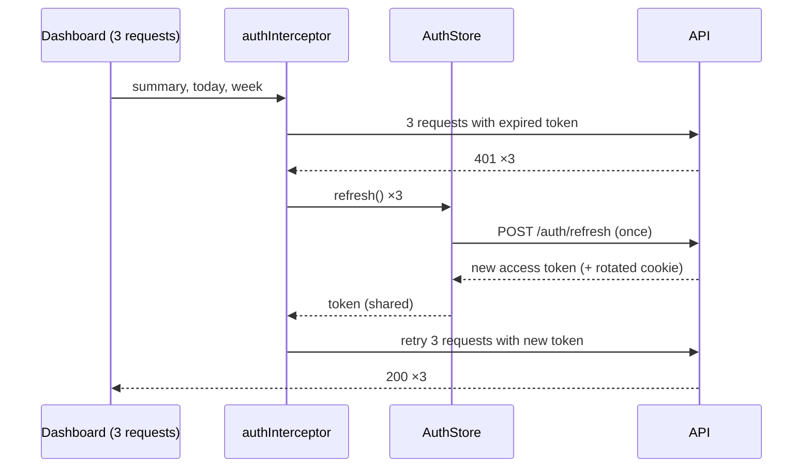

# Interceptors and Authentication

Back to [Module 13](README.md) · Previous: [HttpClient basics](01-httpclient-basics.md) · Next: [Error handling and retry](03-error-handling-retry.md)

## 1. Learning objectives

- Write functional interceptors and control their order.
- Attach the access token only to Myspce API requests.
- Implement refresh-on-401 without race conditions.
- Use `HttpContext` to configure interceptors per request.
- Build `AuthStore` (login, Google callback, refresh, logout).

## 2. Prerequisites

[HttpClient basics](01-httpclient-basics.md), [Guards](../10-routing/04-guards-and-resolvers.md), RxJS `switchMap`/`shareReplay` ([Module 14](../14-rxjs/02-operators.md)).

## 3. What is it?

An **interceptor** is a function that sees every request before it leaves and every response before it reaches your code:

```typescript
type HttpInterceptorFn = (req: HttpRequest<unknown>, next: HttpHandlerFn) => Observable<HttpEvent<unknown>>;
```

## 4. Why does Angular need it?

Cross-cutting HTTP concerns belong in one place: auth headers, token refresh, global errors, request IDs, logging, loading indicators, mock backends.

## 5. How it works internally

Interceptors form a chain in the order you list them. Requests flow **forward** through the list; responses flow **backward**.

```text
withInterceptors([requestId, auth, error, mock])
request:  requestId → auth → error → mock → backend
response: backend → mock → error → auth → requestId
```

Interceptors run in an injection context, so `inject()` works at the top of the function.

## 6. Syntax and API reference

```typescript
import { HttpContextToken, HttpInterceptorFn } from '@angular/common/http';

export const SKIP_AUTH = new HttpContextToken<boolean>(() => false);
export const SKIP_ERROR_TOAST = new HttpContextToken<boolean>(() => false);

// per-request: http.get(url, { context: new HttpContext().set(SKIP_ERROR_TOAST, true) })
// inside an interceptor: req.context.get(SKIP_AUTH)
```

`req.clone({ setHeaders, headers, url, body, withCredentials, context })` returns a modified copy.

## 7. Smallest working example — request ID

```typescript
// core/http/request-id-interceptor.ts
import { HttpInterceptorFn } from '@angular/common/http';

export const requestIdInterceptor: HttpInterceptorFn = (req, next) =>
  next(req.clone({ setHeaders: { 'X-Request-Id': crypto.randomUUID() } }));
```

The NestJS logs can then be correlated with browser errors (the planned error shape includes `requestId`).

## 8. Step-by-step

1. Clone the request (requests are immutable).
2. Add a header.
3. Pass it to `next`, returning its Observable.

## 9. Myspce real-world example — the auth flow

### Token strategy (from the build plan, assumption A2)

| Token | Lifetime | Stored | Sent |
|---|---|---|---|
| Access token (JWT) | ~15 min | **memory only** (a signal in `AuthStore`) | `Authorization: Bearer …` on API requests |
| Refresh token | days | **httpOnly, Secure, SameSite=Strict cookie** set by the API, path `/api/v1/auth` | automatically by the browser to `/api/v1/auth/*` |

JavaScript can't read the refresh cookie (XSS can't steal it). The access token is gone on page reload, so the app calls `/auth/refresh` at startup to get a new one.

### `AuthStore`

```typescript
// core/auth/auth-store.ts
import { Service, computed, inject, signal } from '@angular/core';
import { HttpClient, HttpContext } from '@angular/common/http';
import { Router } from '@angular/router';
import { Observable, finalize, firstValueFrom, map, shareReplay, tap } from 'rxjs';
import { API_URL } from '../http/api-url.token';
import { SKIP_AUTH } from './auth-context';
import { User } from '../models';

interface AuthResponse { accessToken: string; user: User; }

@Service()
export class AuthStore {
  private http = inject(HttpClient);
  private router = inject(Router);
  private api = inject(API_URL);

  private readonly _token = signal<string | null>(null);
  readonly user = signal<User | null>(null);
  readonly status = signal<'unknown' | 'authenticated' | 'anonymous'>('unknown');
  readonly isLoggedIn = computed(() => this.status() === 'authenticated');
  readonly accessToken = this._token.asReadonly();

  private refresh$: Observable<string> | null = null;
  private restoring: Promise<void> | null = null;

  async login(credentials: { email: string; password: string }): Promise<void> {
    const res = await firstValueFrom(
      this.http.post<AuthResponse>(`${this.api}/auth/login`, credentials, { context: new HttpContext().set(SKIP_AUTH, true) }),
    );
    this.setSession(res);
  }

  /** Called once at startup and by guards. */
  ensureSession(): Promise<void> {
    if (this.status() !== 'unknown') return Promise.resolve();
    return (this.restoring ??= firstValueFrom(this.refresh()).then(() => undefined, () => this.clear()));
  }

  /** One shared refresh for all concurrent callers. */
  refresh(): Observable<string> {
    this.refresh$ ??= this.http
      .post<AuthResponse>(`${this.api}/auth/refresh`, {}, { context: new HttpContext().set(SKIP_AUTH, true) })
      .pipe(
        tap(res => this.setSession(res)),
        map(res => res.accessToken),
        finalize(() => (this.refresh$ = null)),
        shareReplay({ bufferSize: 1, refCount: false }),
      );
    return this.refresh$;
  }

  async logout(): Promise<void> {
    try {
      await firstValueFrom(this.http.post(`${this.api}/auth/logout`, {}));
    } finally {
      this.clear();
      await this.router.navigateByUrl('/login');
    }
  }

  /** Called on unrecoverable 401 (refresh failed). */
  expire(): void {
    this.clear();
    this.router.navigate(['/login'], { queryParams: { returnUrl: this.router.url, reason: 'expired' } });
  }

  private setSession(res: AuthResponse) {
    this._token.set(res.accessToken);
    this.user.set(res.user);
    this.status.set('authenticated');
  }
  private clear() {
    this._token.set(null);
    this.user.set(null);
    this.status.set('anonymous');
  }
}
```

```typescript
// core/auth/auth-context.ts
import { HttpContextToken } from '@angular/common/http';
export const SKIP_AUTH = new HttpContextToken<boolean>(() => false);
```

### The auth interceptor (with single-flight refresh)

```typescript
// core/auth/auth-interceptor.ts
import { HttpErrorResponse, HttpInterceptorFn, HttpRequest } from '@angular/common/http';
import { inject } from '@angular/core';
import { catchError, switchMap, throwError } from 'rxjs';
import { API_URL } from '../http/api-url.token';
import { AuthStore } from './auth-store';
import { SKIP_AUTH } from './auth-context';

export const authInterceptor: HttpInterceptorFn = (req, next) => {
  const auth = inject(AuthStore);
  const api = inject(API_URL);

  const isApi = req.url.startsWith(api);              // never send the token to S3, Google, CDNs…
  if (!isApi || req.context.get(SKIP_AUTH)) return next(req);

  const withToken = (r: HttpRequest<unknown>, token: string | null) =>
    token ? r.clone({ setHeaders: { Authorization: `Bearer ${token}` } }) : r;

  return next(withToken(req, auth.accessToken())).pipe(
    catchError((err: unknown) => {
      if (!(err instanceof HttpErrorResponse) || err.status !== 401) return throwError(() => err);
      // Access token expired: refresh once (shared across concurrent requests), then retry this request once.
      return auth.refresh().pipe(
        switchMap(token => next(withToken(req, token))),
        catchError(refreshErr => {
          auth.expire();
          return throwError(() => refreshErr);
        }),
      );
    }),
  );
};
```

```typescript
// app.config.ts
provideHttpClient(withInterceptors([requestIdInterceptor, authInterceptor, errorInterceptor])),
provideAppInitializer(() => inject(AuthStore).ensureSession()),   // restore session before first render
```

### Why the refresh is "single-flight"

The dashboard fires `summary`, `today` and `week-progress` together. If the token expired, all three get 401. Without sharing, you'd call `/auth/refresh` three times; with refresh-token **rotation** on the server, the second and third calls would use an already-rotated token and fail — logging the user out. `refresh$ ??= …shareReplay(...)` makes all three wait on **one** refresh, then retry with the new token.

### Google login

```text
User clicks "Continue with Google"
 → browser navigates to GET /api/v1/auth/google          (backend starts OAuth with state + PKCE)
 → Google consent → GET /api/v1/auth/google/callback      (backend verifies, sets refresh cookie)
 → backend redirects to https://app/auth/callback
 → OAuthCallbackPage calls auth.ensureSession() → /auth/refresh → access token + user
 → navigate to returnUrl or /dashboard
```

```typescript
// features/auth/oauth-callback-page.ts
export default class OAuthCallbackPage {
  private auth = inject(AuthStore);
  private router = inject(Router);
  error = input<string>();                     // ?error=access_denied from the backend

  constructor() {
    afterNextRender(async () => {
      if (this.error()) { await this.router.navigate(['/login'], { queryParams: { reason: this.error() } }); return; }
      this.auth.status.set('unknown');         // force a fresh refresh call
      await this.auth.ensureSession();
      await this.router.navigateByUrl(this.auth.isLoggedIn() ? '/dashboard' : '/login', { replaceUrl: true });
    });
  }
}
```

(The exact callback contract depends on the NestJS implementation; this follows the build plan.)

## 10. Advanced example — re-auth before revealing a credential

`POST /credentials/:id/reveal` requires a recent `POST /auth/reauth` (planned API). An interceptor can turn a specific 403 into a re-auth dialog and retry:

```typescript
// core/auth/reauth-interceptor.ts
export const reauthInterceptor: HttpInterceptorFn = (req, next) => {
  const dialog = inject(ReauthDialog);
  return next(req).pipe(
    catchError((err: unknown) => {
      const needsReauth = err instanceof HttpErrorResponse && err.status === 403 && err.error?.message === 'REAUTH_REQUIRED';
      if (!needsReauth) return throwError(() => err);
      return from(dialog.ask()).pipe(              // opens a password/TOTP prompt, calls /auth/reauth
        switchMap(ok => (ok ? next(req) : throwError(() => err))),
      );
    }),
  );
};
```

Register it **after** `authInterceptor` so the retried request still carries the token.

## 11. Visual explanation



## 12. Common mistakes

| Mistake | Risk | Fix |
|---|---|---|
| Storing tokens in `localStorage` | any XSS steals them | memory + httpOnly refresh cookie |
| Adding `Authorization` to every URL | leaks token to S3/third parties | check `req.url.startsWith(api)` |
| Refreshing per failed request | rotation failures, logouts | single-flight `shareReplay` |
| Retrying the refresh call itself on 401 | infinite loop | `SKIP_AUTH` on auth endpoints |
| Retrying forever | loops | retry once after refresh |
| Wrong interceptor order | retried requests miss the token | auth before error/reauth |
| Class-based interceptors with `HTTP_INTERCEPTORS` in new code | legacy | functional + `withInterceptors` |

## 13. Debugging guide

- Network tab → request headers: is `Authorization` present on API calls and **absent** on S3/Google?
- Application tab → cookies: refresh cookie flags `HttpOnly`, `Secure`, `SameSite=Strict`, correct `Path`.
- Repeated `/auth/refresh` calls → the single-flight isn't shared (new Observable each time) or `refresh$` reset too early.
- Logged out on refresh → `ensureSession` not awaited in `provideAppInitializer`/guards, or the cookie isn't sent (path/domain mismatch).

## 14. Best practices

- Access token in memory, refresh token in httpOnly cookie, rotation on the server.
- Functional interceptors, explicit order, `HttpContextToken`s for opt-outs.
- One `AuthStore`; guards and interceptors depend on it, not vice versa.
- Treat 401 (unauthenticated) and 403 (forbidden) differently.

## 15. Angular vs React

Interceptors ≈ axios interceptors. Angular's version is DI-aware, composable via `withInterceptors`, and unit-testable with `HttpTestingController`.

## 16. Testing

```typescript
describe('authInterceptor', () => {
  let http: HttpClient, ctrl: HttpTestingController, auth: { accessToken: WritableSignal<string | null>; refresh: Mock; expire: Mock };

  beforeEach(() => {
    auth = { accessToken: signal('old'), refresh: vi.fn(() => of('new')), expire: vi.fn() };
    TestBed.configureTestingModule({
      providers: [
        provideHttpClient(withInterceptors([authInterceptor])),
        provideHttpClientTesting(),
        { provide: API_URL, useValue: '/api/v1' },
        { provide: AuthStore, useValue: auth },
      ],
    });
    http = TestBed.inject(HttpClient);
    ctrl = TestBed.inject(HttpTestingController);
  });

  it('adds the bearer token to API calls only', () => {
    http.get('/api/v1/notes').subscribe();
    http.get('https://bucket.s3.amazonaws.com/x').subscribe();
    expect(ctrl.expectOne('/api/v1/notes').request.headers.get('Authorization')).toBe('Bearer old');
    expect(ctrl.expectOne('https://bucket.s3.amazonaws.com/x').request.headers.has('Authorization')).toBe(false);
  });

  it('refreshes once on 401 and retries with the new token', () => {
    let body: unknown;
    http.get('/api/v1/notes').subscribe(b => (body = b));
    ctrl.expectOne('/api/v1/notes').flush(null, { status: 401, statusText: 'Unauthorized' });
    const retry = ctrl.expectOne('/api/v1/notes');
    expect(retry.request.headers.get('Authorization')).toBe('Bearer new');
    retry.flush({ data: [] });
    expect(auth.refresh).toHaveBeenCalledTimes(1);
    expect(body).toEqual({ data: [] });
  });
});
```

## 17. Practice questions

1. Add a `loadingInterceptor` that counts in-flight API requests into a signal for a top progress bar (use `finalize`).
2. Write a test proving three concurrent 401s cause one refresh (test `AuthStore.refresh()` with `HttpTestingController`).
3. Why must `/auth/refresh` skip the auth interceptor's retry logic?

## 18. Interview questions

- **Q: In what order do interceptors run?** Requests in registration order; responses in reverse.
- **Q: How do you avoid multiple simultaneous refresh calls?** Share one in-flight refresh Observable (e.g. `shareReplay`) and reset it when it completes.
- **Q: Where should tokens live in a browser app?** Short-lived access token in memory; refresh token in an httpOnly, Secure, SameSite cookie scoped to the auth path.

## 19. Revision notes

`HttpInterceptorFn` · `withInterceptors([...])` order · `req.clone({ setHeaders })` · token only for `API_URL` · `HttpContextToken` opt-outs · single-flight refresh · retry once · `expire()` on refresh failure · reauth interceptor for 403 `REAUTH_REQUIRED`.

## 20. Completion checklist

- [ ] `AuthStore`, `authInterceptor`, `requestIdInterceptor` written and tested.
- [ ] Session survives page reload via `/auth/refresh`.
- [ ] Token never sent to non-API hosts.
