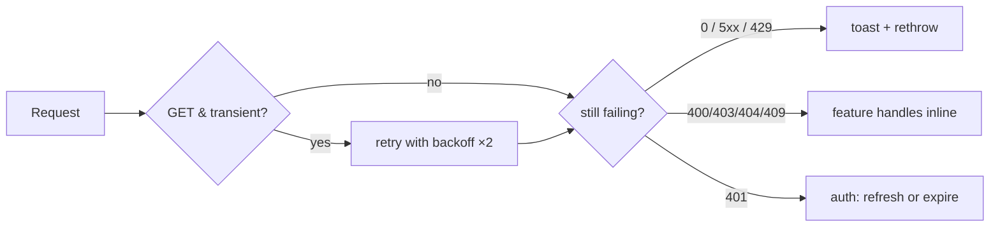

# Error Handling, Retries, Timeouts and Cancellation

Back to [Module 13](README.md) · Previous: [Interceptors and auth](02-interceptors-and-auth.md) · Next: [Uploads, pagination and testing](04-uploads-pagination-testing.md)

## 1. Learning objectives

- Read `HttpErrorResponse` correctly (status 0 vs 4xx vs 5xx).
- Centralise user-facing error messages in an interceptor and a mapper.
- Retry only what's safe, with exponential backoff.
- Add timeouts and cancel stale requests.
- Diagnose CORS and network failures.
- Handle uncaught errors with a global `ErrorHandler`.

## 2. Prerequisites

[Interceptors](02-interceptors-and-auth.md), RxJS `retry`/`catchError` ([Module 14](../14-rxjs/02-operators.md)).

## 3. What is it?

A layered strategy:

1. **Interceptor** — normalise errors and show generic toasts (offline, server down).
2. **Store/page** — handle expected errors for that feature (404 → "Note not found", 409 → "Name already used").
3. **`ErrorHandler`** — catch everything else, log it, show a fallback.

## 4. Why does Angular need it?

Without a plan, every component writes its own `catchError`, messages are inconsistent, some errors are swallowed and others crash the page.

## 5. How it works — `HttpErrorResponse`

| Field | Meaning |
|---|---|
| `status` | `0` = no response (offline, CORS blocked, DNS, aborted); `4xx` = client/auth errors; `5xx` = server errors |
| `error` | the parsed body — for Myspce: `{ statusCode, message, path, requestId, timestamp }` |
| `message` | Angular's technical summary (not for users) |
| `url` | request URL |
| `headers` | response headers (e.g. `Retry-After`) |

## 6. Syntax and API reference

```typescript
import { catchError, retry, timeout, timer, throwError } from 'rxjs';

source$.pipe(
  timeout(10_000),                                    // RxJS timeout (or the HttpClient `timeout` option)
  retry({ count: 3, delay: (err, attempt) => (isRetryable(err) ? timer(2 ** attempt * 300) : throwError(() => err)) }),
  catchError(err => { /* map or rethrow */ return throwError(() => err); }),
);
```

## 7. Smallest working example — mapping errors to messages

```typescript
// core/http/error-messages.ts
import { HttpErrorResponse } from '@angular/common/http';

export interface ApiErrorBody { statusCode: number; message: string | string[]; path?: string; requestId?: string; }

export function toMessage(err: unknown): string {
  if (err instanceof HttpErrorResponse) {
    if (err.status === 0) return navigator.onLine ? "Can't reach the server. Try again in a moment." : "You're offline.";
    const body = err.error as Partial<ApiErrorBody> | null;
    const serverMsg = Array.isArray(body?.message) ? body!.message.join(' ') : body?.message;
    switch (err.status) {
      case 400: return serverMsg ?? 'Please check the highlighted fields.';
      case 401: return 'Your session has expired. Please sign in again.';
      case 403: return "You don't have permission to do that.";
      case 404: return "We couldn't find that.";
      case 409: return serverMsg ?? 'That conflicts with existing data.';
      case 413: return 'That file is too large.';
      case 429: return 'Too many attempts. Please wait a moment.';
      default: return err.status >= 500 ? 'Something went wrong on our side. Try again.' : 'Request failed.';
    }
  }
  return 'Something went wrong.';
}
```

## 8. Step-by-step

1. Status `0` is special: no HTTP response at all.
2. Prefer the server's message for 400/409 (validation, conflicts) — NestJS validation often returns an array of messages.
3. Never show stack traces, URLs or internal codes to users; log them instead with the `requestId`.

## 9. Myspce real-world example — global error interceptor

```typescript
// core/http/error-interceptor.ts
import { HttpErrorResponse, HttpInterceptorFn } from '@angular/common/http';
import { inject } from '@angular/core';
import { catchError, throwError } from 'rxjs';
import { ToastService } from '../../shared/ui/toast/toast-service';
import { SKIP_ERROR_TOAST } from './http-context';
import { toMessage } from './error-messages';

export const errorInterceptor: HttpInterceptorFn = (req, next) => {
  const toast = inject(ToastService);
  return next(req).pipe(
    catchError((err: unknown) => {
      if (err instanceof HttpErrorResponse && !req.context.get(SKIP_ERROR_TOAST)) {
        // Only global, non-feature-specific problems become toasts here.
        if (err.status === 0 || err.status >= 500 || err.status === 429) toast.error(toMessage(err));
        if (err.error?.requestId) console.warn(`[api] ${req.method} ${req.urlWithParams} failed`, { status: err.status, requestId: err.error.requestId });
      }
      return throwError(() => err);   // always rethrow: callers still need to know
    }),
  );
};
```

401 is handled by `authInterceptor`; 400/403/404/409 by the feature (inline messages, form errors). The interceptor **rethrows** so resources and stores still enter their error state.

## 10. Advanced example — safe retries, timeouts, cancellation

### Which requests to retry

| Retry? | Why |
|---|---|
| GET with status 0, 502, 503, 504 | idempotent, transient |
| GET with 429 | after `Retry-After` |
| POST/PATCH/DELETE | **no** (could duplicate a note or double-toggle) — unless the API supports idempotency keys |
| 4xx (except 429) | **no** — retrying won't fix a bad request |

```typescript
// core/http/retry-interceptor.ts
import { HttpErrorResponse, HttpInterceptorFn } from '@angular/common/http';
import { retry, throwError, timer } from 'rxjs';

const TRANSIENT = new Set([0, 502, 503, 504]);

export const retryInterceptor: HttpInterceptorFn = (req, next) => {
  if (req.method !== 'GET') return next(req);
  return next(req).pipe(
    retry({
      count: 2,
      delay: (err: unknown, attempt) => {
        if (!(err instanceof HttpErrorResponse) || !TRANSIENT.has(err.status)) return throwError(() => err);
        const jitter = Math.random() * 200;
        return timer(2 ** attempt * 400 + jitter);      // ~800 ms, ~1.6 s
      },
    }),
  );
};
```

Order: `[requestId, auth, retry, error]` — retries happen before the error toast, so users see a toast only after retries fail.

### Timeouts

```typescript
this.http.get<SearchResult[]>(`${this.api}/search`, { params: { q }, timeout: 8_000 });   // HttpClient option (v20+)
// or: .pipe(timeout(8_000)) — emits a TimeoutError (not HttpErrorResponse); map it in toMessage if you use it
```

### Cancellation

- Resources cancel stale loads automatically when params change.
- In RxJS pipelines, `switchMap` cancels the previous inner request (search, autosave).
- Leaving a page destroys its resources/`takeUntilDestroyed` subscriptions → requests are aborted.
- With the Fetch backend (v22 default), unsubscribing aborts the underlying `fetch`.

### Global `ErrorHandler`

```typescript
// core/errors/app-error-handler.ts
import { ErrorHandler, Injectable, inject } from '@angular/core';
import { HttpErrorResponse } from '@angular/common/http';
import { ToastService } from '../../shared/ui/toast/toast-service';

@Injectable()
export class AppErrorHandler implements ErrorHandler {
  private toast = inject(ToastService);
  handleError(error: unknown): void {
    if (error instanceof HttpErrorResponse) return;            // already handled by interceptors/features
    if (String(error).includes('ChunkLoadError') || String(error).includes('Failed to fetch dynamically imported module')) {
      location.reload();                                        // new deploy; old chunks gone
      return;
    }
    console.error(error);                                       // later: send to a logging endpoint
    this.toast.error('Something went wrong. Please refresh the page.');
  }
}
// app.config.ts: { provide: ErrorHandler, useClass: AppErrorHandler }
```

`provideBrowserGlobalErrorListeners()` (in the generated config) forwards `window.onerror` and unhandled promise rejections to this handler.

### CORS and network failures

| Symptom | Cause | Fix |
|---|---|---|
| Console: "blocked by CORS policy", `status: 0` | browser on `:4200` calling API on `:3000` directly | dev proxy (same origin) |
| Works locally, fails in prod with CORS | API on a different domain without CORS headers | serve API under the same domain (`/api`) or configure NestJS CORS with exact origin and `credentials: true` |
| Preflight `OPTIONS` fails | custom headers/methods not allowed | allow them in NestJS CORS config |
| `status: 0` only on some networks | offline, captive portal, ad blocker blocking paths | show offline message; avoid paths like `/ads` |

## 11. Visual explanation



## 12. Common mistakes

| Mistake | Fix |
|---|---|
| `catchError(() => of([]))` everywhere | hides failures; show error state |
| Toasting every error globally | noisy duplicates with inline messages; toast only global ones |
| Retrying POSTs | duplicates; retry GETs only |
| Showing `err.message` to users | technical text; map to friendly messages |
| Not rethrowing in interceptors | resources/stores never see the error |

## 13. Debugging guide

- Reproduce: DevTools → Network → throttling "Offline" (status 0), or block a URL (simulates failure).
- Find a server error by `requestId` in NestJS logs.
- `NG0200`-style DI cycle with `ToastService` in an interceptor → make sure `ToastService` doesn't inject `HttpClient`.

## 14. Best practices

- Three layers: interceptor (global), feature (expected), `ErrorHandler` (unexpected).
- Friendly messages from one mapper.
- Retry idempotent requests only, with backoff and jitter.
- Always rethrow after side effects.

## 15. Angular vs React

React Query handles retries and error states per query; axios interceptors handle global errors; error boundaries catch render errors. Angular splits the same responsibilities across interceptors, resources/stores, and `ErrorHandler` (a template-level `@boundary` block is under development but not in 22.0).

## 16. Testing

```typescript
it('retries a GET twice on 503 then succeeds', async () => {
  vi.useFakeTimers();
  TestBed.configureTestingModule({ providers: [provideHttpClient(withInterceptors([retryInterceptor])), provideHttpClientTesting()] });
  const http = TestBed.inject(HttpClient), ctrl = TestBed.inject(HttpTestingController);
  let body: unknown;
  http.get('/api/v1/notes').subscribe(b => (body = b));
  ctrl.expectOne('/api/v1/notes').flush(null, { status: 503, statusText: 'Unavailable' });
  await vi.advanceTimersByTimeAsync(1_000);
  ctrl.expectOne('/api/v1/notes').flush(null, { status: 503, statusText: 'Unavailable' });
  await vi.advanceTimersByTimeAsync(2_000);
  ctrl.expectOne('/api/v1/notes').flush({ data: [] });
  expect(body).toEqual({ data: [] });
  vi.useRealTimers();
});

it('does not retry POST', () => {
  TestBed.configureTestingModule({ providers: [provideHttpClient(withInterceptors([retryInterceptor])), provideHttpClientTesting()] });
  const http = TestBed.inject(HttpClient), ctrl = TestBed.inject(HttpTestingController);
  http.post('/api/v1/notes', {}).subscribe({ error: () => {} });
  ctrl.expectOne('/api/v1/notes').flush(null, { status: 503, statusText: 'Unavailable' });
  ctrl.verify();   // no second request
});
```

## 17. Practice questions

1. Extend `toMessage` to handle RxJS `TimeoutError`.
2. Honour `Retry-After` for 429 in `retryInterceptor`.
3. Which Myspce requests would you mark with `SKIP_ERROR_TOAST`, and why? (Hint: background polling, the async name validator.)

## 18. Interview questions

- **Q: What does status 0 mean?** No HTTP response was received — offline, CORS blocked, DNS failure or aborted request.
- **Q: Why not retry POST requests automatically?** They aren't idempotent; a retry can duplicate side effects.
- **Q: Where do you handle errors in Angular?** Interceptors for cross-cutting concerns, features for expected errors, `ErrorHandler` for everything uncaught.

## 19. Revision notes

`HttpErrorResponse.status` 0/4xx/5xx · `toMessage` mapper · error interceptor toasts only global errors and rethrows · retry GET transient with backoff · timeouts · cancellation via switchMap/resources/unsubscribe · `ErrorHandler` + chunk-error reload · CORS → same-origin.

## 20. Completion checklist

- [ ] `toMessage`, `errorInterceptor`, `retryInterceptor`, `AppErrorHandler` written.
- [ ] Offline and 500 scenarios tested in DevTools.
- [ ] Retry tests pass with fake timers.
