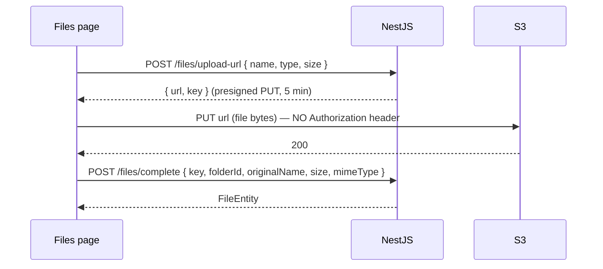

# Uploads, Downloads, Pagination and HTTP Testing

Back to [Module 13](README.md) · Previous: [Error handling and retry](03-error-handling-retry.md) · Next module: [14 RxJS](../14-rxjs/README.md)

## 1. Learning objectives

- Upload files via presigned S3 URLs with progress (and know the v22 Fetch caveat).
- Download files securely.
- Implement server-side pagination, sorting and filtering.
- Track loading globally.
- Test any HTTP code with `HttpTestingController`.

## 2. Prerequisites

Notes 1–3 of this module.

## 3. Uploads — the presigned URL flow (planned API)



Bytes go straight to S3; the API never streams large files. The auth interceptor's `req.url.startsWith(api)` check ensures the bearer token isn't sent to S3.

### Progress with Fetch as the default (v22)

The Fetch API can't report **upload** progress. Options:

| Option | Trade-off |
|---|---|
| `provideHttpClient(withXhr(), …)` app-wide | progress works via `reportUploadProgress: true`; you lose Fetch-only features app-wide |
| A small XHR-based upload service (below) | progress for uploads only; everything else stays on Fetch ✅ |
| No progress bar | simplest; fine for small files |

```typescript
// features/files/data-access/upload-service.ts
import { Service, inject } from '@angular/core';
import { HttpClient } from '@angular/common/http';
import { Observable, switchMap, map, last } from 'rxjs';
import { API_URL } from '../../../core/http/api-url.token';

export type UploadEvent = { kind: 'progress'; percent: number } | { kind: 'done'; file: FileEntity };

@Service()
export class UploadService {
  private http = inject(HttpClient);
  private api = inject(API_URL);

  upload(file: File, folderId: string | null): Observable<UploadEvent> {
    return this.http.post<{ url: string; key: string }>(`${this.api}/files/upload-url`, { name: file.name, type: file.type, size: file.size }).pipe(
      switchMap(({ url, key }) =>
        new Observable<UploadEvent>(sub => {
          const xhr = new XMLHttpRequest();
          xhr.open('PUT', url);
          xhr.setRequestHeader('Content-Type', file.type || 'application/octet-stream');
          xhr.upload.onprogress = e => e.lengthComputable && sub.next({ kind: 'progress', percent: Math.round((e.loaded / e.total) * 100) });
          xhr.onload = () => {
            if (xhr.status >= 200 && xhr.status < 300) {
              this.http.post<FileEntity>(`${this.api}/files/complete`, { key, folderId, originalName: file.name, size: file.size, mimeType: file.type })
                .subscribe({ next: f => { sub.next({ kind: 'done', file: f }); sub.complete(); }, error: e => sub.error(e) });
            } else sub.error(new Error(`Upload failed (${xhr.status})`));
          };
          xhr.onerror = () => sub.error(new Error('Network error during upload'));
          xhr.send(file);
          return () => xhr.abort();          // unsubscribe = cancel upload
        }),
      ),
    );
  }
}
```

(`FileEntity` is the planned file model: `id`, `originalName`, `mimeType`, `sizeBytes`, `createdAt`, `folderId`.)

Using it with a signal for the progress bar:

```typescript
protected progress = signal<number | null>(null);
private uploads = inject(UploadService);

onFile(input: HTMLInputElement) {
  const file = input.files?.[0];
  if (!file) return;
  if (file.size > 50 * 1024 * 1024) { this.toast.error('Max 50 MB'); return; }       // mirror the server limit
  this.uploads.upload(file, this.folderId()).pipe(takeUntilDestroyed(this.destroyRef)).subscribe({
    next: e => (e.kind === 'progress' ? this.progress.set(e.percent) : (this.progress.set(null), this.files.reload())),
    error: err => { this.progress.set(null); this.toast.error(toMessage(err)); },
  });
}
```

Validate type/size on the client for UX; the API must validate again.

## 4. Downloads

```typescript
async download(file: FileEntity) {
  const { url } = await firstValueFrom(this.http.get<{ url: string }>(`${this.api}/files/${file.id}/download-url`));
  const a = Object.assign(document.createElement('a'), { href: url, rel: 'noopener' });
  a.click();   // presigned URL sets Content-Disposition: attachment on the server side
}
```

For API-served blobs (e.g. a backup export): `http.get(url, { responseType: 'blob' })` → `URL.createObjectURL(blob)` → click → `URL.revokeObjectURL()`.

## 5. Server-side pagination, sorting and filtering

Planned convention: `GET /notes?page=2&limit=20&sort=-updatedAt&category=work&q=aws` → `{ data, meta: { total, page, limit } }`.

```typescript
// features/notes/pages/notes-page.ts (server-driven version)
export default class NotesPage {
  private api = inject(API_URL);
  category = input('all');
  q = input('');
  sort = input<'-updatedAt' | 'updatedAt' | 'title'>('-updatedAt');
  page = input(1, { transform: numberAttribute });
  protected readonly limit = 12;

  protected notes = httpResource<Paginated<Note>>(() => ({
    url: `${this.api}/notes`,
    params: {
      page: this.page(),
      limit: this.limit,
      sort: this.sort(),
      ...(this.category() !== 'all' ? { category: this.category() } : {}),
      ...(this.q() ? { q: this.q() } : {}),
    },
  }));

  protected pageCount = computed(() => {
    if (!this.notes.hasValue()) return 1;
    const { total, limit } = this.notes.value().meta;
    return Math.max(1, Math.ceil(total / limit));
  });
}
```

URL → inputs → resource params → request. See [params and navigation](../10-routing/02-params-and-navigation.md) for `setFilter`.

**Infinite scroll** variant: keep `pages = signal<Note[][]>([])`, load page N+1 when a sentinel is visible (`appVisible` directive from Module 09), append immutably. Reset when filters change (`linkedSignal`).

## 6. Global loading indicator

```typescript
// core/http/loading-interceptor.ts
import { HttpInterceptorFn } from '@angular/common/http';
import { Service, computed, inject, signal } from '@angular/core';
import { finalize } from 'rxjs';

@Service()
export class HttpActivity {
  private readonly inflight = signal(0);
  readonly busy = computed(() => this.inflight() > 0);
  start() { this.inflight.update(n => n + 1); }
  end() { this.inflight.update(n => Math.max(0, n - 1)); }
}

export const loadingInterceptor: HttpInterceptorFn = (req, next) => {
  const activity = inject(HttpActivity);
  activity.start();
  return next(req).pipe(finalize(() => activity.end()));
};
```

```html
<!-- core/layout/shell.html -->
@if (activity.busy()) { <div class="fixed inset-x-0 top-0 z-50 h-0.5 animate-pulse bg-blue-500" role="progressbar" aria-label="Loading"></div> }
```

`finalize` runs on complete, error **and** unsubscribe (cancellation), so the counter never gets stuck.

## 7. Testing with `HttpTestingController`

```typescript
import { provideHttpClient, withInterceptors } from '@angular/common/http';
import { HttpTestingController, provideHttpClientTesting } from '@angular/common/http/testing';

beforeEach(() => {
  TestBed.configureTestingModule({
    providers: [
      provideHttpClient(withInterceptors([authInterceptor])),   // include interceptors you want under test
      provideHttpClientTesting(),                                // must come AFTER provideHttpClient
      { provide: API_URL, useValue: '/api/v1' },
    ],
  });
});

afterEach(() => TestBed.inject(HttpTestingController).verify());   // fail on unexpected requests
```

| API | Use |
|---|---|
| `expectOne(url \| { method, url } \| predicate)` | exactly one matching request |
| `expectNone(...)` | none |
| `match(...)` | all matching (array) |
| `req.request` | inspect method, headers, params, body |
| `req.flush(body, { status, statusText, headers })` | respond |
| `req.error(new ProgressEvent('error'))` | network error (status 0) |
| `verify()` | assert no outstanding requests |

```typescript
it('sends pagination and filter params', () => {
  TestBed.inject(NotesApi).list({ page: 2, limit: 12, category: 'work', q: '' }).subscribe();
  const req = TestBed.inject(HttpTestingController).expectOne(r => r.url === '/api/v1/notes');
  expect(req.request.params.get('page')).toBe('2');
  expect(req.request.params.get('category')).toBe('work');
  expect(req.request.params.has('q')).toBe(false);
  req.flush({ data: [], meta: { total: 0, page: 2, limit: 12 } });
});

it('reports a network error as status 0', () => {
  let status = -1;
  TestBed.inject(HttpClient).get('/api/v1/notes').subscribe({ error: e => (status = e.status) });
  TestBed.inject(HttpTestingController).expectOne('/api/v1/notes').error(new ProgressEvent('error'));
  expect(status).toBe(0);
});
```

## 8. Common mistakes

| Mistake | Fix |
|---|---|
| Sending the bearer token to S3 | interceptor host check |
| Expecting upload progress with the Fetch backend | XHR upload service or `withXhr()` |
| Client-side pagination of thousands of notes | server pagination |
| `provideHttpClientTesting()` before `provideHttpClient()` | order matters — testing backend must override |
| Forgetting `verify()` | hidden extra requests go unnoticed |

## 9. Practice questions

1. Add "Cancel upload" (unsubscribe) to the Files page.
2. Implement infinite scroll for Memories' gallery.
3. Write a test for `loadingInterceptor` proving `busy()` returns to false after an error.

## 10. Interview questions

- **Q: Why use presigned URLs for uploads?** The API stays out of the data path (no large bodies through Node), and S3 enforces the size/time-limited permission.
- **Q: How do you test HTTP in Angular?** `provideHttpClientTesting()` + `HttpTestingController` to assert requests and flush responses.

## 11. Completion checklist

- [ ] Upload with progress and cancel works against a mock or real presigned URL.
- [ ] Notes list paginates server-side from URL params.
- [ ] Global loading bar driven by an interceptor.
- [ ] HTTP tests use `verify()`.
