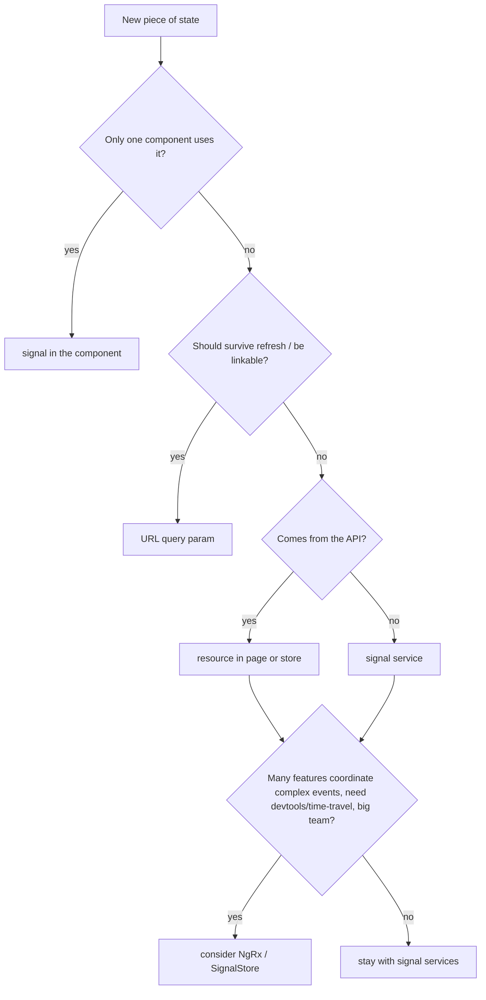

# State Fundamentals

Back to [Module 15](README.md) · Next: [Signal stores](02-signal-stores.md)

## 1. Learning objectives

- Classify state by owner and lifetime.
- Separate server state (cached copies of API data) from client state (UI choices).
- Apply normalisation and immutability.
- Model loading and error states consistently.
- Choose the lightest tool that works.

## 2. Prerequisites

[Signals](../08-signals-and-reactivity/README.md), [Communication patterns](../04-component-communication/03-communication-patterns.md).

## 3. What is it?

**State** is any data that can change and that the UI depends on. **State management** is deciding where each piece lives, who can change it, and how changes propagate.

## 4. Why it matters

Most bugs in SPAs are state bugs: two copies of the same data disagreeing, stale lists after an edit, a spinner that never stops, a filter lost on refresh.

## 5. The five kinds of state

| Kind | Owner | Lifetime | Myspce example | Tool |
|---|---|---|---|---|
| **Local UI** | one component | while it's on screen | dropdown open, show/hide password | `signal` in the component |
| **Shared client** | several components | session | theme mode, sidebar collapsed | signal service |
| **URL** | the router | navigation | `?category=work&page=2` | query params + input binding |
| **Server (cache)** | the backend; you hold a copy | until invalidated | notes list, dashboard counts | resources / store with API |
| **Form** | a form | until submit/cancel | credential being edited | Signal Forms / Reactive Forms |

Rule: **put state in the smallest scope that works, and never keep two writable copies of it.**

## 6. Server state vs client state

Server state has problems client state doesn't:

- it can be **stale** (changed on another device/tab),
- it needs **loading/error** handling,
- it needs **invalidation** after mutations (create a note → list must update),
- it may be **paginated**.

Resources and stores handle these. Client state (theme, selection) is simple signals.

### Invalidation strategies after a mutation

| Strategy | How | When |
|---|---|---|
| Refetch | `notes.reload()` after create/delete | simplest; always correct |
| Update locally | `notes.update(...)` with the server's response | fast; when you have the full entity back |
| Optimistic | update first, roll back on error | toggles (favourite, task done) |

## 7. Normalisation

Store entities **by id**, once; derive views:

```typescript
// shape
interface NotesState {
  byId: Record<string, Note>;
  ids: string[];             // order from the server
}

// derived
const list = computed(() => state().ids.map(id => state().byId[id]!));
const pinned = computed(() => list().filter(n => n.pinned));
```

Benefits: updating one note updates it everywhere (grid, favourites, search results); no duplicates; O(1) lookups by id. For small single-user lists a plain array is fine — normalise when the same entity appears in several views or lists get large.

## 8. Immutability rules

- Never mutate state objects or arrays; create new ones (`{ ...n, pinned: true }`, `list.map(...)`, `list.filter(...)`).
- Expose read-only signals (`asReadonly()`, `computed`).
- Treat API responses as immutable values.

Why: signals and OnPush detect changes by reference; mutation silently breaks updates ([Module 09](../09-lifecycle-and-change-detection/02-change-detection.md)).

## 9. Myspce example — auth/user state

```typescript
// a minimal, explicit session model
type SessionState =
  | { status: 'unknown' }
  | { status: 'anonymous' }
  | { status: 'authenticated'; user: User; accessToken: string };

const session = signal<SessionState>({ status: 'unknown' });
const user = computed(() => { const s = session(); return s.status === 'authenticated' ? s.user : null; });
const isAdmin = computed(() => ['admin', 'super_admin'].includes(user()?.role ?? ''));
```

A discriminated union makes impossible states unrepresentable: you can't have a user without a token, or "authenticated" with no user. (The `AuthStore` in [Module 13](../13-http-and-api-integration/02-interceptors-and-auth.md) uses separate signals for simplicity; refactoring it to this union is a good exercise.)

## 10. Loading and error state

Pick **one** model and use it everywhere. With resources you get `status()`. For hand-written async actions:

```typescript
type AsyncState<T> =
  | { status: 'idle' }
  | { status: 'loading'; previous?: T }
  | { status: 'success'; data: T }
  | { status: 'error'; error: string; previous?: T };
```

`previous` lets you keep showing old data during a reload or after a failed refresh.

## 11. Choosing a tool



## 12. Common mistakes

| Mistake | Fix |
|---|---|
| Copying a store's data into a component signal | read the store signal directly |
| Filters in a service instead of the URL | URL query params |
| A global store for dialog open/close | local signal |
| Boolean soup (`isLoading`, `isError`, `hasData` all separate) | one status union |
| Introducing NgRx "for scalability" on day one | start simple; refactor when the need is real |

## 13. Debugging guide

- "Where is this value coming from?" → Angular DevTools: component inputs → injected stores → signal graph.
- Two components disagree → two sources of truth; delete one.
- Stale list after a mutation → missing invalidation (`reload()` or local update).

## 14. Best practices

- Smallest scope; one writable source; derive everything else.
- Explicit status unions for async state.
- Invalidate deliberately after every mutation.

## 15. Angular vs React

The same categories exist in React (useState, context/Zustand, URL search params, React Query, form libraries). Angular's built-in equivalents are signals, DI services, the router, resources and Signal Forms.

## 16. Testing

Pure derivations and reducers-as-functions are easiest to test: keep state transitions in small functions (`applyToggle(list, id)`) and test them without TestBed.

## 17. Practice questions

1. Classify: theme, selected calendar day, notes list, "add credential" modal open, current page of Files, unsaved note draft.
2. Refactor `AuthStore` to the `SessionState` union.
3. When would you normalise the Notes state?

## 18. Interview questions

- **Q: Server state vs client state?** Server state is a cached copy of backend data with staleness, loading and invalidation concerns; client state is UI-only and owned by the app.
- **Q: Why normalise?** One copy per entity, consistent updates across views, efficient lookups.

## 19. Revision notes

Five kinds: local, shared, URL, server, form · smallest scope · one writable source · invalidate after mutations · normalise when entities repeat · status unions.

## 20. Completion checklist

- [ ] Every piece of Myspce v1 state is classified.
- [ ] `SessionState` union implemented.
- [ ] I can draw the decision flow from memory.
