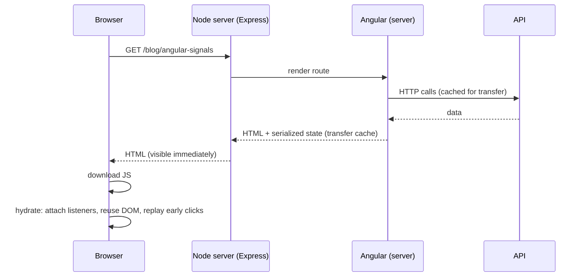

# SSR Concepts and Hydration

Back to [Module 18](README.md) · Next: [Platform-aware code](02-platform-aware-code.md)

## 1. Learning objectives

- Compare CSR, SSR and prerendering (SSG).
- Understand Angular's SSR architecture and server route configuration.
- Explain hydration, incremental hydration and event replay.
- Use the HTTP transfer cache and SEO metadata.
- Decide when SSR is appropriate for Myspce.

## 2. Prerequisites

[Project structure](../01-angular-fundamentals/03-project-structure-and-bootstrap.md), [Routing](../10-routing/README.md), [`@defer`](../17-performance/02-loading-and-bundles.md).

## 3. What is it?

| Mode | HTML produced | When |
|---|---|---|
| **CSR** (client-side rendering) | empty shell; JS renders everything in the browser | apps behind login |
| **SSR** (server-side rendering) | full HTML per request on a Node server | public, dynamic, SEO-sensitive pages |
| **Prerender / SSG** | full HTML at **build time** | public pages that rarely change (landing, docs, blog) |

**Hydration** = the browser reuses server HTML and attaches Angular to it instead of re-creating the DOM.

## 4. Why would Angular need it?

Faster first paint and LCP on slow devices, crawlable HTML for SEO and link previews, content visible before JavaScript runs.

## 5. How it works internally



### Project setup

```bash
ng new my-public-site --ssr          # new project with SSR
ng add @angular/ssr                  # add to an existing project
```

Files added: `src/main.server.ts`, `src/app/app.config.server.ts`, `src/app/app.routes.server.ts`, `src/server.ts` (Express app).

```typescript
// app.config.server.ts
import { mergeApplicationConfig, ApplicationConfig } from '@angular/core';
import { provideServerRendering, withRoutes } from '@angular/ssr';
import { appConfig } from './app.config';
import { serverRoutes } from './app.routes.server';

const serverConfig: ApplicationConfig = {
  providers: [provideServerRendering({ maxResponseBodySize: 1024 * 1024 }, withRoutes(serverRoutes))],   // v22 options object
};
export const config = mergeApplicationConfig(appConfig, serverConfig);
```

```typescript
// app.routes.server.ts
import { RenderMode, ServerRoute } from '@angular/ssr';

export const serverRoutes: ServerRoute[] = [
  { path: '', renderMode: RenderMode.Prerender },                 // landing page at build time
  { path: 'login', renderMode: RenderMode.Prerender },
  { path: 'blog/:slug', renderMode: RenderMode.Prerender, getPrerenderParams: async () => [{ slug: 'hello' }] },
  { path: '**', renderMode: RenderMode.Client },                  // the private app stays CSR
];
```

```typescript
// app.config.ts (browser)
provideClientHydration(withEventReplay())    // incremental hydration is the default in v22
```

### Incremental hydration (default in v22)

`@defer` blocks become hydration boundaries. Server HTML is shown immediately, but the block's JavaScript downloads and hydrates only when its trigger fires:

```html
@defer (hydrate on viewport) {
  <app-comments [postId]="id()" />
}
@defer (hydrate on interaction) { <app-share-buttons /> }
@defer (hydrate never) { <app-static-footer /> }
```

### Event replay

Clicks made before hydration finishes are recorded and replayed afterwards (`withEventReplay()`), so early users don't lose interactions.

### HTTP transfer cache

`HttpClient` GET/HEAD requests made during SSR are serialised into the HTML and reused on the client — no duplicate request during hydration. Configure with `withHttpTransferCacheOptions({ includePostRequests: false, filter: req => … })`. Responses to requests with `Authorization` headers are **not** cached by default (good: no user data leaks into cached HTML). In v22, `resource`/`rxResource` can be transfer-cached too by giving them an `id`.

### SEO metadata

```typescript
private title = inject(Title);
private meta = inject(Meta);

constructor() {
  effect(() => {
    const post = this.post.value();
    if (!post) return;
    this.title.setTitle(`${post.title} · MySpace`);
    this.meta.updateTag({ name: 'description', content: post.summary });
    this.meta.updateTag({ property: 'og:title', content: post.title });
  });
}
```

Canonical URLs: add `<link rel="canonical">` via `DOCUMENT` in a small service.

## 6. Deployment trade-offs

| | CSR | SSR | Prerender |
|---|---|---|---|
| Hosting | any static host (S3+CloudFront, nginx) | Node server (EC2/ECS/Lambda) | static host |
| Cost/complexity | lowest | highest (server, scaling, monitoring) | low |
| First paint | slower (JS first) | fastest for dynamic pages | fastest |
| SEO | weak | strong | strong |
| Personalised content | easy | careful (no leaking user data, cookies) | not for per-user content |

## 7. When SSR is appropriate for Myspce

| Page | Recommendation | Why |
|---|---|---|
| Dashboard, Notes, Credentials, Tasks, Settings, Admin | **CSR** | private, behind login, no SEO; SSR adds server cost and auth complexity |
| Login page | CSR or **prerender** | prerendering gives an instant paint; no user data |
| A future public landing/about page | **prerender** | static, SEO-friendly |

Conclusion: build Myspce as CSR now (`ng new --ssr=false`). If a public page appears later, add `@angular/ssr` with `RenderMode.Prerender` for those routes and `RenderMode.Client` for everything else — no rewrite needed if your code is [platform-aware](02-platform-aware-code.md).

## 8. Common mistakes

| Mistake | Fix |
|---|---|
| SSR for a logged-in dashboard "for speed" | measure first; CSR + `@defer` is usually enough |
| Rendering user-specific data into cached/prerendered HTML | prerender only public pages; `RenderMode.Client` for private routes |
| Browser APIs during server render | [platform-aware code](02-platform-aware-code.md) |
| Duplicate API calls after hydration | ensure requests go through `HttpClient` (transfer cache) |

## 9. Practice questions

1. Write `serverRoutes` for: prerendered `/`, `/about`, `/login`; client-rendered everything else.
2. Which `hydrate on` trigger fits a comments section? A cookie banner?
3. Why aren't requests with an `Authorization` header transfer-cached by default?

## 10. Interview questions

- **Q: What's hydration?** Reusing server-rendered DOM on the client by attaching Angular's runtime instead of re-rendering.
- **Q: What's incremental hydration?** Hydrating `@defer` blocks lazily on triggers, so their JS loads only when needed; default in v22.
- **Q: CSR vs SSR vs prerender — how do you choose?** Private/dynamic-per-user → CSR; public dynamic SEO pages → SSR; public static pages → prerender.

## 11. Completion checklist

- [ ] I can configure render modes per route.
- [ ] I can explain why Myspce is CSR and what would change for a public page.
