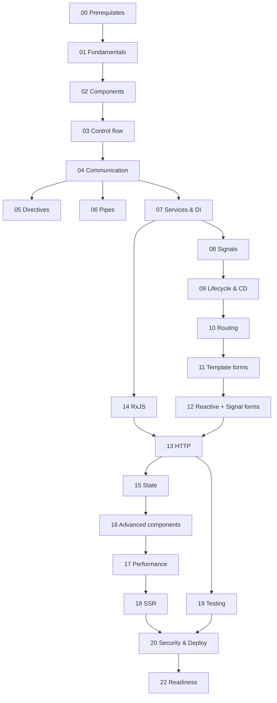

# Learning Roadmap

The plan assumes **12–15 hours per week**. At that pace the full curriculum takes about **14 weeks**. If you have more time, compress weeks; never skip the labs or checkpoints.

Back to [README](README.md).

---

## 1. Recommended order and dependencies

Read 14 (RxJS) **before** 13 (HTTP) if Observables feel unfamiliar. Module 19 (Testing) can start any time after 07; each module also has a small "Testing" section.

## 2. Estimated time per module

| Module | Topic | Theory | Practice | Lab |
|---|---|---|---|---|
| 00 | Prerequisites | 4 h | 2 h | – |
| 01 | Fundamentals, CLI, structure | 3 h | 2 h | Lab 1 |
| 02 | Components and binding | 4 h | 3 h | Lab 2 |
| 03 | Control flow | 2 h | 1 h | – |
| 04 | Component communication | 3 h | 2 h | – |
| 05 | Directives | 3 h | 2 h | – |
| 06 | Pipes | 2 h | 1 h | – |
| 07 | Services and DI | 4 h | 2 h | – |
| 08 | Signals and resources | 5 h | 3 h | Lab 5 |
| 09 | Lifecycle and change detection | 3 h | 2 h | – |
| 10 | Routing | 4 h | 3 h | Lab 4 |
| 11 | Template-driven forms | 2 h | 1 h | – |
| 12 | Reactive + Signal Forms | 5 h | 3 h | Lab 3 |
| 13 | HTTP and API integration | 5 h | 3 h | Labs 6, 7, 8 |
| 14 | RxJS | 5 h | 3 h | – |
| 15 | State management | 3 h | 2 h | Lab 10 |
| 16 | Advanced components | 4 h | 3 h | Lab 11 |
| 17 | Performance | 3 h | 2 h | Lab 13 |
| 18 | SSR and hydration | 3 h | 1 h | – |
| 19 | Testing | 5 h | 4 h | Lab 12 |
| 20 | Security and deployment | 4 h | 2 h | Labs 9, 14 |
| 22 | Final readiness | 2 h | 8 h | Assessment |

Total: about **85 h theory + 55 h practice + labs**.

## 3. Weekly milestones

| Week | Modules | Milestone you must hit |
|---|---|---|
| 1 | 00, 01 | Fresh Angular 22 app runs; you can explain `main.ts → app.config.ts → App`. Lab 1 done. |
| 2 | 02, 03 | You build a `NoteCard` and a notes grid with `@for`, `@empty`, class bindings. Lab 2 done. |
| 3 | 04, 05, 06 | Reusable `ChipFilter` with `model()`, a `copyToClipboard` directive, a `fileSize` pipe. |
| 4 | 07, 08 | A `NotesStore` with `signal`, `computed`, `linkedSignal`, a `httpResource`. Lab 5 done. |
| 5 | 09, 10 | App shell with nested layouts, lazy routes, auth guard. Lab 4 done. **Checkpoint A.** |
| 6 | 11, 12 | Login form (Signal Forms) and credential form (Reactive Forms) with validation. Lab 3 done. |
| 7 | 14 | Global search with `debounceTime` + `switchMap`; you can draw a marble diagram. |
| 8 | 13 | Typed API layer, auth + error interceptors, loading/empty/error states. Labs 6–8 done. |
| 9 | 15, 16 | Tasks store, reusable modal/toast/tabs. Labs 10–11 done. **Checkpoint B.** |
| 10 | 17, 18 | `@defer` on dashboard, bundle under budget, you can say why Myspce is CSR. Lab 13 done. |
| 11 | 19 | Component, service, HTTP, form and guard tests; one Playwright flow. Lab 12 done. |
| 12 | 20 | Security checklist passes; production build in Docker + nginx. Labs 9, 14 done. **Checkpoint C.** |
| 13–14 | 22 | Final assessment, debugging drills, implementation plan signed off. |

## 4. Revision checkpoints

**Checkpoint A (end of week 5).** Without notes, build a page that lists notes from a mock service, filters them with a signal, opens `/notes/:id` in a nested layout, and blocks access when logged out. Explain OnPush and why your page updates.

**Checkpoint B (end of week 9).** Build the Credentials list: typed API service, interceptor-added token, loading/empty/error states, a reveal button that calls a separate endpoint, and a reusable confirm dialog.

**Checkpoint C (end of week 12).** Write tests for the Credentials list (component + HTTP + guard), produce a production build, and pass the security checklist in Module 20.

If you fail a checkpoint, re-read the modules involved and redo their labs before moving on.

## 5. Hands-on exercises

Every module note ends with practice questions. The labs in [Module 21](21-myspce-practice-labs/README.md) tie them together:

| Lab | After module | Builds |
|---|---|---|
| 1 | 01 | App shell project with Tailwind |
| 2 | 02 | Sidebar, topbar, page header, cards |
| 3 | 12 | Login + credential forms and a password input control |
| 4 | 10 | Routes, nested layout, 404, titles |
| 5 | 08 | Signal-based filters and selection on Notes |
| 6 | 13 | Typed `NotesApi`, `TasksApi` with a mock backend |
| 7 | 13 | Loading, empty, success and error states |
| 8 | 13 | Login, refresh token, logout |
| 9 | 20 | Guards, role-aware UI, admin area |
| 10 | 15 | Search, filter, sort, paginate |
| 11 | 16 | Dialog, toast, tabs, dropdown |
| 12 | 19 | Unit + integration tests |
| 13 | 17 | `@defer`, lazy loading, bundle budgets |
| 14 | 20 | Production build, Docker, nginx, CI |

## 6. Final readiness assessment

Complete [Module 22](22-final-project-readiness/README.md). You are ready to build Myspce when you reach **"Ready to build"** on at least 10 of the 12 rubric rows in [the rubric](22-final-project-readiness/05-self-assessment-rubric.md), including Signals, Routing & guards, HTTP & auth, and Security.
